# Flat2VR Index

Every flatscreen game you can play in VR, and the port that does it, on PCVR and standalone headsets.

**Submit or update a port:** see [CONTRIBUTING.md](CONTRIBUTING.md).

<!-- INDEX:START (generated by scripts/build.mjs, do not edit) -->

| Game | Port | Platform | Reviews |
|---|---|---|---|
| 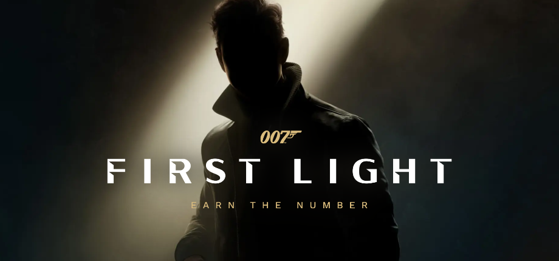 **007 First Light** | [007 First Light R.E.A.L. VR](https://www.patreon.com/realvr/posts/bond-159956522) by Luke Ross Latest: [unversioned](https://www.patreon.com/realvr/posts/bond-159956522) (2026-06-02) | PCVR 🚧 beta | [▶ NotAGameAddict](https://www.youtube.com/watch?v=bkY1nSzsIW8) [▶ YouGotColdYogurt](https://www.youtube.com/watch?v=qlWP_YPt76c) |
|  **A.A.U. Black Site** | [A.A.U. Black Site VR](https://github.com/King-EJ/A.A.U.-Black-Site-VR) by [King-EJ](https://github.com/King-EJ) Latest: [A.A.U.BlackSiteVR](https://github.com/King-EJ/A.A.U.-Black-Site-VR/releases/latest) (2026-10-11) | PCVR 🧪 alpha 1 known bug | — |
| **ACE COMBAT 8** | [ACE COMBAT 8 UEVR Profile (HUD fix)](https://github.com/VTFLAB/ace-combat-8-uevr-profile) by [VTFLAB](https://github.com/VTFLAB) Latest: [v1.0.0](https://github.com/VTFLAB/ace-combat-8-uevr-profile/releases/latest) (2026-10-04) | PCVR ✅ stable 1 known bug | [▶ Paradise Decay](https://www.youtube.com/watch?v=weAhEMpT87k) [▶ NotAGameAddict](https://www.youtube.com/watch?v=spKprOsBkN8) |
| 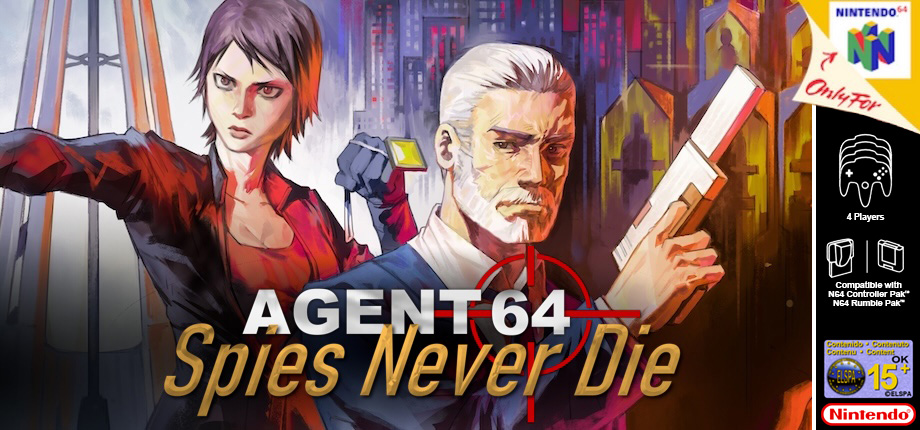 **Agent 64: Spies Never Die** | [Agent 64: Spies Never Die VR Mod](https://github.com/King-EJ/Agent-64-Spies-Never-Die-VR-Mod) by [King-EJ](https://github.com/King-EJ) Latest: [Agent64SpiesNeverDieVR](https://github.com/King-EJ/Agent-64-Spies-Never-Die-VR-Mod/releases/latest) (2026-09-28) | PCVR 🧪 alpha 3 known bugs | [▶ KingVR_PC](https://www.youtube.com/watch?v=-ldkQB-IThQ) |
| 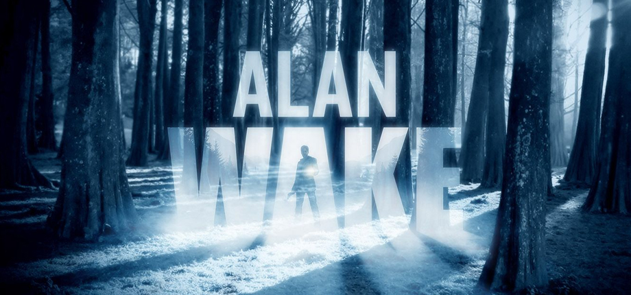 **Alan Wake** | [Alan Wake VR](https://www.youtube.com/watch?v=PUyeBvHkA58) by [Cabalistic](https://alanwake.vrmods.eu/index.html) Latest: [unversioned](https://alanwake.vrmods.eu/index.html) (2026-11-10) | PCVR 🚧 beta | [▶ fholger](https://www.youtube.com/watch?v=meUQMxUkiV0) [▶ NotAGameAddict](https://www.youtube.com/watch?v=PUyeBvHkA58) |
|  **Alien: Isolation** | [MotherVR](https://github.com/Nibre/MotherVR) by [Nibre](https://github.com/Nibre) Latest: [0.8.1](https://github.com/Nibre/MotherVR/releases/latest) (2020-12-28) | PCVR 🚧 beta | [▶ Gamertag VR](https://www.youtube.com/watch?v=2Kj0QCbGiLk) [▶ Beardo Benjo](https://www.youtube.com/watch?v=NgTHbN2btak) |
| **Aliens Versus Predator (1999) / Aliens versus Predator Classic 2000** | [Aliens Versus Predator VR](https://github.com/Bassquake/Aliens-Versus-Predator-VR) by [Bassquake](https://github.com/Bassquake) Latest: [1.4](https://github.com/Bassquake/Aliens-Versus-Predator-VR/releases/latest) (2026-10-29) | PCVR + Standalone 🚧 beta | — |
| 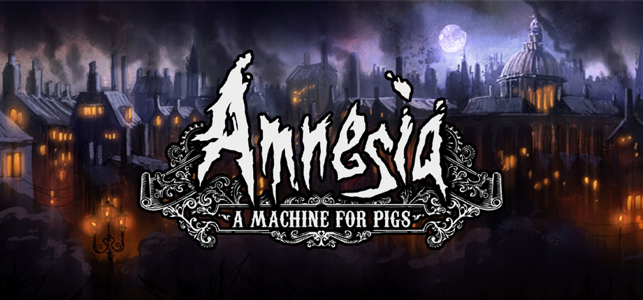 **Amnesia: A Machine for Pigs** | [Amnesia: A Machine for Pigs VR](https://github.com/nvdg-public/amfp-vr) by [nvdg-public](https://github.com/nvdg-public) Latest: [v0.6.0](https://github.com/nvdg-public/amfp-vr/releases/latest) (2026-11-11) | PCVR 🧪 alpha | — |
| 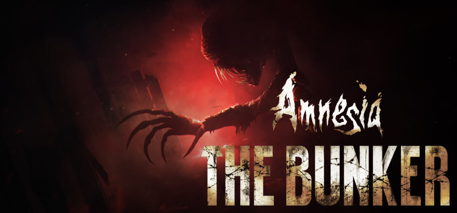 **Amnesia: The Bunker** | [BunkerVR](https://github.com/EdittheWall/BunkerVR) by [EdittheWall](https://github.com/EdittheWall) Latest: [v2.09](https://github.com/EdittheWall/BunkerVR/releases/latest) (2026-11-12) | PCVR 🚧 beta 1 known bug | [▶ POiiSED](https://www.youtube.com/watch?v=WdRdivjd9v4) [▶ Edit](https://www.youtube.com/watch?v=HzKUTmolvnA) |
|  **Amnesia: The Dark Descent** | [Sclerosis](https://questports.vercel.app/ports/sclerosis-vr) by CreaTeam Latest: [v1.10.7](https://questports.vercel.app/ports/sclerosis-vr) (2026-10-11) | PCVR + Standalone ✅ stable | [▶ Marconaeus](https://www.youtube.com/watch?v=DCiWqSirecM) [▶ Bonezz](https://www.youtube.com/watch?v=bhpnBbaMDmo) |
| 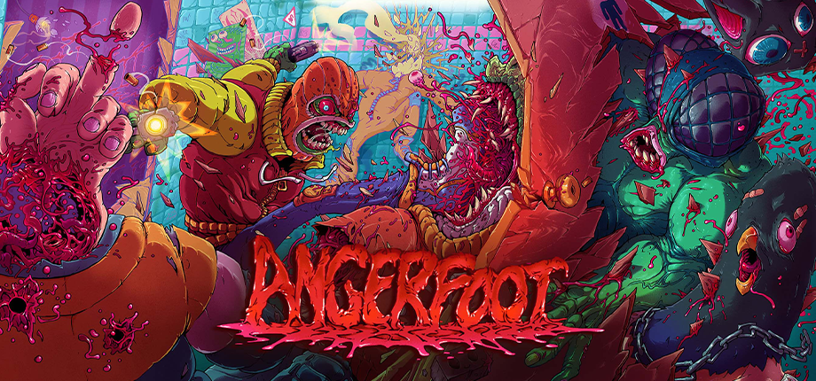 **Anger Foot** | [Anger Foot VR](https://github.com/StrikeZoneVR-hub/AngerFootVR) by [StrikeZoneVR](https://github.com/StrikeZoneVR-hub) Latest: [v1.2.0](https://github.com/StrikeZoneVR-hub/AngerFootVR/releases/latest) (2026-11-06) | PCVR ✅ stable | [▶ Beardo Benjo](https://www.youtube.com/watch?v=5JmIM0tmnCA) [▶ Paradise Decay](https://www.youtube.com/watch?v=AddCaB1XOiU) |
| 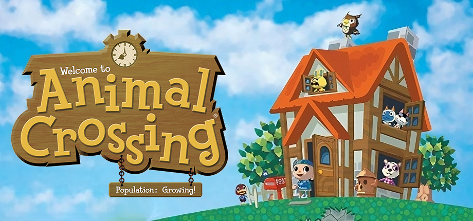 **Animal Crossing** | [Animal Crossing VR (LiquidAzir)](https://github.com/LiquidAzir/animal-crossing-vr) by [LiquidAzir](https://github.com/LiquidAzir) Latest: [v0.9.3-vr20](https://github.com/LiquidAzir/animal-crossing-vr/releases/latest) (2026-09-30) | PCVR + Standalone 🚧 beta | [▶ Crossing Minute](https://www.youtube.com/watch?v=HK8kZMDGMaw) [▶ Nate Masterson](https://www.youtube.com/watch?v=BUi7-NfD-MI) |
| 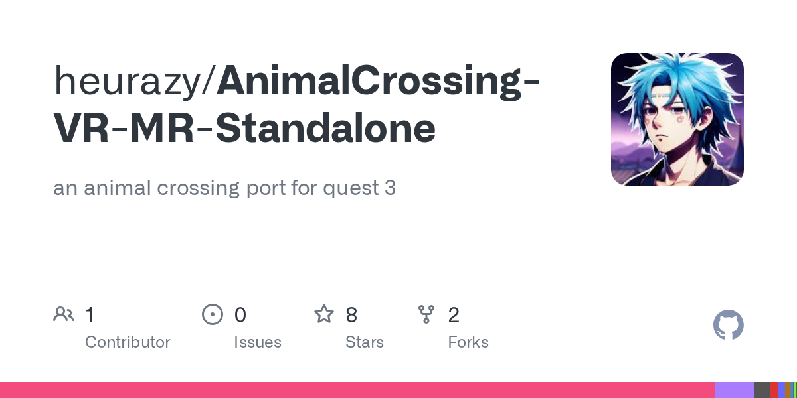 **Animal Crossing (GameCube)** | [Animal Crossing VR/MR Standalone](https://github.com/heurazy/AnimalCrossing-VR-MR-Standalone) by [heurazy](https://github.com/heurazy) Latest: [v1.0.2](https://github.com/heurazy/AnimalCrossing-VR-MR-Standalone/releases/latest) (2026-08-11) | Standalone 🚧 beta | — |
|  **ANOMALITH** | [ANOMALITH-VR](https://github.com/King-EJ/ANOMALITH-VR) by [King-EJ](https://github.com/King-EJ) Latest: [ANOMALITHVR](https://github.com/King-EJ/ANOMALITH-VR/releases/latest) (2026-10-29) | PCVR 🧪 alpha | — |
| 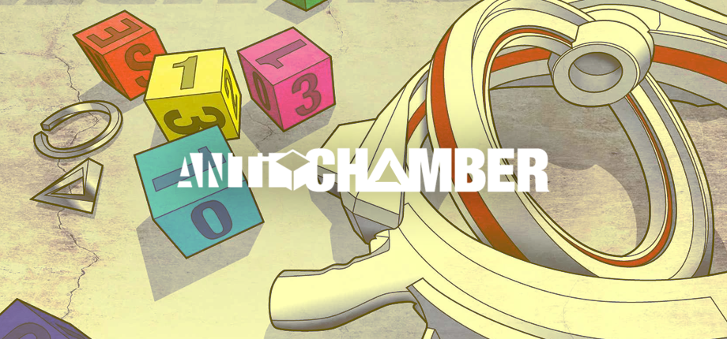 **Antichamber** | [Antichamber VR](https://github.com/hernanrodeblas-tech/antichamber-vr) by [hernanrodeblas-tech](https://github.com/hernanrodeblas-tech) Latest: [v1.1.0](https://github.com/hernanrodeblas-tech/antichamber-vr/releases/latest) (2026-11-11) | PCVR ✅ stable | [▶ Kyle D](https://www.youtube.com/watch?v=S0qMiPxVLVI) [▶ 3D VR TV PC Games Videos](https://www.youtube.com/watch?v=VT68kDqeh_Y) |
| 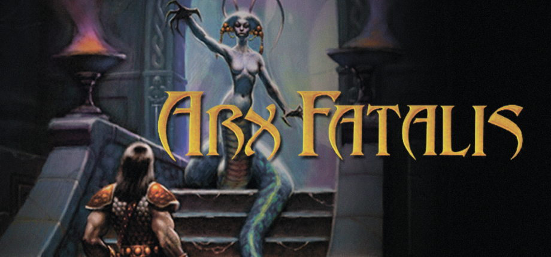 **Arx Fatalis** | [Arx Libertatis VR](https://github.com/cmpayc/ArxLibertatisVR) by [cmpayc](https://github.com/cmpayc) Latest: [vr-v0.5.0](https://github.com/cmpayc/ArxLibertatisVR/releases/latest) (2026-11-10) | PCVR + Standalone 🚧 beta 1 known bug | [▶ ZXZybex](https://www.youtube.com/watch?v=_hC8KJUZ9v4) [▶ StoniVR](https://www.youtube.com/watch?v=BIfWNSKTJmE) |
|  **Assassin's Creed IV: Black Flag** | [Assassin's Creed IV: Black Flag Resynced VR](https://www.patreon.com/NoMoreFlat/posts/assassins-creed-164150917) by Mutar / NoMoreFlat Latest: [unversioned](https://www.patreon.com/NoMoreFlat/posts/assassins-creed-164150917) (2026-07-18) | PCVR 🚧 beta 3 known bugs | [▶ BrothersGanes](https://www.youtube.com/watch?v=rlLao3Q6tvg) |
| 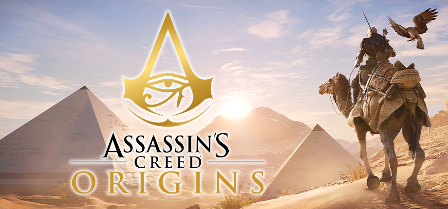 **Assassin's Creed Origins** | [Assassin's Creed Origins VR](https://www.patreon.com/NoMoreFlat/posts/assasins-creed-164608087) by Mutar, NoMoreFlat Latest: [unversioned](https://www.patreon.com/NoMoreFlat/posts/assasins-creed-164608087) (2026-07-23) | PCVR 🚧 beta 1 known bug | [▶ THEGAMEVEDA](https://www.youtube.com/watch?v=OFwRzPdAaHM) [▶ Techno Tamizha](https://www.youtube.com/watch?v=M1OoTOAHWOA) |
|  **ASTRO BOT Rescue Mission** | [AstroQuest](https://github.com/bigmak94/AstroQuest) by [bigmak94](https://github.com/bigmak94) Latest: [v0.23](https://github.com/bigmak94/AstroQuest/releases/latest) (2026-10-21) | PCVR + Standalone 🚧 beta | [▶ VR Studio](https://www.youtube.com/watch?v=3SmrgertDco) [▶ Rames VR - Cafoutch](https://www.youtube.com/watch?v=ltoL_BLV4qY) |
|  **Banjo-Kazooie** | [Banjo-Kazooie VR](https://github.com/RaYRoD-TV/MVRH) by RaYRoD-TV Latest: [Patch 3](https://github.com/RaYRoD-TV/MVRH/releases) (2026-10-09) | PCVR 🧪 alpha | [▶ legaiaflame](https://www.youtube.com/watch?v=k25Mopn0u5k) [▶ Drekwiz](https://www.youtube.com/watch?v=iJwDR0ahuBc) |
|  **Battlefield 2142** | [BF2142VR](https://github.com/justiceofrip/BF2142VR) by [justiceofrip](https://github.com/justiceofrip) Latest: [v0.2.0-beta.4-hotfix.4](https://github.com/justiceofrip/BF2142VR/releases/latest) (2026-10-13) | PCVR 🚧 beta 1 known bug | — |
| 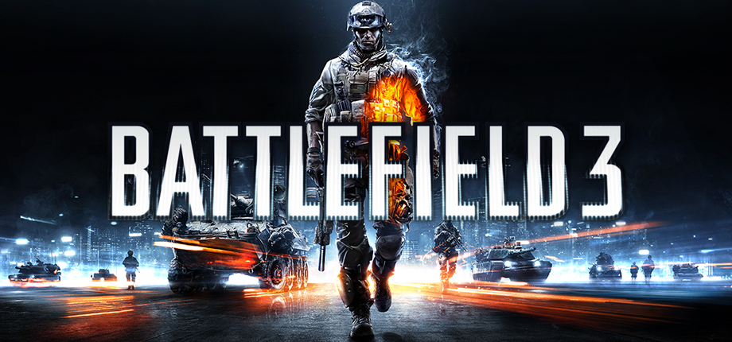 **Battlefield 3** | [Battlefield 3 VR: The Great Destroyer](https://github.com/criminalvictory/Battlefield-3-VR-The-Great-Destroyer) by [criminalvictory](https://github.com/criminalvictory) Latest: [v0.1.0-pre-alpha](https://github.com/criminalvictory/Battlefield-3-VR-The-Great-Destroyer/releases/latest) (2026-11-02) | PCVR 🧪 alpha 3 known bugs | [▶ 3D 'n' Play](https://www.youtube.com/watch?v=vVybcg6XN5g) [▶ ShadowSix](https://www.youtube.com/watch?v=G24qFAHG5xw) |
| 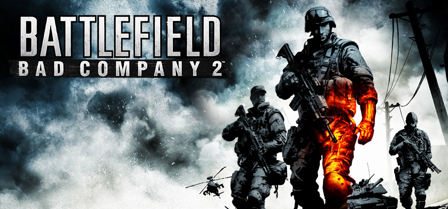 **Battlefield: Bad Company 2** | [BC2VR](https://github.com/justiceofrip/BC2VR) by [justiceofrip](https://github.com/justiceofrip) Latest: [v0.1.15](https://github.com/justiceofrip/BC2VR/releases/latest) (2026-10-26) | PCVR 🧪 alpha 3 known bugs | [▶ Nathie](https://www.youtube.com/watch?v=8QDMKEVrZHg) [▶ NotAGameAddict](https://www.youtube.com/watch?v=EvzOZ35dSdA) |
| 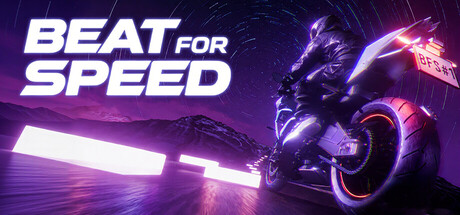 **Beat For Speed** | [Beat-For-Speed-VR](https://github.com/King-EJ/Beat-For-Speed-VR) by [King-EJ](https://github.com/King-EJ) Latest: [BeatForSpeedVR](https://github.com/King-EJ/Beat-For-Speed-VR/releases/latest) (2026-11-05) | PCVR 🧪 alpha | — |
|  **Before Your Eyes** | [Before Your Frames](https://github.com/davidciglesias/before-your-frames) by [davidciglesias](https://github.com/davidciglesias) Latest: [v0.9.0](https://github.com/davidciglesias/before-your-frames/releases/latest) (2026-11-03) | PCVR + Standalone 🚧 beta | — |
|  **Behind Enemy Lines** | [Behind Enemy Lines VR](https://github.com/vr4all-standalone/behind-enemy-lines-vr) by Casty, [vr4all-standalone](https://github.com/vr4all-standalone) Latest: [v0.1.2-beta](https://github.com/vr4all-standalone/behind-enemy-lines-vr/releases/latest) (2026-11-03) | PCVR + Standalone 🚧 beta | [▶ SilentOps](https://www.youtube.com/watch?v=W8niZirK0dg) [▶ 3D VR FUN](https://www.youtube.com/watch?v=ayrPXMYa8Kw) |
|  **Bendy and the Ink Machine** | [BendyVR](https://github.com/Team-Beef-Studios/BendyVR) by [Team Beef](https://github.com/Team-Beef-Studios) Latest: [v.1.2.2](https://github.com/Team-Beef-Studios/BendyVR/releases/latest) (2024-07-13)  [InkVR](https://github.com/StrikeZoneVR-hub/InkVR) by [StrikeZoneVR-hub](https://github.com/StrikeZoneVR-hub) Latest: [v1.1.0](https://github.com/StrikeZoneVR-hub/InkVR/releases/latest) (2026-10-28) | **BendyVR** PCVR ✅ stable  **InkVR** PCVR ✅ stable | [▶ 99TH VR](https://www.youtube.com/watch?v=EsnSDiytst8) [▶ Vano](https://www.youtube.com/watch?v=FjC5Rnk_cOs) [▶ 99TH VR](https://www.youtube.com/watch?v=EsnSDiytst8) [▶ Vano](https://www.youtube.com/watch?v=FjC5Rnk_cOs) |
|  **Beyond: Two Souls** | [Beyond: Two Souls VR Mod](https://github.com/adore11s/Beyond-Two-Souls-VR-Mod) by [adore11s](https://github.com/adore11s) Latest: [v1.0.0](https://github.com/adore11s/Beyond-Two-Souls-VR-Mod/releases/latest) (2026-11-06) | PCVR 🧪 alpha 2 known bugs | — |
| 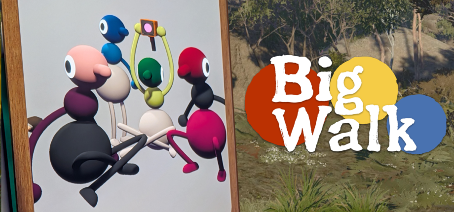 **Big Walk** | [Big Walk VR](https://github.com/CircuitLord/CircuitLordVRModInstaller) by [CircuitLord](https://github.com/CircuitLord) Latest: [v1.2.12](https://github.com/CircuitLord/CircuitLordVRModInstaller/releases/latest/download/CircuitLordVRModInstaller.exe) (2026-10-28) | PCVR ✅ stable | [▶ BamBaeYoh](https://www.youtube.com/watch?v=SXSZO6CctfM) [▶ Sk0l](https://www.youtube.com/watch?v=zMMNyRHrgBg) |
| 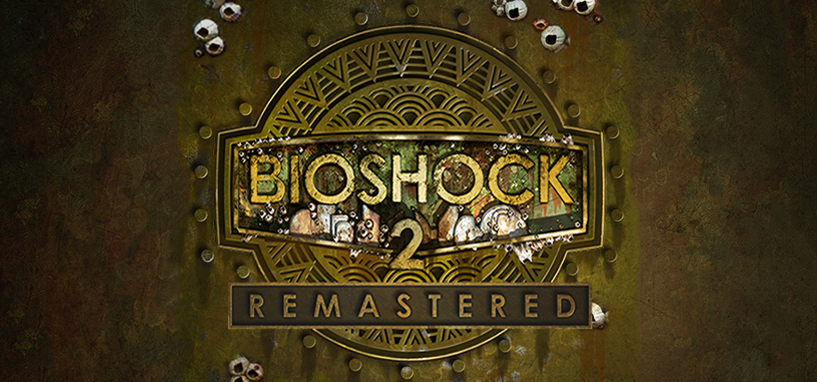 **BioShock 2 Remastered** | [BioShock VR](https://github.com/VR-Stereo-Hub/bioshock-trilogy-vr) by [VR-Stereo-Hub](https://github.com/VR-Stereo-Hub) Latest: [v0.8.3](https://github.com/VR-Stereo-Hub/bioshock-trilogy-vr/releases/latest) (2026-09-10) | PCVR 🧪 alpha 2 known bugs | [▶ Beardo Benjo](https://www.youtube.com/watch?v=4vC_-AKmVeA) [▶ Beardo Benjo](https://www.youtube.com/watch?v=s5XfXX5xpsA) |
| 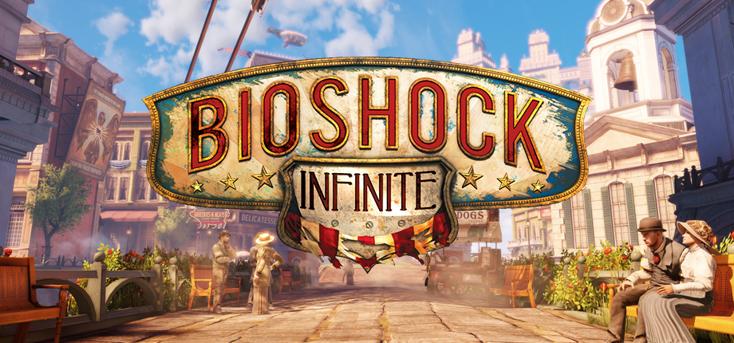 **BioShock Infinite** | [BioShock VR](https://github.com/VR-Stereo-Hub/bioshock-trilogy-vr) by [VR-Stereo-Hub](https://github.com/VR-Stereo-Hub) Latest: [v0.8.3](https://github.com/VR-Stereo-Hub/bioshock-trilogy-vr/releases/latest) (2026-09-10)  [BSI-Quest](https://github.com/egomortal/bsi-quest) by [egomortal](https://github.com/egomortal) Latest: [b142](https://github.com/egomortal/bsi-quest/releases/latest) (2026-11-10) | **BioShock VR** PCVR 🧪 alpha 2 known bugs  **BSI-Quest** Standalone ✅ stable | [▶ Beardo Benjo](https://www.youtube.com/watch?v=4vC_-AKmVeA) [▶ Beardo Benjo](https://www.youtube.com/watch?v=s5XfXX5xpsA) [▶ NotAGameAddict](https://www.youtube.com/watch?v=tXf4WUCDfKI) |
| 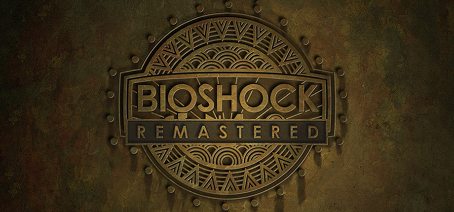 **BioShock Remastered** | [BioShock Remastered VR](https://github.com/BioVRDev/Bioshock-Remastered-VR) by [BioVRDev](https://github.com/BioVRDev), Pizzzaparker Latest: [v1.0.3a](https://github.com/BioVRDev/Bioshock-Remastered-VR/releases/latest) (2026-08-14)  [BioShock VR](https://github.com/VR-Stereo-Hub/bioshock-trilogy-vr) by [VR-Stereo-Hub](https://github.com/VR-Stereo-Hub) Latest: [v0.8.3](https://github.com/VR-Stereo-Hub/bioshock-trilogy-vr/releases/latest) (2026-09-10) | **BioShock Remastered VR** PCVR ✅ stable  **BioShock VR** PCVR 🧪 alpha 2 known bugs | [▶ Mac In VR](https://www.youtube.com/watch?v=QKVw10Tt_2c) [▶ VoodooDE VR - english version -](https://www.youtube.com/watch?v=QH5imGj8PjE) [▶ Beardo Benjo](https://www.youtube.com/watch?v=4vC_-AKmVeA) [▶ Beardo Benjo](https://www.youtube.com/watch?v=s5XfXX5xpsA) |
|  **Black & White** | [Black & White VR](https://github.com/jmanoclay/BW-VR-Releases) by [jmanoclay](https://github.com/jmanoclay) Latest: [v0.3.0](https://github.com/jmanoclay/BW-VR-Releases/releases/latest) (2026-11-08)  [BW1-VR](https://github.com/BW1-VR/BW1-VR) by [BW1-VR](https://github.com/BW1-VR) Latest: [v1.2.0-20261020-fd7f198](https://github.com/BW1-VR/BW1-VR/releases/latest) (2026-10-20) | **Black & White VR** PCVR 🚧 beta  **BW1-VR** PCVR 🧪 alpha | [▶ Buck](https://www.youtube.com/watch?v=6LNpu24--G8) [▶ Buck](https://www.youtube.com/watch?v=AlUMAS-Iqcc) [▶ Buck](https://www.youtube.com/watch?v=fT-J_DspllY) [▶ VoodooDE VR](https://www.youtube.com/watch?v=uo5Q8LV3hTM) |
| 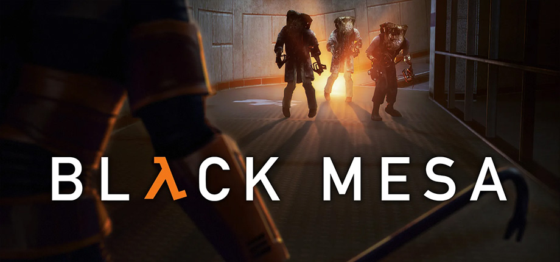 **Black Mesa** | [Black Mesa VR](https://github.com/Hochgeschwindigkeitsrennfahrer/black-mesa-vr) by [Hochgeschwindigkeitsrennfahrer](https://github.com/Hochgeschwindigkeitsrennfahrer) Latest: [bugfixes](https://github.com/Hochgeschwindigkeitsrennfahrer/black-mesa-vr/releases/latest) (2026-10-03) | PCVR 🚧 beta 4 known bugs | [▶ Ben Plays VR](https://www.youtube.com/watch?v=YWEzatOqQq0) [▶ Validator_maybelater](https://www.youtube.com/watch?v=2yywvDLK5iA) |
| 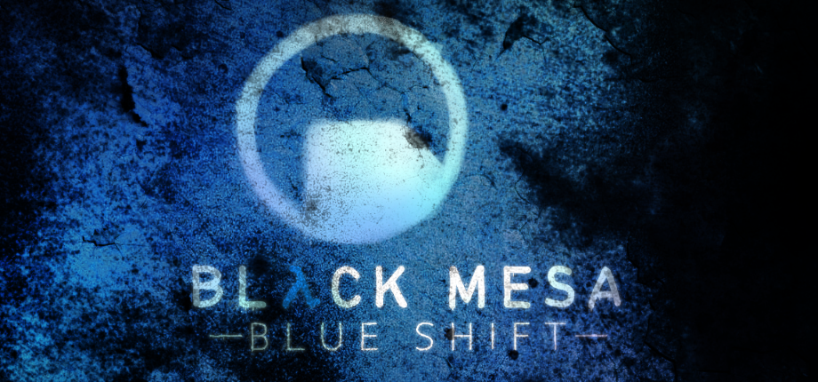 **Black Mesa: Blue Shift** | [Black Mesa VR](https://github.com/Hochgeschwindigkeitsrennfahrer/black-mesa-vr) by [Hochgeschwindigkeitsrennfahrer](https://github.com/Hochgeschwindigkeitsrennfahrer) Latest: [bugfixes](https://github.com/Hochgeschwindigkeitsrennfahrer/black-mesa-vr/releases/latest) (2026-10-03) | PCVR 🚧 beta 4 known bugs | [▶ Ben Plays VR](https://www.youtube.com/watch?v=YWEzatOqQq0) [▶ Validator_maybelater](https://www.youtube.com/watch?v=2yywvDLK5iA) |
|  **Blood** | [RazeXR](https://github.com/Team-Beef-Studios/RazeXR) by [Team Beef](https://github.com/Team-Beef-Studios) Latest: [v1.0.0](https://github.com/Team-Beef-Studios/RazeXR/releases/latest) (2023-09-30) | Standalone ✅ stable | [▶ VR Reviews](https://www.youtube.com/watch?v=dFiVi_xUjRc) [▶ VoodooDE VR](https://www.youtube.com/watch?v=h5vjhgyeNiE) |
| 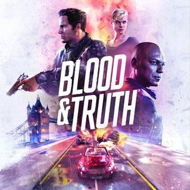 **Blood & Truth** | [BloodTruth](https://github.com/evertec82/BloodTruth) by [evertec82](https://github.com/evertec82) Latest: [v0.1.0](https://github.com/evertec82/BloodTruth/releases/latest) (2026-10-25) | PCVR 🧪 alpha 4 known bugs | [▶ Without Parole](https://www.youtube.com/watch?v=f8RwQk7ORG8) [▶ Virtual Reality Oasis](https://www.youtube.com/watch?v=0qlQ29GLDko) |
| 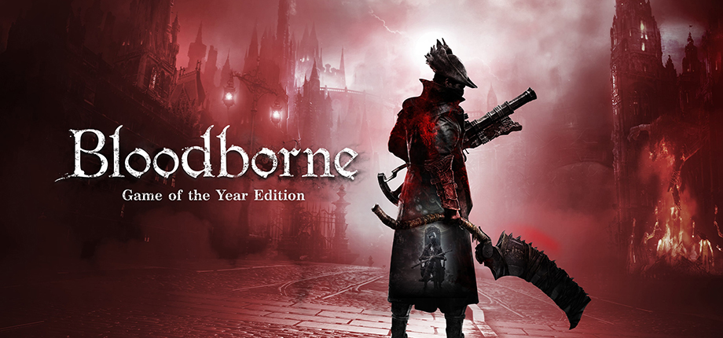 **Bloodborne** | [Night of the Hunt VR](https://github.com/bldbrne-vr/bldbrne-vr) by [bldbrne-vr](https://github.com/bldbrne-vr) Latest: [v0.9.5](https://github.com/bldbrne-vr/bldbrne-vr/releases/latest) (2026-11-11) | PCVR 🧪 alpha | [▶ Lost.Media.Prophet](https://www.youtube.com/watch?v=pEitKjXLf4c) [▶ Beardo Benjo](https://www.youtube.com/watch?v=oE-o1MewoEc) |
|  **Blue Estate** | [Blue Estate VR](https://github.com/i3dman420311/blue-estate-vr) by [i3dman420311](https://github.com/i3dman420311) Latest: [v0.1.0](https://github.com/i3dman420311/blue-estate-vr/releases/latest) (2026-11-11) | PCVR 🧪 alpha | [▶ FastLawyer](https://www.youtube.com/watch?v=o1Kk70cNn6E) [▶ VRLF - Virtual Reality Lightgun Framework](https://www.youtube.com/watch?v=IOgsqf24-gg) |
|  **Bomberman Hero** | [Bomberman Hero Quest 3 VR Standalone](https://github.com/VistaLargaGames/Bomberman-Hero-Quest-3-VR-Standalone) by [VistaLargaGames](https://github.com/VistaLargaGames) Latest: [n64](https://github.com/VistaLargaGames/Bomberman-Hero-Quest-3-VR-Standalone/releases/latest) (2026-10-12) | Standalone 🧪 alpha 2 known bugs | — |
| 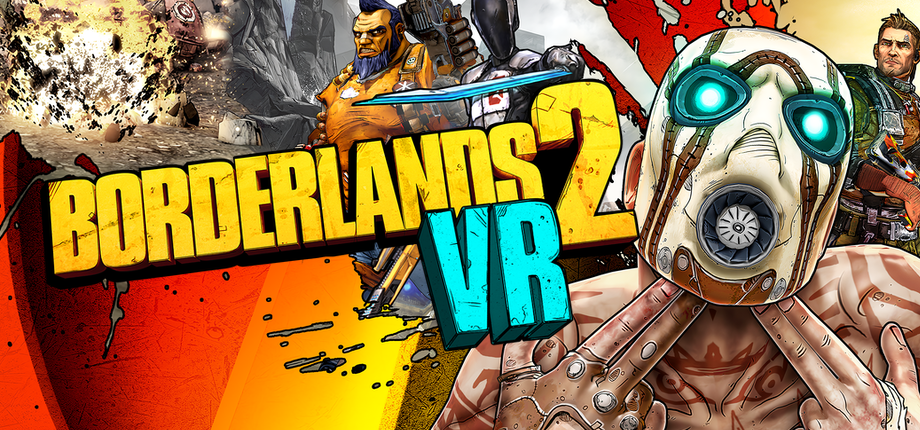 **Borderlands 2 VR** | [BL2VR Enhanced](https://github.com/RimachOfficial/BL2VR-Enhanced) by [RimachOfficial](https://github.com/RimachOfficial) Latest: [v0.1.8](https://github.com/RimachOfficial/BL2VR-Enhanced/releases/latest) (2026-10-26) | PCVR 🧪 alpha | [▶ altered](https://www.youtube.com/watch?v=TGy8REwCsOw) [▶ altered](https://www.youtube.com/watch?v=6MS_fT9U7V8) |
|  **Borderlands: Game of the Year Enhanced** | [BL1GOTYVR](https://github.com/Mastersellz/BL1GOTYVR) by [Mastersellz](https://github.com/Mastersellz) Latest: [BL1GOTYVRV0.5.7.3](https://github.com/Mastersellz/BL1GOTYVR/releases/latest) (2026-11-12) | PCVR 🚧 beta | — |
|  **Brick Buddies** | [Brick Buddies VR](https://github.com/King-EJ/Brick-Buddies-VR) by [King-EJ](https://github.com/King-EJ) Latest: [BrickBuddiesVR](https://github.com/King-EJ/Brick-Buddies-VR/releases/latest) (2026-11-12) | PCVR 🧪 alpha 1 known bug | — |
|  **Buckshot Roulette** | [Buckshot Roulette VR](https://github.com/KMielnik/Buckshot-Roulette-VR-Mod) by [KMielnik](https://github.com/KMielnik) Latest: [v1.0.3](https://github.com/KMielnik/Buckshot-Roulette-VR-Mod/releases/latest) (2026-11-06) | PCVR ✅ stable | [▶ VR zona](https://www.youtube.com/watch?v=DGGl-9AEkso) [▶ Scientific Guy](https://www.youtube.com/watch?v=CblZIoXzV44) |
|  **Call of Duty 4: Modern Warfare** | [KisakCOD VR WinlatorXR](https://github.com/SgtBilko76/CallOfDuty4_VR_WinlatorXR) by [SgtBilko76](https://github.com/SgtBilko76), jplakon, SwagSoftware Latest: [v0.1.0-beta.1](https://github.com/SgtBilko76/CallOfDuty4_VR_WinlatorXR/releases/latest) (2026-09-20) | Standalone 🚧 beta 4 known bugs | [▶ NotAGameAddict](https://www.youtube.com/watch?v=NlR_JheVXCk) |
|  **Call of Duty 4: Modern Warfare (2007)** | [KisakCOD VR](https://github.com/jplakon/CallOfDuty4_VR) by JplayUltimate, [jplakon](https://github.com/jplakon) Latest: [v0.10.0-beta.19](https://github.com/jplakon/CallOfDuty4_VR/releases/latest) (2026-09-23) | PCVR 🚧 beta 3 known bugs | [▶ NotAGameAddict](https://www.youtube.com/watch?v=NlR_JheVXCk) [▶ StrainZex](https://www.youtube.com/watch?v=IfMoMmu5rhA) |
| 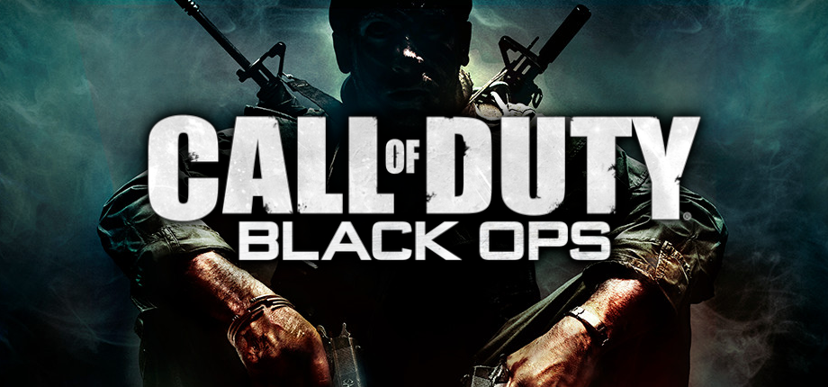 **Call of Duty: Black Ops (2010)** | [Black Ops VR](https://github.com/jplakon/BlackOpsVR) by [jplakon](https://github.com/jplakon) Latest: [v0.1.0-beta.4](https://github.com/jplakon/BlackOpsVR/releases/latest) (2026-11-05) | PCVR 🚧 beta 2 known bugs | [▶ STEVIEtheSAVAGE](https://www.youtube.com/watch?v=gipGQoyuzPg) [▶ NotAGameAddict](https://www.youtube.com/watch?v=VV01xmQ8zRA) |
|  **Call of Duty: Modern Warfare 2 Campaign Remastered** | [Overlord](https://github.com/Aeka0/Overlord) by [Aeka0](https://github.com/Aeka0) Latest: [v0.7.0-beta](https://github.com/Aeka0/Overlord/releases/latest) (2026-10-24) | PCVR 🚧 beta 4 known bugs | [▶ NotAGameAddict](https://www.youtube.com/watch?v=rh8HVtGAKaM) [▶ Uruzz](https://www.youtube.com/watch?v=FvUelHCBwcc) |
| 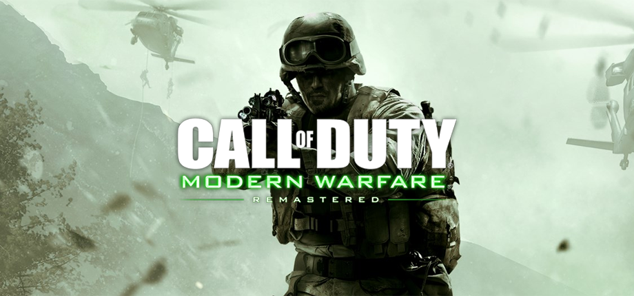 **Call of Duty: Modern Warfare Remastered** | [MWR VR](https://github.com/lesan0622/MWR-VR) by [lesan0622](https://github.com/lesan0622) Latest: [v0.1-beta9](https://github.com/lesan0622/MWR-VR/releases/latest) (2026-11-10) | PCVR 🚧 beta 3 known bugs | [▶ NotAGameAddict](https://www.youtube.com/watch?v=rh8HVtGAKaM) [▶ UrGamingTechie](https://www.youtube.com/watch?v=VQxmwCGtvDQ) |
|  **Carmageddon** | [QuestCarNage](https://github.com/maranone/carnage) by [maranone](https://github.com/maranone) Latest: [pico-test](https://github.com/maranone/carnage/releases/latest) (2026-10-17) | PCVR + Standalone 🚧 beta | [▶ Virtuální zóna](https://www.youtube.com/watch?v=W2DwFqEjBzM) [▶ Game Marathon runner ](https://www.youtube.com/watch?v=F1Q3UGeCCVw) |
|  **Center Ice Hockey** | [Center Ice Hockey VR](https://github.com/King-EJ/Center-Ice-Hockey-VR) by [King-EJ](https://github.com/King-EJ) Latest: [Center_Ice_Hockey_VR](https://github.com/King-EJ/Center-Ice-Hockey-VR/releases/latest) (2026-10-12) | PCVR 🧪 alpha | — |
|  **The Coin Game** | [TheCoinGameVR](https://github.com/Hoshi82/TheCoinGameVR) by [Hoshi82](https://github.com/Hoshi82) Latest: [v0.0.90](https://github.com/Hoshi82/TheCoinGameVR/releases/latest) (2026-11-10) | PCVR 🧪 alpha 1 known bug | [▶ 2ndJerma](https://www.youtube.com/watch?v=yjf4u6SqlEw) |
|  **Cold Rails** | [Cold Rails VR](https://github.com/King-EJ/Cold-Rails-VR) by [King-EJ](https://github.com/King-EJ) Latest: [ColdRailsVR](https://github.com/King-EJ/Cold-Rails-VR/releases/latest) (2026-11-07) | PCVR 🚧 beta | [▶ KingVR_PC](https://www.youtube.com/watch?v=mvzhpvb4RlI) |
|  **Colin McRae Rally 2.0** | [OpenCMR2 VR](https://github.com/DR-89/opencmr2-vr) by [DR-89](https://github.com/DR-89) Latest: [v0.1.0](https://github.com/DR-89/opencmr2-vr/releases/latest) (2026-10-13) | PCVR + Standalone 🚧 beta 1 known bug | [▶ GregzVR](https://www.youtube.com/watch?v=0dnauzNftNs) [▶ NotAGameAddict](https://www.youtube.com/watch?v=DLRhWcwrqtY) |
|  **Colin McRae: DiRT 2** | [DiRT2VR](https://github.com/preseznik/DiRT2VR) by [preseznik](https://github.com/preseznik) Latest: [v0.18.0](https://github.com/preseznik/DiRT2VR/releases/latest) (2026-10-27) | PCVR 🚧 beta 2 known bugs | [▶ NotAGameAddict](https://www.youtube.com/watch?v=rwlOWadANQ0) [▶ GregzVR](https://www.youtube.com/watch?v=0dnauzNftNs) |
|  **Command & Conquer: Generals - Zero Hour** | [Generals: Zero Hour XR](https://github.com/Cesarus85/Generals-Zero-Hour-XR) by [Cesarus85](https://github.com/Cesarus85) Latest: [v1.2.36-xr-preview](https://github.com/Cesarus85/Generals-Zero-Hour-XR/releases/latest) (2026-09-30) | Standalone 🚧 beta 3 known bugs | [▶ NotAGameAddict](https://www.youtube.com/watch?v=wUl_WnjUFyY) [▶ NotAGameAddict](https://www.youtube.com/watch?v=_IzGGuUn1cY) |
|  **Confidential Mission** | [Confidential Mission VR](https://github.com/vr4all-standalone/confidential-mission-vr) by [vr4all-standalone](https://github.com/vr4all-standalone), [mikermak](https://github.com/mikermak/hotd2-vr) Latest: [v1.3.5](https://github.com/vr4all-standalone/confidential-mission-vr/releases/latest) (2026-11-03) | PCVR + Standalone 🚧 beta | [▶ AliVentura](https://www.youtube.com/watch?v=S8wPLZtvvFY) [▶ Press start to begin](https://www.youtube.com/watch?v=jDBEdNgFlps) |
| 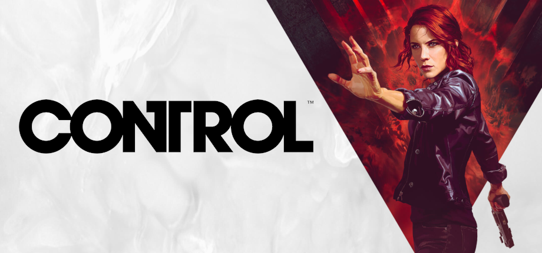 **Control** | [Control VR](https://www.patreon.com/NoMoreFlat/posts/control-vr-dev-161743534) by Mutar (NoMoreFlat) Latest: [unversioned](https://www.patreon.com/NoMoreFlat/posts/control-vr-dev-161743534) (2026-07-02) | PCVR 🚧 beta 2 known bugs | [▶ Kory & Brooke](https://www.youtube.com/watch?v=6DJ01fHF8Sc) [▶ PowerOnVR](https://www.youtube.com/watch?v=0rXO54K3iYM) |
| 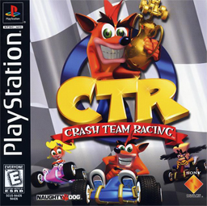 **Crash Team Racing** | [CTR Turbocharged VR](https://github.com/SgtBilko76/CTR-Turbocharged-VR) by [SgtBilko76](https://github.com/SgtBilko76) Latest: [v0.1.0](https://github.com/SgtBilko76/CTR-Turbocharged-VR/releases/latest) (2026-10-22) | Standalone 🚧 beta | [▶ Pixelacos VR and Pixelacos Gameplays](https://www.youtube.com/watch?v=z74MgnNkRo8) [▶ Pixelacos Gameplays and Pixelacos VR](https://www.youtube.com/watch?v=QDuF4oMzhLI) |
|  **Crazy Taxi** | [Crazy Taxi VR Standalone](https://github.com/Baywilly/Crazy-Taxi-VR-Standalone) by [Baywilly](https://github.com/Baywilly), Sito Latest: [v0.1-beta](https://github.com/Baywilly/Crazy-Taxi-VR-Standalone/releases/latest) (2026-10-12) | Standalone 🚧 beta 1 known bug | [▶ NotAGameAddict](https://www.youtube.com/watch?v=53FEb8eGrSo) [▶ 𝐈𝐑𝐎𝐍𝐁𝐔𝐆𝙑𝙍](https://www.youtube.com/watch?v=J0pn9FTNJKs) |
|  **The Crimson Hunt** | [The Crimson Hunt VR](https://github.com/King-EJ/The-Crimson-Hunt-VR-single-player-) by [King-EJ](https://github.com/King-EJ) Latest: [The_Crimson_Hunt_VR](https://github.com/King-EJ/The-Crimson-Hunt-VR-single-player-/releases/latest) (2026-10-13) | PCVR 🧪 alpha | — |
|  **Crisis Zone** | [Crisis Zone VR](https://github.com/DR-89/crisis-zone-vr) by [DR-89](https://github.com/DR-89) Latest: [v0.1.7](https://github.com/DR-89/crisis-zone-vr/releases/latest) (2026-10-20) | PCVR + Standalone 🧪 alpha | [▶ AddictedDev](https://www.youtube.com/watch?v=xq8nQMOmouI) [▶ Press start to begin](https://www.youtube.com/watch?v=E7h4ji12VwY) |
| 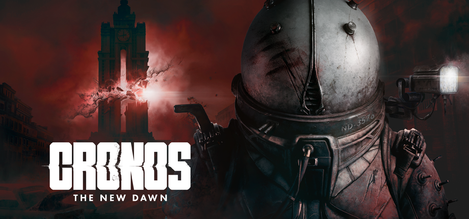 **Cronos: The New Dawn** | [Cronos: The New Dawn UEVR](https://github.com/letmein-vr/CRONOS_UEVR) by [letmein-vr](https://github.com/letmein-vr) Latest: [1.5](https://github.com/letmein-vr/CRONOS_UEVR/releases/latest) (2026-11-12) | PCVR ✅ stable 2 known bugs | [▶ Paradise Decay](https://www.youtube.com/watch?v=0bOrTZ69bbQ) [▶ NotAGameAddict](https://www.youtube.com/watch?v=XMWrEvKC7QU) |
| 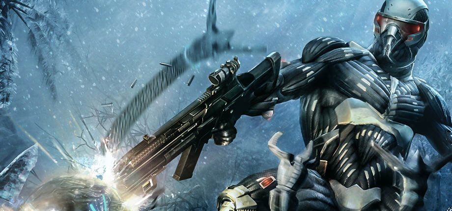 **Crysis** | [Crysis VR WinlatorXR](https://github.com/SgtBilko76/Crysis-VR-WinlatorXR) by [SgtBilko76](https://github.com/SgtBilko76), fholger Latest: [Beta-0.3](https://github.com/SgtBilko76/Crysis-VR-WinlatorXR/releases/latest) (2026-09-16) | Standalone 🚧 beta | [▶ Parzival_VR_EN](https://www.youtube.com/watch?v=cwGWHTBZ5SU) [▶ Louie's VR Corner](https://www.youtube.com/watch?v=X362mNKhA7U) |
| 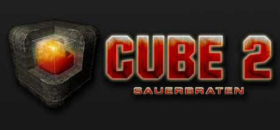 **Cube 2: Sauerbraten** | [SauerQuest](https://github.com/SgtBilko76/Sauerbraten-VR) by [SgtBilko76](https://github.com/SgtBilko76) Latest: [Beta-0.2](https://github.com/SgtBilko76/Sauerbraten-VR/releases/latest) (2026-09-23) | Standalone 🚧 beta 1 known bug | — |
| 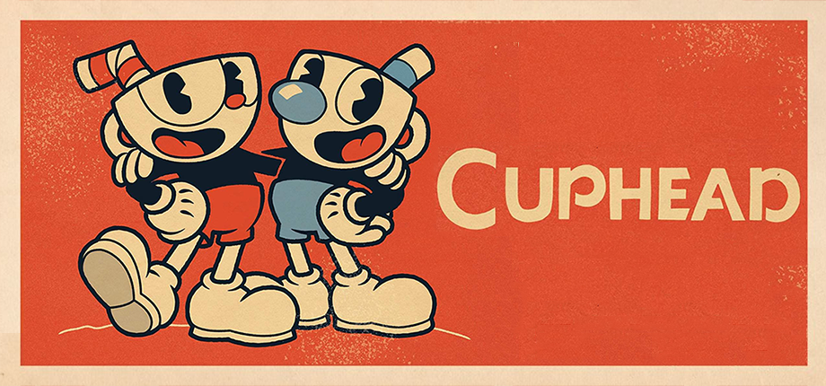 **Cuphead** | [CupheadVR](https://github.com/scubasteve2365/cupheadVR) by [scubasteve2365](https://github.com/scubasteve2365) Latest: [v1.05](https://github.com/scubasteve2365/cupheadVR/releases/latest) (2026-11-12) | PCVR ✅ stable | [▶ Michael Rivera](https://www.youtube.com/watch?v=DIBnf9ZHuF0) [▶ Bijuu Mike](https://www.youtube.com/watch?v=a35ObYDqbL8) |
| 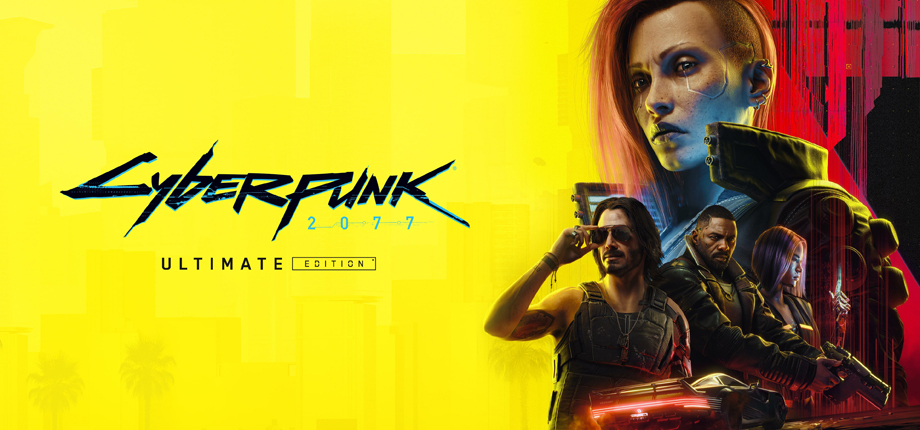 **Cyberpunk 2077** | [CyberpunkVR Port](https://github.com/dariulone/cyberpunk-vr-port) by [dariulone](https://github.com/dariulone) Latest: [0.2.3](https://github.com/dariulone/cyberpunk-vr-port/releases/latest) (2026-11-08) | PCVR 🚧 beta | [▶ Beardo Benjo](https://www.youtube.com/watch?v=bqWALEvZ1to) [▶ Beardo Benjo](https://www.youtube.com/watch?v=XkzaBRPJoQE) |
| 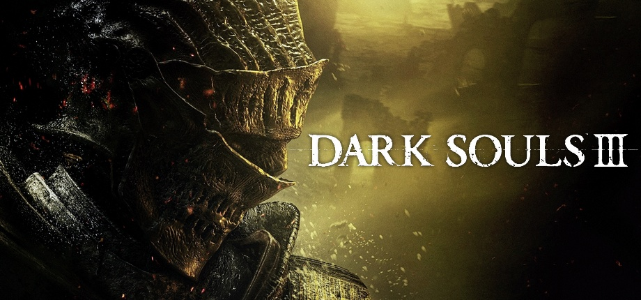 **Dark Souls III** | [DS3 VR](https://github.com/scubasteve2365/DS3-VR) by [scubasteve2365](https://github.com/scubasteve2365) Latest: [v2.0.1](https://github.com/scubasteve2365/DS3-VR/releases/latest) (2026-10-29) | PCVR ✅ stable 1 known bug | [▶ Beardo Benjo](https://www.youtube.com/watch?v=7dQkcR8BVNI) [▶ Hoopermation VR](https://www.youtube.com/watch?v=yUGZW2x-hhw) |
| 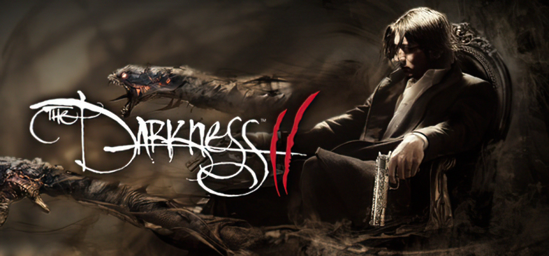 **The Darkness II** | [The Darkness II VR](https://github.com/trilex07/TrilexModInstaller) by [Trilex07](https://github.com/trilex07) Latest: [installer-1.1.0](https://github.com/trilex07/TrilexModInstaller/releases/latest) (2026-11-07) | PCVR 🚧 beta | [▶ VR Кучер](https://www.youtube.com/watch?v=XZ1tLkt_T0Y) [▶ NotAGameAddict](https://www.youtube.com/watch?v=ux3NvpxTmDw) |
|  **Dead Rising** | [DeadRisingVR](https://github.com/AshenVR/DeadRisingVR) by [AshenVR](https://github.com/AshenVR) Latest: [v0.2.0-alpha](https://github.com/AshenVR/DeadRisingVR/releases/latest) (2026-10-23) | PCVR 🧪 alpha 2 known bugs | [▶ Freako](https://www.youtube.com/watch?v=aLlOIIkpCMA) [▶ Jammyhero](https://www.youtube.com/watch?v=fxVvP3Plt1g) |
|  **Dead Space (2008)** | [Dead Space (2008) VR](https://www.youtube.com/watch?v=u0_oRUFopxU) by [Talemann](https://dspacevr.com/) Latest: [unversioned](https://dspacevr.com/) (2026-11-07)  [ds-vr](https://github.com/Mortygotvr/deadspace-vr) by [Mortygotvr](https://github.com/Mortygotvr) Latest: [v0.1.0-alpha](https://github.com/Mortygotvr/deadspace-vr/releases/latest) (2026-10-14) | **Dead Space (2008) VR** PCVR 🚧 beta  **ds-vr** PCVR 🧪 alpha 5 known bugs | [▶ Beardo Benjo](https://www.youtube.com/watch?v=i8kqEA6QuM4) [▶ Talemann](https://www.youtube.com/watch?v=9x1d27MMhrQ) [▶ Beardo Benjo](https://www.youtube.com/watch?v=i8kqEA6QuM4) [▶ Beardo Benjo](https://www.youtube.com/watch?v=lvCuaE87zS0) |
| 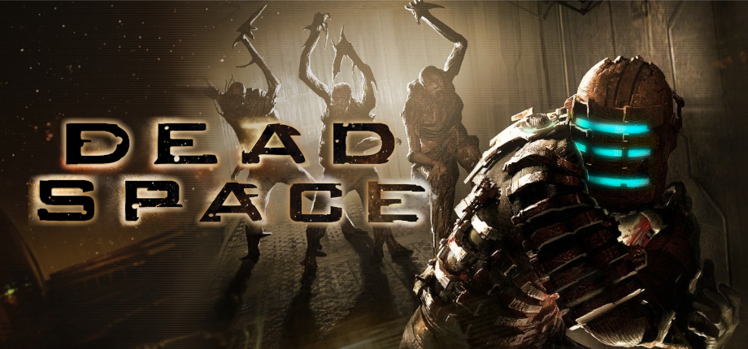 **Dead Space (2023)** | [Dead Space (2023) R.E.A.L. VR](https://www.patreon.com/realvr/posts/ds2023-165285354) by Luke Ross Latest: [2607.31.2](https://www.patreon.com/realvr/posts/ds2023-165285354) (2026-07-31) | PCVR 🚧 beta | [▶ Beardo Benjo](https://www.youtube.com/watch?v=i8kqEA6QuM4) [▶ Beardo Benjo](https://www.youtube.com/watch?v=lvCuaE87zS0) |
| 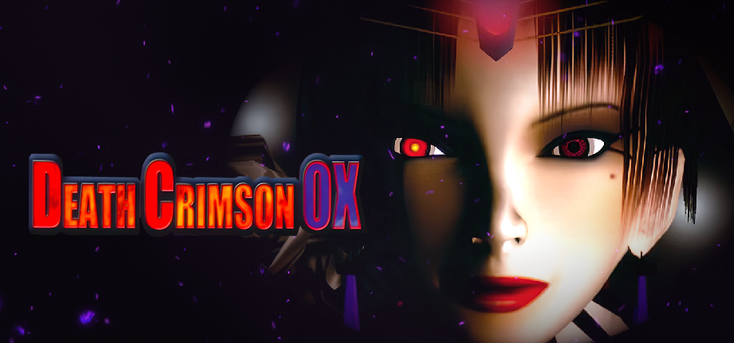 **Death Crimson OX** | [Death Crimson OX VR](https://github.com/vr4all-standalone/death-crimson-ox-vr) by [vr4all-standalone](https://github.com/vr4all-standalone) Latest: [v1.0.7](https://github.com/vr4all-standalone/death-crimson-ox-vr/releases/latest) (2026-11-03) | PCVR + Standalone 🧪 alpha 1 known bug | [▶ Press start to begin](https://www.youtube.com/watch?v=M1x3-cu_y2g) [▶ Press start to begin](https://www.youtube.com/watch?v=cHi0qoCG0fQ) |
| 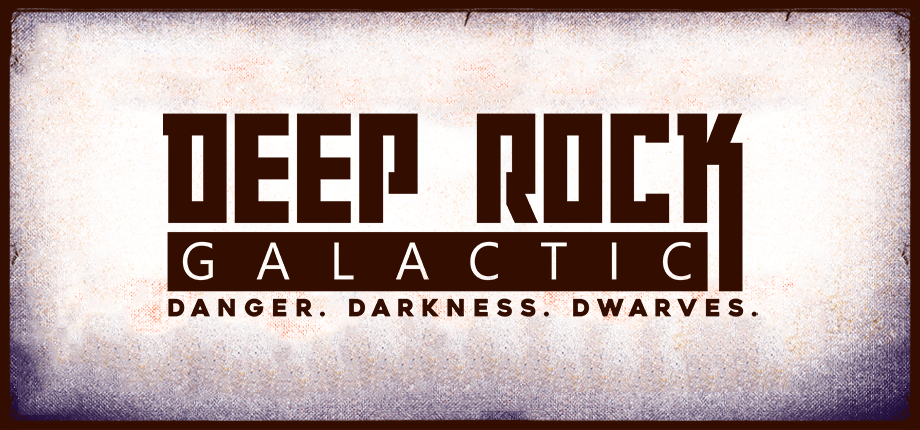 **Deep Rock Galactic** | [VRG](https://mod.io/g/drg/m/vrg) by Unknown Latest: [unversioned](https://mod.io/g/drg/m/vrg) (2026-10-09) | PCVR 🚧 beta | [▶ Beardo Benjo](https://www.youtube.com/watch?v=jrcGVagjNpc) [▶ MedvediVodki](https://www.youtube.com/watch?v=HcI-ybJrUAs) |
| 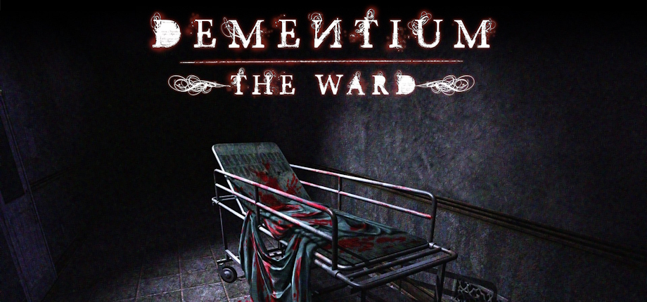 **Dementium: The Ward** | [Dementium: The Ward VR](https://github.com/stevethetitan92/Dementium-The-Ward-VR) by [stevethetitan92](https://github.com/stevethetitan92) Latest: [v0.1.8-launcher-optimization](https://github.com/stevethetitan92/Dementium-The-Ward-VR/releases/latest) (2026-11-10) | PCVR 🧪 alpha | [▶ SteveTheTitan](https://www.youtube.com/watch?v=tol44JZvklk) |
|  **Descent** | [Descent 1 & 2 VR](https://github.com/GameOrDie007/Descent-1-and-2-VR) by [GameOrDie007](https://github.com/GameOrDie007) Latest: [v1.2.1](https://github.com/GameOrDie007/Descent-1-and-2-VR/releases/latest) (2026-10-23) | PCVR + Standalone 🚧 beta | [▶ GeeksvsGeeks](https://www.youtube.com/watch?v=k41nuqxpkkI) [▶ substatica](https://www.youtube.com/watch?v=lgq4KuqIZoo) |
|  **Descent 2** | [Descent 1 & 2 VR](https://github.com/GameOrDie007/Descent-1-and-2-VR) by [GameOrDie007](https://github.com/GameOrDie007) Latest: [v1.2.1](https://github.com/GameOrDie007/Descent-1-and-2-VR/releases/latest) (2026-10-23) | PCVR + Standalone 🚧 beta | [▶ GeeksvsGeeks](https://www.youtube.com/watch?v=k41nuqxpkkI) [▶ substatica](https://www.youtube.com/watch?v=lgq4KuqIZoo) |
|  **Descent 3** | [Descent 3 VR](https://github.com/SgtBilko76/Descent3-VR) by [SgtBilko76](https://github.com/SgtBilko76) Latest: [quest-v0.3-beta](https://github.com/SgtBilko76/Descent3-VR/releases/latest) (2026-09-23) | Standalone 🚧 beta 1 known bug | [▶ Meta Quest Central \| VR Gameplay](https://www.youtube.com/watch?v=GjHt_ug7Ykw) [▶ Dave The Psycho](https://www.youtube.com/watch?v=XsRfs_1VAqc) |
| 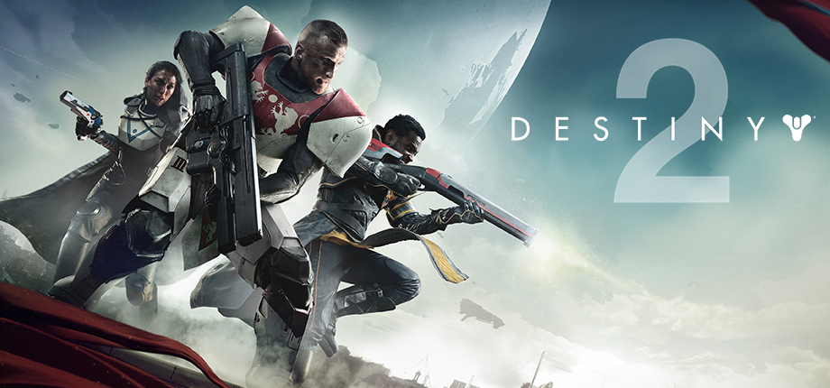 **Destiny 2** | [Destiny 2 VR](https://github.com/thecosmictangerine-cloud/destiny-2-vr) by [thecosmictangerine-cloud](https://github.com/thecosmictangerine-cloud) Latest: [v0.1.0](https://github.com/thecosmictangerine-cloud/destiny-2-vr/releases/latest) (2026-10-28) | PCVR 🚧 beta 2 known bugs | [▶ Cosmic Tangerine](https://www.youtube.com/watch?v=i2J9zE-kviE) [▶ Scyushi](https://www.youtube.com/watch?v=UZmDvDT_a9E) |
| 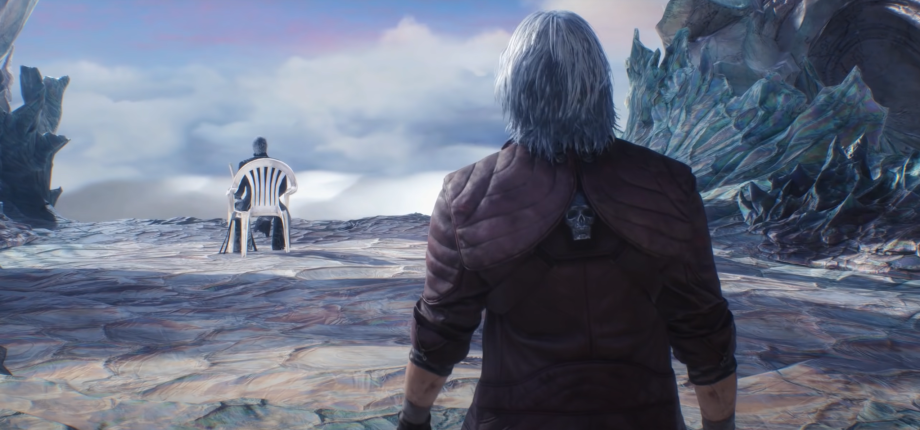 **Devil May Cry 5** | [REFramework](https://github.com/praydog/REFramework) by [praydog](https://github.com/praydog) Latest: [v1.5.9.1](https://github.com/praydog/REFramework/releases/latest) (2025-03-05) | PCVR ✅ stable | [▶ MRTV - MIXED REALITY TV](https://www.youtube.com/watch?v=hySd4sHtcDE) [▶ Stereo3DProductions](https://www.youtube.com/watch?v=Ql5ggETipyM) |
|  **Diablo II: Resurrected** | [D2R VR](https://github.com/natpoh/diablo2-vr-port) by [natpoh](https://github.com/natpoh) Latest: [v0.215.0](https://github.com/natpoh/diablo2-vr-port/releases/latest) (2026-11-12)  [D2R VR Unleashed](https://github.com/bearstonem/d2r-pcvr) by [bearstonem](https://github.com/bearstonem) Latest: [v0.3.35-windows-preview](https://github.com/bearstonem/d2r-pcvr/releases/latest) (2026-11-13) | **D2R VR** PCVR 🚧 beta  **D2R VR Unleashed** PCVR 🚧 beta 1 known bug | [▶ Monkeylashes](https://www.youtube.com/watch?v=EBL7lzd4s-M) [▶ Virtuix Omni](https://www.youtube.com/watch?v=8-6nk1sE08s) [▶ Monkeylashes](https://www.youtube.com/watch?v=EBL7lzd4s-M) [▶ Virtuix Omni](https://www.youtube.com/watch?v=8-6nk1sE08s) |
|  **Dirt 4** | [CodiesVR](https://github.com/drowhunter/CodiesVR) by [drowhunter](https://github.com/drowhunter) Latest: [v1.0.0](https://github.com/drowhunter/CodiesVR/releases/latest) (2026-11-02) | PCVR 🧪 alpha 1 known bug | [▶ Gamertag VR](https://www.youtube.com/watch?v=IY-sZO68E8k) [▶ GameOnScorpio](https://www.youtube.com/watch?v=0aFCZnMl4Lk) |
| 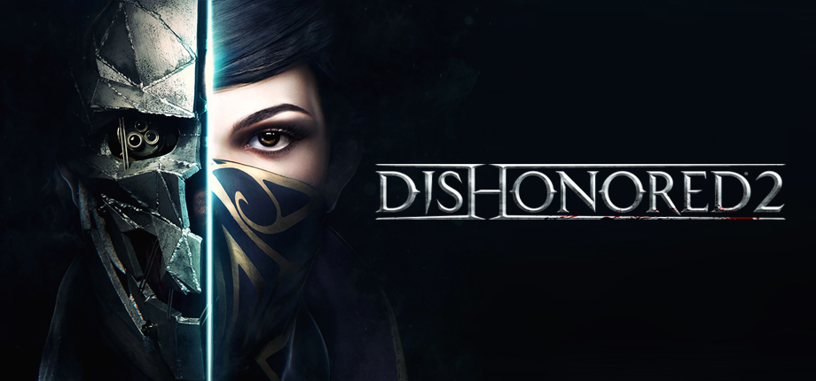 **Dishonored 2** | [Dishonored 2 VR](https://github.com/Hollownett/dishonored2-vr) by [Hollownett](https://github.com/Hollownett) Latest: [v1276](https://github.com/Hollownett/dishonored2-vr/releases/latest) (2026-11-13) | PCVR 🚧 beta 1 known bug | [▶ NotAGameAddict](https://www.youtube.com/watch?v=29cmGRrJEmU) [▶ Cosmic Tangerine](https://www.youtube.com/watch?v=SIVYcIaLrgU) |
|  **Disney Dreamlight Valley** | [Disney Dreamlight Valley VR](https://github.com/King-EJ/Disney-Dreamlight-Valley-VR) by [King-EJ](https://github.com/King-EJ) Latest: [Disney_Dreamlight_Valley_VR_update2](https://github.com/King-EJ/Disney-Dreamlight-Valley-VR/releases/latest) (2026-11-06)  [Vibelight Valley](https://github.com/TheBacon00/vibelight-valley) by [TheBacon00](https://github.com/TheBacon00) Latest: [v0.2.0](https://github.com/TheBacon00/vibelight-valley/releases/latest) (2026-10-15) | **Disney Dreamlight Valley VR** PCVR 🧪 alpha  **Vibelight Valley** PCVR 🧪 alpha | [▶ FastLawyer](https://www.youtube.com/watch?v=2pElA9KSMF4) [▶ FastLawyer](https://www.youtube.com/watch?v=2pElA9KSMF4) |
| 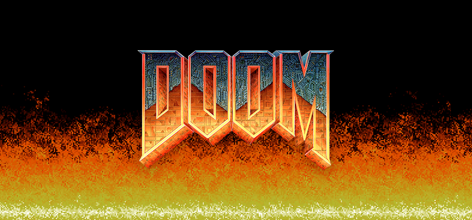 **DOOM** | [Quest DOOM](https://github.com/CommunityPokeOrg/quest-doom) by [CommunityPokeOrg](https://github.com/CommunityPokeOrg) Latest: [v0.2.6](https://github.com/CommunityPokeOrg/quest-doom/releases/latest) (2026-09-18) | Standalone 🧪 alpha 1 known bug | [▶ Captainabrik](https://www.youtube.com/watch?v=2upPEhhzTTw) [▶ Beardo Benjo](https://www.youtube.com/watch?v=YelM8MdzzpI) |
|  **Doom** | [QuestZDoom](https://github.com/Team-Beef-Studios/QuestZDoom) by [Team Beef](https://github.com/Team-Beef-Studios) Latest: [1.6.2](https://github.com/Team-Beef-Studios/QuestZDoom/releases/latest) (2026-09-30) | Standalone ✅ stable | [▶ Beardo Benjo](https://www.youtube.com/watch?v=YelM8MdzzpI) [▶ VR Reviews](https://www.youtube.com/watch?v=LwT1aKRGcOA) |
| 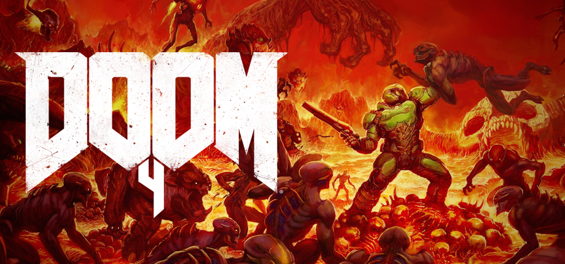 **DOOM (2016)** | [DOOM (2016) R.E.A.L. VR](https://www.patreon.com/realvr/posts/doom-162879153) by Luke Ross Latest: [2607.31.1](https://www.patreon.com/realvr/posts/doom-162879153) (2026-07-04) | PCVR 🚧 beta | [▶ Beardo Benjo](https://www.youtube.com/watch?v=rf1aWozpwK0) [▶ Gamertag VR](https://www.youtube.com/watch?v=5BCafGSVhN0) |
| 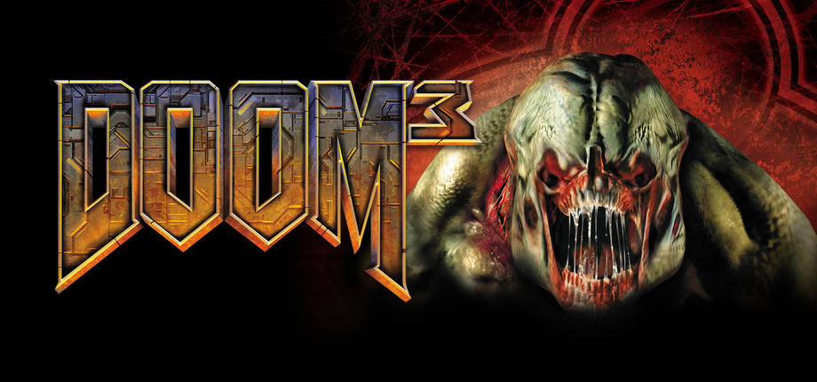 **Doom 3** | [Doom3Quest](https://github.com/Team-Beef-Studios/Doom3Quest) by [Team Beef](https://github.com/Team-Beef-Studios) Latest: [v1.4.8](https://github.com/Team-Beef-Studios/Doom3Quest/releases/latest) (2026-09-30) | Standalone ✅ stable | [▶ Team Beef VR Game Ports](https://www.youtube.com/watch?v=y2y9C0E2kPk) [▶ Gamertag VR](https://www.youtube.com/watch?v=U4aRzfja8xg) |
|  **DOOM Eternal** | [EternalVR](https://github.com/ArcadaLabs-Jason/EternalVR) by [ArcadaLabs-Jason](https://github.com/ArcadaLabs-Jason) Latest: [v0.1.92](https://github.com/ArcadaLabs-Jason/EternalVR/releases/latest) (2026-11-12) | PCVR 🧪 alpha | [▶ Beardo Benjo](https://www.youtube.com/watch?v=rf1aWozpwK0) [▶ VR DaD ](https://www.youtube.com/watch?v=x5IhUhJaNrg) |
| 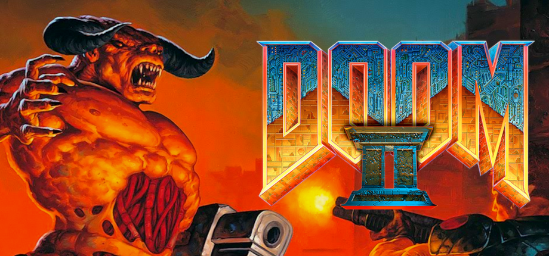 **Doom II** | [QuestZDoom](https://github.com/Team-Beef-Studios/QuestZDoom) by [Team Beef](https://github.com/Team-Beef-Studios) Latest: [1.6.2](https://github.com/Team-Beef-Studios/QuestZDoom/releases/latest) (2026-09-30) | Standalone ✅ stable | [▶ Beardo Benjo](https://www.youtube.com/watch?v=YelM8MdzzpI) [▶ VR Reviews](https://www.youtube.com/watch?v=LwT1aKRGcOA) |
| 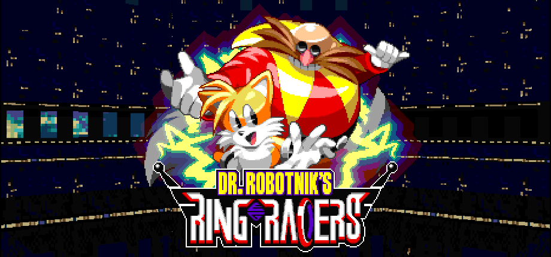 **Dr. Robotnik's Ring Racers** | [Dr. Robotnik's Ring Racers VR](https://github.com/RaYRoD-TV/MVRH) by RaYRoD-TV Latest: [Patch 3](https://github.com/RaYRoD-TV/MVRH/releases) (2026-10-09) | PCVR 🚧 beta | [▶ legaiaflame](https://www.youtube.com/watch?v=zZoC6sKsX9U) |
| 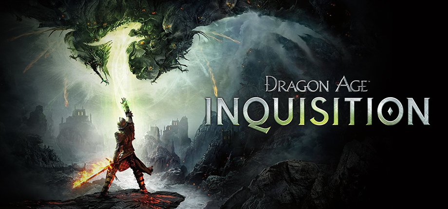 **Dragon Age: Inquisition** | [Dragon Age: Inquisition VR](https://github.com/mark-mon/dragon-age-inquisition-vr) by [mark-mon](https://github.com/mark-mon) Latest: [v1.0](https://github.com/mark-mon/dragon-age-inquisition-vr/releases/latest) (2026-10-30) | PCVR ✅ stable | [▶ Oculus Gamer](https://www.youtube.com/watch?v=6Cau9I62pMM) |
| 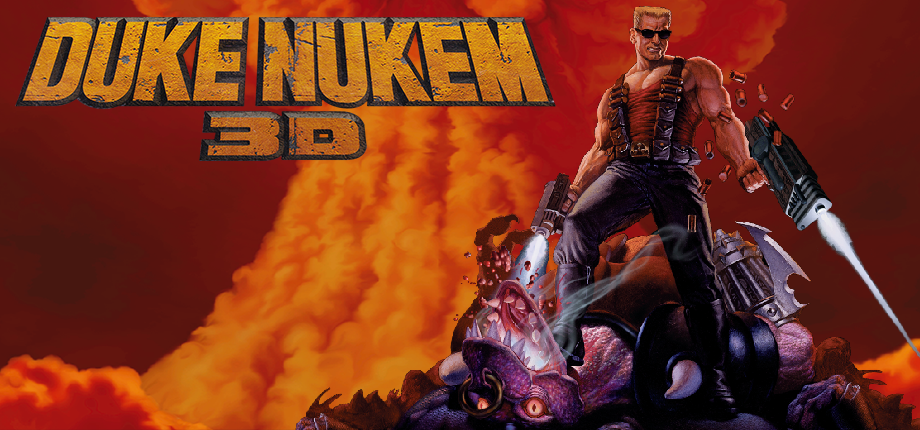 **Duke Nukem 3D** | [RazeXR](https://github.com/Team-Beef-Studios/RazeXR) by [Team Beef](https://github.com/Team-Beef-Studios) Latest: [v1.0.0](https://github.com/Team-Beef-Studios/RazeXR/releases/latest) (2023-09-30) | Standalone ✅ stable | [▶ VR Reviews](https://www.youtube.com/watch?v=dFiVi_xUjRc) [▶ VoodooDE VR](https://www.youtube.com/watch?v=h5vjhgyeNiE) |
|  **Dungeon Keeper 2** | [Dungeon Keeper 2 VR (DK2VR)](https://github.com/lovemakerz/Dungeon-Keeper-2-VR-MOD) by [LoVeMaKeRz](https://github.com/lovemakerz) Latest: [V0.9.47.63](https://github.com/lovemakerz/Dungeon-Keeper-2-VR-MOD/releases/latest) (2026-10-11) | PCVR 🧪 alpha 1 known bug | [▶ LoVeMaKeRz](https://www.youtube.com/watch?v=0tBOKbF9qJE) |
|  **Earth Defense Force 6** | [EDF6VR](https://github.com/momotori01/EARTH-DEFENSE-FORCE-6-VR-MOD) by [momotori01](https://github.com/momotori01) Latest: [EDF6VR-3.2.20](https://github.com/momotori01/EARTH-DEFENSE-FORCE-6-VR-MOD/releases/latest) (2026-11-11) | PCVR ✅ stable | [▶ NotAGameAddict](https://www.youtube.com/watch?v=q6mnrXdHd-8) [▶ EDF Central](https://www.youtube.com/watch?v=NX79tWuvssw) |
| 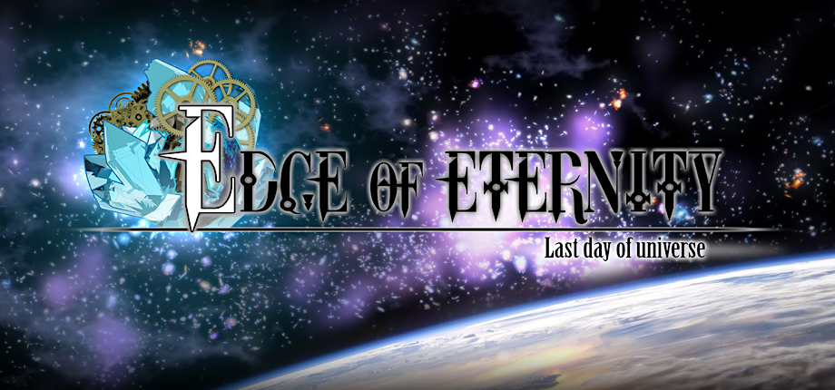 **Edge of Eternity** | [Edge of Eternity VR](https://github.com/mark-mon/edge-of-eternity-vr) by [mark-mon](https://github.com/mark-mon) Latest: [v1.0](https://github.com/mark-mon/edge-of-eternity-vr/releases/latest) (2026-10-29) | PCVR ✅ stable | — |
| 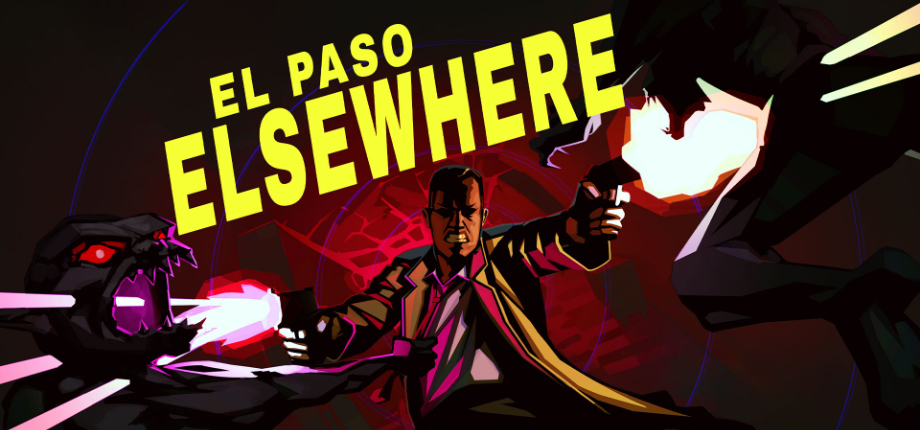 **El Paso, Elsewhere** | [El Paso, Elsewhere VR](https://github.com/King-EJ/El-Paso-Elsewhere) by [King-EJ](https://github.com/King-EJ) Latest: [ElPasoElsewhereVR](https://github.com/King-EJ/El-Paso-Elsewhere/releases/latest) (2026-11-04) | PCVR 🧪 alpha 1 known bug | [▶ KingVR_PC](https://www.youtube.com/watch?v=zMsbrFo9hPE) |
|  **The Elder Scrolls III: Morrowind** | [OpenMW VR](https://gitlab.com/madsbuvi/openmw) by Mads Buvik Sandvei Latest: [unversioned](https://gitlab.com/madsbuvi/openmw) (2026-10-09)  [OpenMW-VR Quest](https://github.com/tomups/openmw-vr-quest) by [tomups](https://github.com/tomups) Latest: [v0.51](https://github.com/tomups/openmw-vr-quest/releases/latest) (2026-07-05) | **OpenMW VR** PCVR ✅ stable  **OpenMW-VR Quest** Standalone 💀 abandoned | [▶ Paradise Decay](https://www.youtube.com/watch?v=7xgJZve3ZpE) [▶ Immersed Robot](https://www.youtube.com/watch?v=7kqEdA5f4Jg) [▶ Linux Games BR](https://www.youtube.com/watch?v=AxZkffnsj50) |
|  **Enshrouded** | [Enshrouded VR](https://github.com/momotori01/ENSHROUDED-VR-MOD) by [momotori01](https://github.com/momotori01) Latest: [EnshroudedVR-0.9.24](https://github.com/momotori01/ENSHROUDED-VR-MOD/releases/latest) (2026-11-12) | PCVR 🚧 beta | [▶ NotAGameAddict](https://www.youtube.com/watch?v=my_yKx7H3IU) [▶ NotAGameAddict](https://www.youtube.com/watch?v=9xUTpmc0ubA) |
|  **The Evil Within** | [The Evil Within VR](https://github.com/TefMeister/the-evil-within-vr) by [TefMeister](https://github.com/TefMeister) Latest: [v0.1.0-first-vr](https://github.com/TefMeister/the-evil-within-vr/releases/latest) (2026-10-11) | PCVR 🧪 alpha 6 known bugs | [▶ Headset-VR](https://www.youtube.com/watch?v=qRE7m-B8jN0) |
| **Exhumed** | [RazeXR](https://github.com/Team-Beef-Studios/RazeXR) by [Team Beef](https://github.com/Team-Beef-Studios) Latest: [v1.0.0](https://github.com/Team-Beef-Studios/RazeXR/releases/latest) (2023-09-30) | Standalone ✅ stable | [▶ VR Reviews](https://www.youtube.com/watch?v=dFiVi_xUjRc) [▶ VoodooDE VR](https://www.youtube.com/watch?v=h5vjhgyeNiE) |
|  **F-Zero X** | [F-Zero X VR Standalone](https://github.com/heurazy/FzeroVR-Standalone) by [heurazy](https://github.com/heurazy) Latest: [v1.0.1](https://github.com/heurazy/FzeroVR-Standalone/releases/latest) (2026-08-14) | Standalone 🚧 beta | [▶ Trev](https://www.youtube.com/watch?v=CheaOy69uEo) |
|  **F.E.A.R.** | [F.E.A.R. VR](https://github.com/DR-89/fear-vr) by [DR-89](https://github.com/DR-89) Latest: [v1.0.0-beta.8](https://github.com/DR-89/fear-vr/releases/latest) (2026-08-04) | PCVR 🚧 beta | [▶ TheFreeMike](https://www.youtube.com/watch?v=mIsvNvWRc-w) [▶ TheFreeMike](https://www.youtube.com/watch?v=LHwgHBhKbjE) |
|  **F.E.A.R. 2: Project Origin** | [FEAR2VR](https://github.com/praydog/FEAR2VR) by [Praydog](https://github.com/praydog) Latest: [unversioned](https://github.com/praydog/FEAR2VR) (2026-08-09) | PCVR 🧪 alpha | — |
|  **Fallout 3** | [THEwill Fallout 3 VR](https://github.com/THEwill2002/Fallout3VR) by [THEwill2002](https://github.com/THEwill2002) Latest: [v0.1.0-alpha.6-rc.25](https://github.com/THEwill2002/Fallout3VR/releases/latest) (2026-11-09) | PCVR 💀 abandoned 2 known bugs | [▶ habie147](https://www.youtube.com/watch?v=rBxHre8A9Oc) [▶ Gamertag VR](https://www.youtube.com/watch?v=QQMEPLt-h3Y) |
|  **Far Cry (2004)** | [Far Cry VR](https://farcryvr.de/) by Holger Frydrych Latest: [unversioned](https://farcryvr.de/) (2026-10-09) | PCVR ✅ stable | [▶ MAME-FAN](https://www.youtube.com/watch?v=8sD5DVkP9vI) [▶ Beardo Benjo](https://www.youtube.com/watch?v=ndyG_lw7ZeU) |
|  **Far Cry 2** | [far-cry-2-vr](https://github.com/TefMeister/far-cry-2-vr) by [TefMeister](https://github.com/TefMeister) Latest: [v0.1.0-alpha](https://github.com/TefMeister/far-cry-2-vr/releases/latest) (2026-08-21) | PCVR 🧪 alpha 3 known bugs | [▶ NotAGameAddict](https://www.youtube.com/watch?v=9kPQB1_rBks) [▶ Press start to begin](https://www.youtube.com/watch?v=jCD_iUH-Geo) |
|  **Far Cry 5** | [Far Cry 5 VR Mod](https://www.youtube.com/watch?v=5m84kdtTx9Q) by Press.Start Latest: [unversioned](https://www.nexusmods.com/farcry5/mods/273?tab=description) (2026-10-29) | PCVR 🚧 beta | [▶ Beardo Benjo](https://www.youtube.com/watch?v=VPN1wppEkB8) [▶ NotAGameAddict](https://www.youtube.com/watch?v=D_1d8oWWTko) |
|  **Far Far West** | [Far Far VR](https://github.com/pr-io/Far-Far-VR) by [PR_VR](https://github.com/pr-io) Latest: [v0.4.20](https://github.com/pr-io/Far-Far-VR/releases/latest) (2026-11-08) | PCVR 🧪 alpha | [▶ BionicFreak](https://www.youtube.com/watch?v=BY8-jR-ActI) [▶ Dedo 2000](https://www.youtube.com/watch?v=AHlsVxAqIrY) |
|  **FAR: Changing Tides** | [FAR Changing Tides VR](https://github.com/King-EJ/FAR-Changing-Tides-VR) by [King-EJ](https://github.com/King-EJ) Latest: [FARChangingTidesVR](https://github.com/King-EJ/FAR-Changing-Tides-VR/releases/latest) (2026-11-12) | PCVR 🧪 alpha 2 known bugs | — |
|  **Farpoint** | [Farpoint PC VR](https://github.com/evertec82/Farpoint) by [evertec82](https://github.com/evertec82) Latest: [v0.9.6](https://github.com/evertec82/Farpoint/releases/latest) (2026-10-26) | PCVR 🧪 alpha 3 known bugs | [▶ Wizzite](https://www.youtube.com/watch?v=CNg8TdD1S4A) [▶ SpottinGames](https://www.youtube.com/watch?v=UwKws_65zeI) |
|  **Final Fantasy XIII** | [Final Fantasy XIII Trilogy VR](https://github.com/mark-mon/final_fantasy_13_parts_1_2_3) by [mark-mon](https://github.com/mark-mon) Latest: [v1.2](https://github.com/mark-mon/final_fantasy_13_parts_1_2_3/releases/latest) (2026-11-09) | PCVR ✅ stable | — |
|  **Final Fantasy XIII-2** | [Final Fantasy XIII Trilogy VR](https://github.com/mark-mon/final_fantasy_13_parts_1_2_3) by [mark-mon](https://github.com/mark-mon) Latest: [v1.2](https://github.com/mark-mon/final_fantasy_13_parts_1_2_3/releases/latest) (2026-11-09) | PCVR ✅ stable | — |
|  **Firewatch** | [Two Forks VR](https://github.com/Raicuparta/two-forks-vr) by [Raicuparta](https://raicuparta.com) Latest: [v2.1.0](https://github.com/Raicuparta/two-forks-vr/releases/latest) (2022-08-19) | PCVR ✅ stable | [▶ VoodooDE VR](https://www.youtube.com/watch?v=aIAuiCtT9Lw) [▶ VoodooDE VR - english version -](https://www.youtube.com/watch?v=lrqEuM8T8xc) |
|  **FlatOut 2** | [FlatOut 2 VR](https://github.com/Saikava/flatout2-vr) by [Saikava](https://github.com/Saikava) Latest: [v1.6.14](https://github.com/Saikava/flatout2-vr/releases/latest) (2026-11-12) | PCVR ✅ stable | [▶ NotAGameAddict](https://www.youtube.com/watch?v=nEwPOAV10WQ) |
|  **FlatOut 4: Total Insanity** | [FlatOut 4 VR](https://store.steampowered.com/news/app/3844750/view/681890829846976119) by Flat2VR Studios Latest: [1.0](https://store.steampowered.com/app/3844750/FlatOut_4_Total_Insanity_VR/) (2026-10-23) | PCVR ✅ stable | [▶ Gamertag VR](https://www.youtube.com/watch?v=-I818cvWMTo) [▶ VoodooDE VR](https://www.youtube.com/watch?v=KNWUOf39k8c) |
|  **Forsaken** | [Forsaken VR](https://github.com/SgtBilko76/Forsaken-VR) by [SgtBilko76](https://github.com/SgtBilko76) Latest: [v0.1.2](https://github.com/SgtBilko76/Forsaken-VR/releases/latest) (2026-10-31) | Standalone 🧪 alpha | [▶ Magician Rblx](https://www.youtube.com/watch?v=RZb21mAXT_o) [▶ Magician Rblx](https://www.youtube.com/watch?v=IL_2oXfb-ZQ) |
|  **Forza Horizon 5** | [Forza VRMod](https://github.com/oofz/vrmod-releases) by lufz, [oofz](https://github.com/oofz) Latest: [v1.4.3](https://github.com/oofz/vrmod-releases/releases/latest) (2026-10-18) | PCVR 🚧 beta | [▶ SimplyPops](https://www.youtube.com/watch?v=D3vgxYuoxr8) [▶ coolkidfrmbx](https://www.youtube.com/watch?v=--EgpTztmxw) |
|  **Forza Horizon 6** | [Forza VRMod](https://github.com/oofz/vrmod-releases) by lufz, [oofz](https://github.com/oofz) Latest: [v1.4.3](https://github.com/oofz/vrmod-releases/releases/latest) (2026-10-18) | PCVR 🚧 beta | [▶ SimplyPops](https://www.youtube.com/watch?v=D3vgxYuoxr8) [▶ coolkidfrmbx](https://www.youtube.com/watch?v=--EgpTztmxw) |
|  **Garfield Kart - Furious Racing** | [Garfield Kart - Furious Racing VR](https://github.com/King-EJ/Garfield-Kart---Furious-Racing-VR) by [King-EJ](https://github.com/King-EJ) Latest: [Garfield_Kart_Furious_Racing_VRa](https://github.com/King-EJ/Garfield-Kart---Furious-Racing-VR/releases/latest) (2026-10-14) | PCVR 🧪 alpha | — |
| **Garfield Kart 2 - All You Can Drift** | [Garfield Kart 2 All You Can Drift VR](https://github.com/King-EJ/Garfield-Kart-2---All-You-Can-Drift-VR) by [King-EJ](https://github.com/King-EJ) Latest: [Garfield_Kart_Furious_Racing_VRa](https://github.com/King-EJ/Garfield-Kart-2---All-You-Can-Drift-VR/releases/latest) (2026-10-14) | PCVR 🧪 alpha 1 known bug | — |
|  **Gears of War: E-Day** | [GoWEDay-VR](https://github.com/paultaran00/GoWEDay-VR) by [paultaran00](https://github.com/paultaran00) Latest: [v0.2.8](https://github.com/paultaran00/GoWEDay-VR/releases/latest) (2026-11-09) | PCVR 🧪 alpha | [▶ rockonthehill](https://www.youtube.com/watch?v=5vXPBVKwbHs) [▶ rockonthehill](https://www.youtube.com/watch?v=MvI1veGMVuA) |
|  **Ghostbusters: The Video Game Remastered** | [GB-VR](https://www.nexusmods.com/ghostbustersthevideogameremastered/mods/101) by [Gamertag VR](https://www.youtube.com/watch?v=jRXQdiEC1xc) Latest: [unversioned](https://www.nexusmods.com/ghostbustersthevideogameremastered/mods/101) (2026-11-10) | PCVR 🚧 beta 3 known bugs | [▶ NotAGameAddict](https://www.youtube.com/watch?v=LsiLSH-WVNQ) [▶ Clueless Dad Gamer](https://www.youtube.com/watch?v=eKad28HV000) |
|  **Girls' Frontline 2: Exilium** | [GF2Exilium-VR](https://github.com/deadpixel134/GF2Exilium-VR) by [deadpixel134](https://github.com/deadpixel134), [TBluebox12](https://x.com/TBluebox12) Latest: [v1.3.11](https://github.com/deadpixel134/GF2Exilium-VR/releases/latest) (2026-11-08) | PCVR ✅ stable | — |
|  **Gloomhaven (Digital)** | [GloomhavenVR](https://github.com/McFredward/GloomhavenVR) by [McFredward](https://github.com/McFredward) Latest: [v1.2.4](https://github.com/McFredward/GloomhavenVR/releases/latest) (2026-11-10) | PCVR ✅ stable | [▶ FastLawyer](https://www.youtube.com/watch?v=w0mlw50PqZc) [▶ PCVR Gamer](https://www.youtube.com/watch?v=tgJAk6Z62b4) |
|  **Goat Simulator** | [GoatVR](https://github.com/5chech/GoatVR) by [5chech](https://github.com/5chech) Latest: [v43.0](https://github.com/5chech/GoatVR/releases/latest) (2026-10-11) | Standalone 🚧 beta | [▶ Wadonk AB](https://www.youtube.com/watch?v=3eR-GNQdHiw) [▶ E-Goat](https://www.youtube.com/watch?v=cpLlkY3QLtI) |
|  **God of War (2018)** | [God of War VR Mod](https://github.com/adore11s/God-of-War-VR-Mod) by [adore11s](https://github.com/adore11s) Latest: [v0.2.9](https://github.com/adore11s/God-of-War-VR-Mod/releases/latest) (2026-11-04) | PCVR 🧪 alpha 3 known bugs | [▶ Downloadable Content](https://www.youtube.com/watch?v=OGTF98a1B2Y) [▶ Virtual Dudes](https://www.youtube.com/watch?v=lb7DZuQwSpM) |
|  **GoldenEye 007** | [GoldenEye VR](https://github.com/MrSco/goldeneye-vr) by [MrSco](https://github.com/MrSco) Latest: [v0.5.17](https://github.com/MrSco/goldeneye-vr/releases/latest) (2026-11-12) | Standalone 🚧 beta | [▶ LunchAndVR](https://www.youtube.com/watch?v=4tPkNMYzDjY) [▶ NotAGameAddict](https://www.youtube.com/watch?v=DYKvCZazyJA) |
|  **Gothic II: Night of the Raven** | [Gothic II VR](https://github.com/dubrovskiy-yevhen-stakelogic/gothic2-vr) by [dubrovskiy-yevhen-stakelogic](https://github.com/dubrovskiy-yevhen-stakelogic), JaXt0r Latest: [v0.2.1](https://github.com/dubrovskiy-yevhen-stakelogic/gothic2-vr/releases/latest) (2026-11-08) | PCVR + Standalone 🧪 alpha 1 known bug | [▶ umut_rre](https://www.youtube.com/watch?v=rhsqMxieF08) |
|  **Gran Turismo 2** | [Gran Turismo 2 VR](https://github.com/dubrovskiy-yevhen-stakelogic/gt-2-pc) by [dubrovskiy-yevhen-stakelogic](https://github.com/dubrovskiy-yevhen-stakelogic) Latest: [v0.9.2](https://github.com/dubrovskiy-yevhen-stakelogic/gt-2-pc/releases/latest) (2026-11-11) | PCVR + Standalone 🚧 beta | [▶ NotAGameAddict](https://www.youtube.com/watch?v=1_6met_dnAk) [▶ Saiynergy](https://www.youtube.com/watch?v=gNwACh3Jxs8) |
|  **Gran Turismo 3 A-Spec** | [GT3 Revisited](https://github.com/matt-pulsipher/GT3-revisited) by [matt-pulsipher](https://github.com/matt-pulsipher) Latest: [v0.6.5](https://github.com/matt-pulsipher/GT3-revisited/releases/latest) (2026-11-12) | PCVR + Standalone 🚧 beta | [▶ NotAGameAddict](https://www.youtube.com/watch?v=UQzIiN9SwvE) [▶ Matthew Pulsipher](https://www.youtube.com/watch?v=51AEQxkkumg) |
|  **Gran Turismo 4** | [GT4 VR](https://github.com/SgtBilko76/gt4-vr) by [SgtBilko76](https://github.com/SgtBilko76) Latest: [v0.3.1-beta-specii](https://github.com/SgtBilko76/gt4-vr/releases/latest) (2026-11-12) | Standalone 🚧 beta | — |
|  **Granblue Fantasy: Relink** | [Granblue Fantasy: Relink VR](https://github.com/mark-mon/GranblueFantasyRelink-VR) by [mark-mon](https://github.com/mark-mon) Latest: [v1.0.2](https://github.com/mark-mon/GranblueFantasyRelink-VR/releases/latest) (2026-10-24) | PCVR ✅ stable | — |
|  **Grand Prix Legends** | [GPLVR](https://github.com/Casqade/gplvr) by [Casqade](https://github.com/Casqade) Latest: [v1.1](https://github.com/Casqade/gplvr/releases/latest) (2026-11-11) | PCVR 🚧 beta | [▶ SimRacing604](https://www.youtube.com/watch?v=3FqX7UulFrs) [▶ DaftnDirect](https://www.youtube.com/watch?v=JT_RTjwahu0) |
|  **Grand Theft Auto IV** | [Grand Theft Auto IV VR](https://github.com/Hochgeschwindigkeitsrennfahrer/Grand-Theft-Auto-IV-VR-Mod) by [Hochgeschwindigkeitsrennfahrer](https://github.com/Hochgeschwindigkeitsrennfahrer) Latest: [GTA4VR](https://github.com/Hochgeschwindigkeitsrennfahrer/Grand-Theft-Auto-IV-VR-Mod/releases/latest) (2026-08-04) | PCVR 🧪 alpha 2 known bugs | [▶ NotAGameAddict](https://www.youtube.com/watch?v=qJbdckHlBmM) [▶ MrIch325](https://www.youtube.com/watch?v=JkVdSyDpg78) |
|  **Grand Theft Auto V** | [GTA 5 VR](https://github.com/enricosampaio533-source/GTA-5-VR-MOD) by [enricosampaio533-source](https://github.com/enricosampaio533-source) Latest: [GTA5VRMOD](https://github.com/enricosampaio533-source/GTA-5-VR-MOD/releases/latest) (2026-11-10) | PCVR 🧪 alpha | [▶ Beardo Benjo](https://www.youtube.com/watch?v=U78hfstGW3U) [▶ Beardo Benjo](https://www.youtube.com/watch?v=T2LoOFt9hiY) |
|  **Grand Theft Auto: San Andreas** | [GTA San Andreas Diorama MR](https://github.com/galateainteractive/gta-sa-diorama-mr-quest) by [Galatea Interactive](https://github.com/galateainteractive) Latest: [gta-installer-v1.3.10](https://github.com/galateainteractive/gta-sa-diorama-mr-quest/releases/latest) (2026-11-12)  [GTA San Andreas VR for Quest](https://github.com/dubrovskiy-yevhen-stakelogic/gta-sa-vr-quest) by [dubrovskiy-yevhen-stakelogic](https://github.com/dubrovskiy-yevhen-stakelogic) Latest: [0.3.1 alpha](https://github.com/dubrovskiy-yevhen-stakelogic/gta-sa-vr-quest) (2026-10-11) | **GTA San Andreas Diorama MR** Standalone 🧪 alpha  **GTA San Andreas VR for Quest** Standalone 🧪 alpha | — |
|  **Grand Theft Auto: San Andreas - The Definitive Edition** | [SAN ANDREAS VR DEFINITIVE EDITION](https://github.com/Gangbusters1337/SAN-ANDREAS-VR-DEFINITIVE-EDITION) by [Gangbusters1337](https://github.com/Gangbusters1337) Latest: [v0.3.7](https://github.com/Gangbusters1337/SAN-ANDREAS-VR-DEFINITIVE-EDITION/releases/latest) (2026-09-09) | PCVR 🚧 beta | — |
|  **Grand Theft Auto: Vice City** | [Vice City VR](https://github.com/dubrovskiy-yevhen-stakelogic/vice-city-vr) by dubrovskiy-yevhen-stakelogic Latest: [v0.5.5.1](https://github.com/dubrovskiy-yevhen-stakelogic/vice-city-vr/releases/latest) (2026-09-14) | PCVR + Standalone 🧪 alpha | [▶ Vlad Yaps](https://www.youtube.com/watch?v=2e0IqwScrVk) [▶ Beyond Meta](https://www.youtube.com/watch?v=eEVMxo9YLLI) |
|  **GRID Legends** | [CodiesVR](https://github.com/drowhunter/CodiesVR) by [drowhunter](https://github.com/drowhunter) Latest: [v1.0.0](https://github.com/drowhunter/CodiesVR/releases/latest) (2026-11-02) | PCVR 🧪 alpha 1 known bug | [▶ Gamertag VR](https://www.youtube.com/watch?v=IY-sZO68E8k) [▶ GameOnScorpio](https://www.youtube.com/watch?v=0aFCZnMl4Lk) |
|  **Grim Dawn** | [Grim Dawn VR](https://github.com/simplysnake/GrimDawn_mod) by [simplysnake](https://github.com/simplysnake) Latest: [v0.3.5](https://github.com/simplysnake/GrimDawn_mod/releases/latest) (2026-11-04) | PCVR 🧪 alpha | [▶ fordfanboi](https://www.youtube.com/watch?v=7-qQtKcjipM) [▶ The_Mess](https://www.youtube.com/watch?v=qfaEIu_zYPM) |
|  **Gujian 3** | [Gujian3VR](https://github.com/iamtweety/Gujian3VR) by [iamtweety](https://github.com/iamtweety) Latest: [v0.6.9](https://github.com/iamtweety/Gujian3VR/releases/latest) (2026-11-07) | PCVR 🧪 alpha 2 known bugs | — |
|  **Gunblade NY** | [Gunblade NY VR](https://github.com/vr4all-standalone/gunblade-ny-vr) by [vr4all-standalone](https://github.com/vr4all-standalone) Latest: [v0.1.9-beta](https://github.com/vr4all-standalone/gunblade-ny-vr/releases/latest) (2026-11-03) | PCVR + Standalone 🚧 beta 2 known bugs | [▶ Press start to begin](https://www.youtube.com/watch?v=jOfONbACBTA) |
|  **Gunfire Reborn** | [GunfireRebornVRMod](https://github.com/xPrinny/GunfireRebornVRMod) by [xPrinny](https://github.com/xPrinny), [PureDark](https://github.com/PureDark) Latest: [1.0.6.1](https://github.com/xPrinny/GunfireRebornVRMod/releases/latest) (2024-03-19) | PCVR ✅ stable | [▶ Eurogamer](https://www.youtube.com/watch?v=WL9V5aDS7_c) [▶ Laserfights](https://www.youtube.com/watch?v=TQTKvaMpzOE) |
|  **Hail to the Rainbow** | [Hail to the Rainbow VR](https://github.com/King-EJ/Hail-to-the-Rainbow) by [King-EJ](https://github.com/King-EJ) Latest: [HailtotheRainbowVR](https://github.com/King-EJ/Hail-to-the-Rainbow/releases/latest) (2026-11-03) | PCVR 🧪 alpha 2 known bugs | [▶ BeGosha](https://www.youtube.com/watch?v=ZhtUufibUZ8) |
|  **Half-Life** | [Half-Life: VR Mod](https://store.steampowered.com/app/1908720) by Max Makes Mods Latest: [unversioned](https://store.steampowered.com/app/1908720) (2022-10-19)  [Lambda1VR](https://github.com/Team-Beef-Studios/Lambda1VR) by [Team Beef](https://github.com/Team-Beef-Studios) Latest: [v1.7.4](https://github.com/Team-Beef-Studios/Lambda1VR/releases/latest) (2026-09-29)  [Lambda1VR Vive XR Elite](https://github.com/gerardoriveradoesstuff/Lambda1VR-Vive-XR-Elite) by [gerardoriveradoesstuff](https://github.com/gerardoriveradoesstuff) Latest: [v1.7.4-vive-xr-elite](https://github.com/gerardoriveradoesstuff/Lambda1VR-Vive-XR-Elite/releases/latest) (2026-11-10) | **Half-Life: VR Mod** PCVR ✅ stable  **Lambda1VR** Standalone ✅ stable  **Lambda1VR Vive XR Elite** Standalone ✅ stable | [▶ ratlobber](https://www.youtube.com/watch?v=8YVCDrVMKio) [▶ Lambomang](https://www.youtube.com/watch?v=kK_810iUFfA) [▶ BMFVR](https://www.youtube.com/watch?v=A11e-h6qgDM) [▶ Matteo311](https://www.youtube.com/watch?v=5eRyhJwN1c0) [▶ BMFVR](https://www.youtube.com/watch?v=A11e-h6qgDM) [▶ RaMarcus](https://www.youtube.com/watch?v=fOaYIzp27ds) |
|  **Half-Life 2** | [Half-Life 2: VR Mod](https://store.steampowered.com/app/658920/) by Source VR Mod Team Latest: [Steam (auto-updates)](https://store.steampowered.com/app/658920/) (2023-04-06)  [HL2Quest](https://github.com/alferiko/half-life-2-stanalone-quest-releases) by [Anton Regolytov](https://github.com/alferiko) Latest: [1.02](https://github.com/alferiko/half-life-2-stanalone-quest-releases/releases/latest) (2026-11-11)  [SourceVR](https://github.com/tinsarfal/SourceVR) by [tinsarfal](https://github.com/tinsarfal) Latest: [0.1.28](https://github.com/tinsarfal/SourceVR/releases/latest) (2026-10-02) | **Half-Life 2: VR Mod** PCVR ✅ stable  **HL2Quest** Standalone ✅ stable  **SourceVR** Standalone 🚧 beta | [▶ Bonezz](https://www.youtube.com/watch?v=z8LRyoxo7kQ) [▶ 99TH VR](https://www.youtube.com/watch?v=0X7h9nVNHX8) [▶ Beardo Benjo](https://www.youtube.com/watch?v=YEb2Kw3UtU4) [▶ LunchAndVR](https://www.youtube.com/watch?v=QzgDw8xEpeM) [▶ LunchAndVR](https://www.youtube.com/watch?v=QzgDw8xEpeM) [▶ LunchAndVR](https://www.youtube.com/watch?v=kR_z39AJ-PQ) |
|  **Half-Life 2: Episode One** | [Half-Life 2: VR Mod](https://store.steampowered.com/app/658920/) by Source VR Mod Team Latest: [Steam (auto-updates)](https://store.steampowered.com/app/658920/) (2023-04-06)  [Half-Life 2: VR Mod - Episode One](https://store.steampowered.com/app/2177750) by Source VR Mod Team Latest: [unversioned](https://store.steampowered.com/app/2177750) (2023-03-17)  [HL2Quest](https://github.com/alferiko/half-life-2-stanalone-quest-releases) by [Anton Regolytov](https://github.com/alferiko) Latest: [1.02](https://github.com/alferiko/half-life-2-stanalone-quest-releases/releases/latest) (2026-11-11)  [SourceVR](https://github.com/tinsarfal/SourceVR) by [tinsarfal](https://github.com/tinsarfal) Latest: [0.1.28](https://github.com/tinsarfal/SourceVR/releases/latest) (2026-10-02) | **Half-Life 2: VR Mod** PCVR ✅ stable  **Half-Life 2: VR Mod - Episode One** PCVR ✅ stable  **HL2Quest** Standalone ✅ stable  **SourceVR** Standalone 🚧 beta | [▶ Bonezz](https://www.youtube.com/watch?v=z8LRyoxo7kQ) [▶ 99TH VR](https://www.youtube.com/watch?v=0X7h9nVNHX8) [▶ 99TH VR](https://www.youtube.com/watch?v=gdhenl5duKg) [▶ 99TH VR](https://www.youtube.com/watch?v=Q9R-gv_t87w) [▶ Beardo Benjo](https://www.youtube.com/watch?v=YEb2Kw3UtU4) [▶ LunchAndVR](https://www.youtube.com/watch?v=QzgDw8xEpeM) [▶ LunchAndVR](https://www.youtube.com/watch?v=QzgDw8xEpeM) [▶ LunchAndVR](https://www.youtube.com/watch?v=kR_z39AJ-PQ) |
|  **Half-Life 2: Episode Two** | [Half-Life 2: VR Mod](https://store.steampowered.com/app/658920/) by Source VR Mod Team Latest: [Steam (auto-updates)](https://store.steampowered.com/app/658920/) (2023-04-06)  [Half-Life 2: VR Mod - Episode Two](https://store.steampowered.com/app/2177760) by Source VR Mod Team Latest: [unversioned](https://store.steampowered.com/app/2177760) (2023-04-06)  [HL2Quest](https://github.com/alferiko/half-life-2-stanalone-quest-releases) by [Anton Regolytov](https://github.com/alferiko) Latest: [1.02](https://github.com/alferiko/half-life-2-stanalone-quest-releases/releases/latest) (2026-11-11)  [SourceVR](https://github.com/tinsarfal/SourceVR) by [tinsarfal](https://github.com/tinsarfal) Latest: [0.1.28](https://github.com/tinsarfal/SourceVR/releases/latest) (2026-10-02) | **Half-Life 2: VR Mod** PCVR ✅ stable  **Half-Life 2: VR Mod - Episode Two** PCVR ✅ stable  **HL2Quest** Standalone ✅ stable  **SourceVR** Standalone 🚧 beta | [▶ Bonezz](https://www.youtube.com/watch?v=z8LRyoxo7kQ) [▶ 99TH VR](https://www.youtube.com/watch?v=0X7h9nVNHX8) [▶ Glich'e Gaming](https://www.youtube.com/watch?v=-NharCGCBVU) [▶ 99TH VR](https://www.youtube.com/watch?v=9PM_NdczXo8) [▶ Beardo Benjo](https://www.youtube.com/watch?v=YEb2Kw3UtU4) [▶ LunchAndVR](https://www.youtube.com/watch?v=QzgDw8xEpeM) [▶ LunchAndVR](https://www.youtube.com/watch?v=QzgDw8xEpeM) [▶ LunchAndVR](https://www.youtube.com/watch?v=kR_z39AJ-PQ) |
|  **Half-Life 2: Lost Coast** | [HL2Quest](https://github.com/alferiko/half-life-2-stanalone-quest-releases) by [Anton Regolytov](https://github.com/alferiko) Latest: [1.02](https://github.com/alferiko/half-life-2-stanalone-quest-releases/releases/latest) (2026-11-11) | Standalone ✅ stable | [▶ Beardo Benjo](https://www.youtube.com/watch?v=YEb2Kw3UtU4) [▶ LunchAndVR](https://www.youtube.com/watch?v=QzgDw8xEpeM) |
|  **Half-Life: Alyx** | [Alyx Jailbreak](https://sidequestvr.com/app/62971) by Anton Regolytov Latest: [0.203](https://github.com/alferiko/alyx-jailbreak-releases) (2026-11-06)  [Qualyx](https://github.com/tinsarfal/Qualyx) by [tinsarfal](https://github.com/tinsarfal) Latest: [1.0.85](https://github.com/tinsarfal/Qualyx/releases/latest) (2026-10-29) | **Alyx Jailbreak** Standalone 🧪 alpha 2 known bugs  **Qualyx** Standalone 🧪 alpha | [▶ NotAGameAddict](https://www.youtube.com/watch?v=6CiPO-ohQXc) [▶ Paradise Decay](https://www.youtube.com/watch?v=zdsycxlcpKg) [▶ Paradise Decay](https://www.youtube.com/watch?v=JHW-FMm_c7c) |
|  **Half-Life: Blue Shift** | [Half-Life: VR Mod - Blue Shift](https://github.com/DmitryShaburov/Blue-Shift-VR) by [DmitryShaburov](https://github.com/DmitryShaburov) Latest: [v0.4.0](https://github.com/DmitryShaburov/Blue-Shift-VR/releases/latest) (2026-10-31) | PCVR 🚧 beta 6 known bugs | [▶ SweViver](https://www.youtube.com/watch?v=rUvwvqrFtE4) [▶ Sky Yuki](https://www.youtube.com/watch?v=tMPT7EjAnIQ) |
|  **Halo: Campaign Evolved** | [Halo: Campaign Evolved UEVR](https://github.com/MOTYSHIZ/HaloCampaignEvolved_UEVR) by [MOTYSHIZ](https://github.com/MOTYSHIZ) Latest: [v0.7.0](https://github.com/MOTYSHIZ/HaloCampaignEvolved_UEVR/releases/latest) (2026-10-06) | PCVR 🧪 alpha | [▶ LunchAndVR](https://www.youtube.com/watch?v=rVQWN7DvcMA) [▶ ThisKory](https://www.youtube.com/watch?v=_XOhW_B2e6k) |
|  **Halo: Combat Evolved** | [AlphaHaloQuest](https://github.com/christiancoler/AlphaHaloQuest) by [christiancoler](https://github.com/christiancoler) Latest: [alpha](https://github.com/christiancoler/AlphaHaloQuest/releases/latest) (2026-09-30)  [Halo CE Quest VR + Android](https://github.com/moistman42069/HaloCE-Quest-VR) by [moistman42069](https://github.com/moistman42069) Latest: [v1.0.41](https://github.com/moistman42069/HaloCE-Quest-VR/releases/latest) (2026-10-23)  [Ringfall: Mjolnir VR](https://github.com/Cesarus85/ringfall-mjolnir-vr) by [Cesarus85](https://github.com/Cesarus85) Latest: [build-322](https://github.com/Cesarus85/ringfall-mjolnir-vr/releases/latest) (2026-11-08) | **AlphaHaloQuest** Standalone 🧪 alpha 6 known bugs  **Halo CE Quest VR + Android** Standalone 🚧 beta  **Ringfall: Mjolnir VR** Standalone 🧪 alpha | — |
|  **Halo: Combat Evolved (PC)** | [HaloCEVR](https://github.com/LivingFray/HaloCEVR) by [LivingFray](https://github.com/LivingFray) Latest: [1.4.0](https://github.com/LivingFray/HaloCEVR/releases/latest) (2026-01-10) | PCVR ✅ stable 10 known bugs | [▶ Beardo Benjo](https://www.youtube.com/watch?v=KV-SMBYu7IY) [▶ Tyriel Wood - VR Tech](https://www.youtube.com/watch?v=zUMakbVleso) |
|  **Hardspace: Shipbreaker** | [ShipbreakerVR](https://raicuparta.com/shipbreaker-vr-mod) by [Rai](https://raicuparta.com/shipbreaker-vr-mod) Latest: [unversioned](https://raicuparta.com/shipbreaker-vr-mod) (2026-10-09) | PCVR 🚧 beta 1 known bug | [▶ Raicuparta](https://www.youtube.com/watch?v=UGGtz1lYMNw) [▶ Paradise Decay](https://www.youtube.com/watch?v=PZLhq5NiFKo) |
|  **Harry Potter and the Chamber of Secrets (2002 PC)** | [HP2VR](https://github.com/The-Logeen/HP2VR) by [The-Logeen](https://github.com/The-Logeen) Latest: [v0.1.5](https://github.com/The-Logeen/HP2VR/releases/latest) (2026-10-18) | PCVR 🧪 alpha 1 known bug | — |
|  **Harry Potter and the Sorcerer's Stone** | [Harry Potter VR](https://github.com/dubrovskiy-yevhen-stakelogic/harry-potter-vr) by [dubrovskiy-yevhen-stakelogic](https://github.com/dubrovskiy-yevhen-stakelogic) Latest: [v0.1.4.1](https://github.com/dubrovskiy-yevhen-stakelogic/harry-potter-vr/releases/latest) (2026-09-23) | Standalone 🚧 beta | [▶ J.H](https://www.youtube.com/watch?v=J50lNIZZfWo) |
|  **Herdling** | [Herdling VR](https://github.com/King-EJ/Herdling-VR) by [King-EJ](https://github.com/King-EJ) Latest: [HerdlingVR](https://github.com/King-EJ/Herdling-VR/releases/latest) (2026-10-30) | PCVR 🧪 alpha | [▶ Paradise Decay](https://www.youtube.com/watch?v=dcJnWzGdFMo) |
|  **Heretic** | [QuestZDoom](https://github.com/Team-Beef-Studios/QuestZDoom) by [Team Beef](https://github.com/Team-Beef-Studios) Latest: [1.6.2](https://github.com/Team-Beef-Studios/QuestZDoom/releases/latest) (2026-09-30) | Standalone ✅ stable | [▶ Beardo Benjo](https://www.youtube.com/watch?v=YelM8MdzzpI) [▶ VR Reviews](https://www.youtube.com/watch?v=LwT1aKRGcOA) |
|  **Hexen** | [QuestZDoom](https://github.com/Team-Beef-Studios/QuestZDoom) by [Team Beef](https://github.com/Team-Beef-Studios) Latest: [1.6.2](https://github.com/Team-Beef-Studios/QuestZDoom/releases/latest) (2026-09-30) | Standalone ✅ stable | [▶ Beardo Benjo](https://www.youtube.com/watch?v=YelM8MdzzpI) [▶ VR Reviews](https://www.youtube.com/watch?v=LwT1aKRGcOA) |
|  **Hitman 2: Silent Assassin** | [Hitman 2: Silent Assassin VR](https://github.com/andreystashev/hitman-2-silent-assassin-vr-showcase) by [andreystashev](https://github.com/andreystashev) Latest: [alpha-2-rc1](https://github.com/andreystashev/hitman-2-silent-assassin-vr-showcase/releases/latest) (2026-10-31) | PCVR 🧪 alpha | [▶ Andrey Nicolaevich](https://www.youtube.com/watch?v=xJ5WY64UEH8) [▶ VR in EVERYTHING](https://www.youtube.com/watch?v=Ge329H-Z8SE) |
|  **Hitman: Blood Money** | [Hitman: Blood Money VR](https://github.com/andreystashev/hitman-blood-money-vr-showcase) by [andreystashev](https://github.com/andreystashev) Latest: [v0.1.8.175-alpha.6](https://github.com/andreystashev/hitman-blood-money-vr-showcase/releases/latest) (2026-10-31) | PCVR 🧪 alpha 2 known bugs | [▶ NotAGameAddict](https://www.youtube.com/watch?v=tJ-w2aOfUAs) [▶ Perturbed Gaming](https://www.youtube.com/watch?v=1tIIGklRq_o) |
|  **The House of the Dead** | [The House of the Dead VR](https://github.com/vr4all-standalone/hotd-model2-vr) by [vr4all-standalone](https://github.com/vr4all-standalone) Latest: [v0.1.8-beta](https://github.com/vr4all-standalone/hotd-model2-vr/releases/latest) (2026-11-03) | PCVR + Standalone 🚧 beta | [▶ Beardo Benjo](https://www.youtube.com/watch?v=sqLPoL2fVXE) [▶ Press start to begin](https://www.youtube.com/watch?v=i3kmCNB9gp4) |
|  **The House of the Dead 2** | [The House of the Dead 2 VR](https://github.com/mikermak/hotd2-vr) by [mikermak](https://github.com/mikermak) Latest: [v0.4-test1](https://github.com/mikermak/hotd2-vr/releases/latest) (2026-10-14) | PCVR + Standalone 🧪 alpha 2 known bugs | [▶ Retroid](https://www.youtube.com/watch?v=A7b83PHgRB8) [▶ VR in EVERYTHING](https://www.youtube.com/watch?v=MkmQsxcIMLc) |
|  **How to Fish** | [HowToFish-VRMod](https://github.com/sniperstyx/HowToFish-VRMod) by [sniperstyx](https://github.com/sniperstyx) Latest: [v1.0.0](https://github.com/sniperstyx/HowToFish-VRMod/releases/latest) (2026-10-27) | PCVR 🚧 beta | [▶ Xifo](https://www.youtube.com/watch?v=vemHwDFoPI0) [▶ NcK](https://www.youtube.com/watch?v=5SN0OdeUBfI) |
|  **Hytale** | [Hytale VR Injector](https://github.com/heurazy/HytaleVRInjector-mod) by [heurazy](https://github.com/heurazy) Latest: [v1.0.4](https://github.com/heurazy/HytaleVRInjector-mod/releases/latest) (2026-08-24) | PCVR 🚧 beta | [▶ Muntan](https://www.youtube.com/watch?v=Kg0P_mDJoTo) |
|  **I Hate This Place** | [I Hate This Place VR Mod](https://github.com/King-EJ/I-Hate-This-Place-VR-Mod) by [King-EJ](https://github.com/King-EJ) Latest: [IHateThisPlaceVRMod](https://github.com/King-EJ/I-Hate-This-Place-VR-Mod/releases/latest) (2026-10-03) | PCVR 🧪 alpha | [▶ Press start to begin](https://www.youtube.com/watch?v=V6aomsQwg_0) |
|  **I Know a Guy: Shady Life Simulator** | [I Know a Guy VR](https://github.com/D-Rey86/IKnowAGuyVR) by [D-Rey86](https://github.com/D-Rey86) Latest: [v1.0.1](https://github.com/D-Rey86/IKnowAGuyVR/releases/latest) (2026-11-11) | PCVR ✅ stable | — |
|  **Idols of Ash** | [Idols of Ash VR](https://github.com/hernanrodeblas-tech/IdolsOfAsh-VR) by [hernanrodeblas-tech](https://github.com/hernanrodeblas-tech) Latest: [v1.0](https://github.com/hernanrodeblas-tech/IdolsOfAsh-VR/releases/latest) (2026-11-12) | PCVR ✅ stable | [▶ Waifu Enjoyer](https://www.youtube.com/watch?v=Bn_Zd-X5rGw) [▶ FastLawyer](https://www.youtube.com/watch?v=x9bD5VWyngE) |
|  **IL-2 Sturmovik: 1946** | [IL-2 Sturmovik: 1946 VR](https://www.sas1946.com/main/index.php/topic,75791.0.html) by boilingMetal, firepolo Latest: [unversioned](https://www.sas1946.com/main/index.php/topic,75791.0.html) (2026-08-09) | PCVR 🧪 alpha | [▶ Xiao Wen](https://www.youtube.com/watch?v=MYpE9PPb49k) [▶ Xiao Wen](https://www.youtube.com/watch?v=MdMiA-GprkE) |
|  **INFRA** | [INFRA VR](https://github.com/RawBeef1237/INFRAVR) by [RawBeef1237](https://github.com/RawBeef1237) Latest: [initial-release](https://github.com/RawBeef1237/INFRAVR/releases/latest) (2026-11-04) | PCVR 🧪 alpha 1 known bug | [▶ VR Infra](https://www.youtube.com/watch?v=1cMr0R6Rl0s) [▶ jenxbear](https://www.youtube.com/watch?v=b_qbwW3z3Tc) |
|  **The Inquisitor** | [The Inquisitor VR](https://github.com/King-EJ/The-Inquisitor-VR) by [King-EJ](https://github.com/King-EJ) Latest: [TheInquisitorVR](https://github.com/King-EJ/The-Inquisitor-VR/releases/latest) (2026-11-11) | PCVR 🧪 alpha 1 known bug | [▶ Fudgy](https://www.youtube.com/watch?v=Hm0DHJV-kes) [▶ xHaze48](https://www.youtube.com/watch?v=E5JYCdht7Xw) |
|  **Iron Blight** | [Iron Blight VR](https://github.com/King-EJ/Iron-Blight-VR) by [King-EJ](https://github.com/King-EJ) Latest: [IronBlightVR](https://github.com/King-EJ/Iron-Blight-VR/releases/latest) (2026-10-06) | PCVR 🧪 alpha | [▶ FastLawyer](https://www.youtube.com/watch?v=b8MIbIEECCY) |
|  **Kane & Lynch 2: Dog Days** | [Kane & Lynch 2 VR](https://github.com/andreystashev/kane-lynch2-vr-showcase) by [andreystashev](https://github.com/andreystashev) Latest: [v0.6.39](https://github.com/andreystashev/kane-lynch2-vr-showcase/releases/latest) (2026-11-07) | PCVR 🧪 alpha 2 known bugs | [▶ NotAGameAddict](https://www.youtube.com/watch?v=4fURKPTQAG8) [▶ Andrey Nicolaevich](https://www.youtube.com/watch?v=z4mqecXOO2I) |
|  **Kane & Lynch: Dead Men** | [Kane & Lynch: Dead Men VR](https://github.com/andreystashev/kane-lynch-vr-showcase) by [andreystashev](https://github.com/andreystashev) Latest: [v0.3.61](https://github.com/andreystashev/kane-lynch-vr-showcase/releases/latest) (2026-11-10) | PCVR 🧪 alpha 1 known bug | [▶ Andrey Nicolaevich](https://www.youtube.com/watch?v=spbL4MClluQ) |
|  **Kingdom Come: Deliverance** | [KCD1VR](https://github.com/farmerarmor/KCD1VR) by [farmerarmor](https://github.com/farmerarmor) Latest: [v0.1.69](https://github.com/farmerarmor/KCD1VR/releases/latest) (2026-09-26) | PCVR 🧪 alpha 6 known bugs | [▶ Sweet Beans](https://www.youtube.com/watch?v=O1C_DT_P3oE) [▶ FastLawyer](https://www.youtube.com/watch?v=bEemOkchFGU) |
|  **Kingdom Come: Deliverance II** | [KCD2VR](https://www.nexusmods.com/kingdomcomedeliverance2/mods/3607?tab=description) by 0Nicolas125 Latest: [unversioned](https://www.nexusmods.com/kingdomcomedeliverance2/mods/3607?tab=description) (2026-11-07) | PCVR 🚧 beta | [▶ ReaperzVR](https://www.youtube.com/watch?v=je_wmCAFFz8) [▶ ReaperzVR](https://www.youtube.com/watch?v=mZYRtwL7iXk) |
|  **Kingdom Hearts 358/2 Days** | [KH 358/2 Days VR](https://github.com/brodan100105/KH-365-2-VR) by [brodan100105](https://github.com/brodan100105) Latest: [experimental](https://github.com/brodan100105/KH-365-2-VR/releases/latest) (2026-11-07) | Standalone 🧪 alpha 2 known bugs | — |
|  **Kiosk** | [Kiosk-VR](https://github.com/King-EJ/Kiosk-VR) by [King-EJ](https://github.com/King-EJ) Latest: [KioskVR](https://github.com/King-EJ/Kiosk-VR/releases/latest) (2026-11-09) | PCVR 🧪 alpha | [▶ Mohi Plays](https://www.youtube.com/watch?v=CmNRVTjykgc) [▶ Mohi Plays](https://www.youtube.com/watch?v=DudnxmXLWWw) |
|  **Left 4 Dead 2** | [L4D2VR](https://github.com/sd805/l4d2vr) by [sd805](https://github.com/sd805), MasterMind420 Latest: [0.6.2](https://github.com/sd805/l4d2vr/releases/latest) (2025-07-19) | PCVR 🧪 alpha 3 known bugs | [▶ Ace TheOcarinaMaker](https://www.youtube.com/watch?v=RiUE3ImEBT4) [▶ Shaak4 VR](https://www.youtube.com/watch?v=Yb_JfxGoWms) |
|  **The Legend of Heroes: Trails of Cold Steel** | [Trails of Cold Steel VR](https://github.com/petonexus/tocs-vr-releases) by [petonexus](https://github.com/petonexus) Latest: [v1.4.0](https://github.com/petonexus/tocs-vr-releases/releases/latest) (2026-11-13) | PCVR 🧪 alpha 1 known bug | — |
|  **The Legend of Zelda: Breath of the Wild** | [BetterVR](https://github.com/Crementif/BotW-BetterVR) by [Crementif](https://github.com/Crementif) Latest: [0.9.23](https://github.com/Crementif/BotW-BetterVR/releases/latest) (2026-08-24)  [BOTW VR Recomp](https://github.com/guideahon/BOTW-VR-RECOMP) by [guideahon](https://github.com/guideahon) Latest: [vr-2026.11.12](https://github.com/guideahon/BOTW-VR-RECOMP/releases/latest) (2026-11-12) | **BetterVR** PCVR 🚧 beta 4 known bugs  **BOTW VR Recomp** PCVR 🧪 alpha 1 known bug | [▶ GSpider Extras](https://www.youtube.com/watch?v=RiqP97-nGbw) [▶ Alexander Goncharov](https://www.youtube.com/watch?v=6usdDChC3xE) |
|  **The Legend of Zelda: Link's Awakening** | [AwakeningFrame](https://github.com/simplysanatori/AwakeningFrame) by [simplysanatori](https://github.com/simplysanatori) Latest: [v0.1.1](https://github.com/simplysanatori/AwakeningFrame/releases/latest) (2026-11-10) | Standalone 🧪 alpha | [▶ Nintendúo](https://www.youtube.com/watch?v=Zd_-sj9YKg0) [▶ TheSixthAxis](https://www.youtube.com/watch?v=-fjYsHfPfe0) |
|  **The Legend of Zelda: Majora's Mask** | [Majora's Mask VR](https://github.com/fulldivegames/Majoras-Mask-VR) by [FullDiveGames](https://github.com/fulldivegames) Latest: [v0.36](https://github.com/fulldivegames/Majoras-Mask-VR/releases/latest) (2026-10-11) | PCVR + Standalone 🚧 beta 1 known bug | [▶ FullDiveGames](https://www.youtube.com/watch?v=LC08Rpj-5xc) [▶ FullDiveGames](https://www.youtube.com/watch?v=MJuM7PrNoK0) |
|  **The Legend of Zelda: Ocarina of Time** | [oot-vr](https://github.com/gibranfelix/oot-vr) by [gibranfelix](https://github.com/gibranfelix) Latest: [v0.9.8-beta](https://github.com/gibranfelix/oot-vr/releases/latest) (2026-11-10)  [Quest 3: OOT VR](https://github.com/ChocoTorp/Shipwright-VR) by [ChocoTorp](https://github.com/ChocoTorp) Latest: [v1.2.1](https://github.com/ChocoTorp/Shipwright-VR/releases/latest) (2026-10-14)  [Shipwright-VR](https://github.com/ShinyWindow/Shipwright-VR) by [ShinyWindow](https://github.com/ShinyWindow) Latest: [v1.4.1](https://github.com/ShinyWindow/Shipwright-VR/releases/latest) (2026-10-06) | **oot-vr** Standalone 🧪 alpha  **Quest 3: OOT VR** Standalone ✅ stable  **Shipwright-VR** PCVR + Standalone 🚧 beta | [▶ Reallycoolguy55](https://www.youtube.com/watch?v=Y9PKeWhd6as) [▶ legaiaflame](https://www.youtube.com/watch?v=IZRvTBmzS-4) [▶ Dyno Mike Gaming](https://www.youtube.com/watch?v=jnuR13guRAk) |
|  **The Legend of Zelda: The Wind Waker** | [WakerQuest](https://github.com/Trastorillo/wakerquest) by [Trastorillo](https://github.com/Trastorillo) Latest: [v1.4](https://github.com/Trastorillo/wakerquest/releases/latest) (2026-11-06) | Standalone 🚧 beta | [▶ Täglich Dax and Dax](https://www.youtube.com/watch?v=KjtpaMXY32w) |
|  **The Legend of Zelda: The Wind Waker HD** | [VR-WakerHD](https://github.com/VR-WakerHD/VR-WakerHD) by [VR-WakerHD](https://github.com/VR-WakerHD) Latest: [v0.5.0](https://github.com/VR-WakerHD/VR-WakerHD/releases/latest) (2026-11-11) | PCVR + Standalone 🧪 alpha 3 known bugs | [▶ Beardo Benjo](https://www.youtube.com/watch?v=T_8MuUBSS7g) [▶ VRified Games](https://www.youtube.com/watch?v=49Qja7s0DrI) |
|  **The Legend of Zelda: Twilight Princess** | [Dusk VR](https://github.com/provencher/dusk-vr) by [provencher](https://github.com/provencher) Latest: [unversioned](https://github.com/provencher/dusk-vr) (2026-10-09)  [TPVR](https://github.com/JoeyAW/TPVR) by [JoeyAW](https://github.com/JoeyAW) Latest: [2.4.0](https://github.com/JoeyAW/TPVR/releases/latest) (2026-10-19) | **Dusk VR** PCVR 🧪 alpha  **TPVR** PCVR + Standalone ✅ stable | [▶ legaiaflame](https://www.youtube.com/watch?v=t9OfB7FwT4Q) [▶ legaiaflame](https://www.youtube.com/watch?v=sugca8IC4ac) [▶ legaiaflame](https://www.youtube.com/watch?v=t9OfB7FwT4Q) [▶ legaiaflame](https://www.youtube.com/watch?v=sugca8IC4ac) |
|  **Lemmings (NeoLemmix)** | [Lemmix for Steam Frame](https://github.com/SPD13/lemmix-frame) by [SPD13](https://github.com/SPD13) Latest: [v1.0.0](https://github.com/SPD13/lemmix-frame/releases/latest) (2026-10-13) | Standalone ✅ stable 1 known bug | — |
|  **Lethal Company** | [LethalCompanyVR (LCVR)](https://github.com/DaXcess/LCVR) by [DaXcess](https://github.com/DaXcess) Latest: [v1.5.0](https://github.com/DaXcess/LCVR/releases/latest) (2026-04-14) | PCVR ✅ stable | [▶ BamBaeYoh](https://www.youtube.com/watch?v=W-z03H3Yo5E) [▶ Jameskii](https://www.youtube.com/watch?v=mASgCcYJHNk) |
|  **Lightning Returns: Final Fantasy XIII** | [Final Fantasy XIII Trilogy VR](https://github.com/mark-mon/final_fantasy_13_parts_1_2_3) by [mark-mon](https://github.com/mark-mon) Latest: [v1.2](https://github.com/mark-mon/final_fantasy_13_parts_1_2_3/releases/latest) (2026-11-09) | PCVR ✅ stable | — |
|  **Lil Gator Game** | [Lil Gator Game VR](https://github.com/King-EJ/Lil-Gator-Game-VR) by [King-EJ](https://github.com/King-EJ) Latest: [LilGatorGameVR](https://github.com/King-EJ/Lil-Gator-Game-VR/releases/latest) (2026-11-06) | PCVR 🧪 alpha | — |
|  **Lou's Lagoon** | [Lou's Lagoon VR](https://github.com/King-EJ/Lou-s-Lagoon-VR) by [King-EJ](https://github.com/King-EJ) Latest: [LousLagoonVR](https://github.com/King-EJ/Lou-s-Lagoon-VR/releases/latest) (2026-11-10) | PCVR 🧪 alpha | — |
|  **Magic Carpet** | [Magic Carpet VR](https://github.com/NathanaelA/mgcarpet-vr) by [NathanaelA](https://github.com/NathanaelA) Latest: [0.1.0](https://github.com/NathanaelA/mgcarpet-vr/releases/latest) (2026-08-18) | Standalone 🚧 beta | [▶ 샌프란시스코 아빠의 농구 다이어리](https://www.youtube.com/watch?v=B4LGZ_hp_14) [▶ ClicksterVR](https://www.youtube.com/watch?v=71c9InnRu30) |
| **Magic Carpet 2: The Netherworlds** | [Magic Carpet VR](https://github.com/NathanaelA/mgcarpet-vr) by [NathanaelA](https://github.com/NathanaelA) Latest: [0.1.0](https://github.com/NathanaelA/mgcarpet-vr/releases/latest) (2026-08-18) | Standalone 🚧 beta | [▶ 샌프란시스코 아빠의 농구 다이어리](https://www.youtube.com/watch?v=B4LGZ_hp_14) [▶ ClicksterVR](https://www.youtube.com/watch?v=71c9InnRu30) |
| **Magic Carpet: Hidden Worlds** | [Magic Carpet VR](https://github.com/NathanaelA/mgcarpet-vr) by [NathanaelA](https://github.com/NathanaelA) Latest: [0.1.0](https://github.com/NathanaelA/mgcarpet-vr/releases/latest) (2026-08-18) | Standalone 🚧 beta | [▶ 샌프란시스코 아빠의 농구 다이어리](https://www.youtube.com/watch?v=B4LGZ_hp_14) [▶ ClicksterVR](https://www.youtube.com/watch?v=71c9InnRu30) |
|  **Mario Kart 64** | [XRKart 64](https://github.com/ArtfulRascal8/XRKart-64) by [ArtfulRascal8](https://github.com/ArtfulRascal8) Latest: [v0.2.0](https://github.com/ArtfulRascal8/XRKart-64/releases/latest) (2026-07-29) | Standalone 🧪 alpha | [▶ J4NKY](https://www.youtube.com/watch?v=tau9wEk4E74) |
|  **Mario Kart Wii** | [Wiicompiled VR](https://github.com/iChris4/Wiicompiled_VR) by [iChris4](https://github.com/iChris4) Latest: [0.2.46](https://github.com/iChris4/Wiicompiled_VR/releases/latest) (2026-10-22)  [Wiicompiled VR PLUS](https://github.com/heurazy/Wiicompiled_VR-PLUS) by [heurazy](https://github.com/heurazy) Latest: [v1.3.1](https://github.com/heurazy/Wiicompiled_VR-PLUS/releases/latest) (2026-10-02) | **Wiicompiled VR** PCVR 🧪 alpha 2 known bugs  **Wiicompiled VR PLUS** PCVR + Standalone 🚧 beta | [▶ Poofesure](https://www.youtube.com/watch?v=2D5KLLdZxPk) [▶ TWD98](https://www.youtube.com/watch?v=gQrwLvBTyN8) [▶ Poofesure](https://www.youtube.com/watch?v=2D5KLLdZxPk) [▶ TWD98](https://www.youtube.com/watch?v=gQrwLvBTyN8) |
|  **Mario Party 4** | [Mario Party 4 PartyBoard](https://github.com/zeranemesis/Marioparty4) by [zeranemesis](https://github.com/zeranemesis) Latest: [v0.21.1](https://github.com/zeranemesis/Marioparty4/releases) (2026-11-06) | Standalone 🚧 beta 1 known bug | — |
|  **Mario Strikers Charged** | [Quest 3 Strikers CHARGED](https://github.com/LanceSweatpants/Quest-3-Strikers-CHARGED) by [LanceSweatpants](https://github.com/LanceSweatpants) Latest: [v0.1.1-alpha1.1](https://github.com/LanceSweatpants/Quest-3-Strikers-CHARGED/releases/latest) (2026-10-16) | Standalone 🧪 alpha 1 known bug | — |
|  **Mass Effect (Legendary Edition)** | [Mass Effect Legendary Edition VR](https://www.patreon.com/dhalcyon/posts/suicide-mission-165506412) by dhalcyon Latest: [unversioned](https://www.patreon.com/dhalcyon/posts/suicide-mission-165506412) (2026-08-01) | PCVR 🧪 alpha | [▶ Beardo Benjo](https://www.youtube.com/watch?v=K-z0tIGgJag) [▶ Headset-VR](https://www.youtube.com/watch?v=tFHrf8v_uUY) |
|  **Mass Effect 2 (Legendary Edition)** | [Mass Effect Legendary Edition VR](https://www.patreon.com/dhalcyon/posts/suicide-mission-165506412) by dhalcyon Latest: [unversioned](https://www.patreon.com/dhalcyon/posts/suicide-mission-165506412) (2026-08-01) | PCVR 🧪 alpha | [▶ Beardo Benjo](https://www.youtube.com/watch?v=K-z0tIGgJag) [▶ Headset-VR](https://www.youtube.com/watch?v=tFHrf8v_uUY) |
|  **Mass Effect Legendary Edition** | [MEVR](https://github.com/dnehring/MEVR) by [dnehring](https://github.com/dnehring) Latest: [v0.2.0](https://github.com/dnehring/MEVR/releases/latest) (2026-11-10) | PCVR 🧪 alpha 2 known bugs | [▶ Marauder](https://www.youtube.com/watch?v=NqHy-XMePBs) [▶ Ellie.N7](https://www.youtube.com/watch?v=SPF-A-A7Hlk) |
|  **Max Payne** | [Max Payne VR: Nightmare Edition](https://questports.vercel.app/ports/max-payne-vr) by HaveliSkywalker Latest: [v0.9.1](https://questports.vercel.app/ports/max-payne-vr) (2026-10-28) | Standalone 🚧 beta | [▶ NotAGameAddict](https://www.youtube.com/watch?v=be00334qNus) [▶ Press start to begin](https://www.youtube.com/watch?v=b04E_a2ibOk) |
| **The Maze of the Kings** | [The House of the Dead 2 VR](https://github.com/mikermak/hotd2-vr) by [mikermak](https://github.com/mikermak) Latest: [v0.4-test1](https://github.com/mikermak/hotd2-vr/releases/latest) (2026-10-14) | PCVR + Standalone 🧪 alpha 2 known bugs | [▶ Retroid](https://www.youtube.com/watch?v=A7b83PHgRB8) [▶ VR in EVERYTHING](https://www.youtube.com/watch?v=MkmQsxcIMLc) |
|  **Medal of Honor: Airborne** | [MOHAVR](https://github.com/Disonomouss/MOHAVR) by [Disonomouss](https://github.com/Disonomouss) Latest: [v0.8.16](https://github.com/Disonomouss/MOHAVR/releases/latest) (2026-11-13) | PCVR 🚧 beta | [▶ NotAGameAddict](https://www.youtube.com/watch?v=s9aMjvlmLHs) [▶ StoniVR](https://www.youtube.com/watch?v=LU7LbkhDUCk) |
|  **Medal of Honor: Warfighter** | [MOHWVR](https://github.com/CaptainBrannigan/WarfighterVR) by [CaptainBrannigan](https://github.com/CaptainBrannigan) Latest: [v1.2](https://github.com/CaptainBrannigan/WarfighterVR/releases/latest) (2026-11-01) | PCVR 🚧 beta 1 known bug | — |
|  **Mega Man 64** | [MegaMan64RecompiledVR](https://github.com/randygil/MegaMan64RecompiledVR) by [randygil](https://github.com/randygil) Latest: [v0.9.1-vr1](https://github.com/randygil/MegaMan64RecompiledVR/releases/latest) (2026-10-01) | PCVR + Standalone 🚧 beta | — |
|  **Metal Gear Solid** | [Metal Gear Solid VR Standalone](https://github.com/Baywilly/Metal-Gear-Solid-VR-Standalone) by [Baywilly](https://github.com/Baywilly) Latest: [V0.1-beta](https://github.com/Baywilly/Metal-Gear-Solid-VR-Standalone/releases/latest) (2026-09-15) | Standalone 🚧 beta | [▶ Pixelacos Gameplays and Pixelacos VR](https://www.youtube.com/watch?v=KXF8Vtq7Yhs) |
|  **Metal Gear Solid V: The Phantom Pain** | [MGS5VR](https://github.com/nikamigaming-create/MGS5VR) by [nikamigaming-create](https://github.com/nikamigaming-create) Latest: [nightly-2026-11-12-7152d0a27f31](https://github.com/nikamigaming-create/MGS5VR/releases/latest) (2026-11-12) | PCVR 🧪 alpha 3 known bugs | [▶ FastLawyer](https://www.youtube.com/watch?v=dshTY6jZAbM) [▶ TheReclusiveGamer](https://www.youtube.com/watch?v=E7usAsMe0n0) |
|  **Metro Exodus** | [Metro Exodus VR](https://github.com/RippeR37/MetroExodusVR) by [RippeR37](https://github.com/RippeR37) Latest: [v0.9.1](https://github.com/RippeR37/MetroExodusVR/releases/latest) (2026-11-09) | PCVR 🚧 beta 2 known bugs | [▶ Metro Exodus VR mod](https://www.youtube.com/watch?v=3WRt712lfMI) [▶ Metro Exodus VR mod](https://www.youtube.com/watch?v=5eeDcDpyBcY) |
|  **Metro Last Light Redux** | [Metro Last Light Redux VR](https://github.com/viclex2/metro-last-light-redux-vr) by [viclex2](https://github.com/viclex2) Latest: [E35](https://github.com/viclex2/metro-last-light-redux-vr/releases/latest) (2026-11-12) | PCVR 🧪 alpha 3 known bugs | — |
|  **Metroid Prime** | [MetroidPrimePortVR (PrimedGun v2)](https://github.com/iChris4/MetroidPrimePortVR) by [iChris4](https://github.com/iChris4), Odran (Odrannnn), Nobbie248 Latest: [v2.0.0-beta.8](https://github.com/iChris4/MetroidPrimePortVR/releases/latest) (2026-11-07)  [PrimedGun](https://github.com/Nobbie248/PrimedGun) by [Nobbie248](https://github.com/Nobbie248) Latest: [primedgun-2.0-downloads](https://github.com/Nobbie248/PrimedGun/releases/latest) (2026-11-06)  [PrimedGun Quest 3](https://github.com/LiquidAzir/PrimedGun-Quest3) by [LiquidAzir](https://github.com/LiquidAzir) Latest: [v0.1.0-preview.1](https://github.com/LiquidAzir/PrimedGun-Quest3/releases/latest) (2026-10-03) | **MetroidPrimePortVR (PrimedGun v2)** PCVR + Standalone 🧪 alpha  **PrimedGun** PCVR + Standalone ✅ stable 1 known bug  **PrimedGun Quest 3** Standalone 🧪 alpha 3 known bugs | [▶ Beardo Benjo](https://www.youtube.com/watch?v=iWS_krcirCw) [▶ Beardo Benjo](https://www.youtube.com/watch?v=--05XNl9YaU) [▶ Beardo Benjo](https://www.youtube.com/watch?v=iWS_krcirCw) [▶ Beardo Benjo](https://www.youtube.com/watch?v=--05XNl9YaU) [▶ Beardo Benjo](https://www.youtube.com/watch?v=iWS_krcirCw) [▶ NotAGameAddict](https://www.youtube.com/watch?v=d_xUXZURdzM) |
|  **Metroid Prime 2: Echoes** | [PrimedGun Echoes](https://github.com/iChris4/MetroidPrime2PortVR) by [iChris4](https://github.com/iChris4) Latest: [v1.0.0-alpha.3](https://github.com/iChris4/MetroidPrime2PortVR/releases/latest) (2026-11-01) | PCVR + Standalone 🧪 alpha | [▶ legaiaflame](https://www.youtube.com/watch?v=nf0YZtOqWkw) [▶ VR in EVERYTHING](https://www.youtube.com/watch?v=wVP-PS2l25A) |
|  **Minecraft: Java Edition** | [Boardcraft-VR](https://github.com/Jaisprint/Boardcraft-VR) by [Jaisprint](https://github.com/Jaisprint) Latest: [v0.1.0-alpha](https://github.com/Jaisprint/Boardcraft-VR/releases/latest) (2026-11-09)  [QuestCraftPlus+](https://github.com/MisterEnglishDev/QuestCraftPlus) by [MisterEnglishDev](https://github.com/MisterEnglishDev) Latest: [v26.2-1.0.0](https://github.com/MisterEnglishDev/QuestCraftPlus/releases/latest) (2026-08-29) | **Boardcraft-VR** Standalone 🧪 alpha 1 known bug  **QuestCraftPlus+** Standalone ✅ stable | — |
|  **Mirror's Edge (2008)** | [Mirror's Edge VR](https://github.com/letsgosportsteam/mirrors-edge-vr-mod) by [LetsGoSportsTeam](https://github.com/letsgosportsteam) Latest: [v0.2.2-alpha](https://github.com/letsgosportsteam/mirrors-edge-vr-mod/releases/latest) (2026-09-19) | PCVR 🧪 alpha 3 known bugs | — |
|  **Moon Sweepers** | [Moon Sweepers VR](https://github.com/VEEERRR77/Moon-Sweepers-VR) by [VEEERRR77](https://github.com/VEEERRR77) Latest: [v1.0.0](https://github.com/VEEERRR77/Moon-Sweepers-VR/releases/latest) (2026-11-12) | PCVR ✅ stable 3 known bugs | — |
|  **Mount & Blade: Warband** | [WarbandVR](https://github.com/M3-4T35/WarbandVR) by [M3-4T35](https://github.com/M3-4T35) Latest: [v0.5.0](https://github.com/M3-4T35/WarbandVR/releases/latest) (2026-11-07) | PCVR + Standalone 🚧 beta | — |
|  **Mystical Ninja Starring Goemon** | [Mystical Ninja Starring Goemon VR](https://github.com/VistaLargaGames/Mystical-Ninja-VR) by [VistaLargaGames](https://github.com/VistaLargaGames), Casty Latest: [v0.1.20](https://github.com/VistaLargaGames/Mystical-Ninja-VR/releases/latest) (2026-10-18) | Standalone 🧪 alpha | [▶ legaiaflame](https://www.youtube.com/watch?v=HzIg4HNnRoo) |
|  **Need for Speed: Underground** | [Need for Speed: Underground VR](https://github.com/DR-89/nfsu-vr) by [DR-89](https://github.com/DR-89) Latest: [v0.6.0-preview.1](https://github.com/DR-89/nfsu-vr/releases/latest) (2026-11-06) | PCVR + Standalone 🚧 beta 3 known bugs | [▶ AddictedDev](https://www.youtube.com/watch?v=gIAqFgsnvxI) [▶ NotAGameAddict](https://www.youtube.com/watch?v=4I0g-dkLjuM) |
|  **Need for Speed: Underground 2** | [Need for Speed: Underground 2 VR](https://github.com/DR-89/nfsu2-vr) by [DR-89](https://github.com/DR-89) Latest: [dev-2026-11-10-r3](https://github.com/DR-89/nfsu2-vr/releases/latest) (2026-11-10) | PCVR + Standalone 🚧 beta 1 known bug | [▶ AddictedDev](https://www.youtube.com/watch?v=MHHi2G6Lixk) [▶ AddictedDev](https://www.youtube.com/watch?v=-OymhEWWIkw) |
|  **NEO: The World Ends with You** | [NEO: The World Ends with You VR](https://github.com/mark-mon/neo-the-world-ends-with-you-vr) by [mark-mon](https://github.com/mark-mon) Latest: [v1.0](https://github.com/mark-mon/neo-the-world-ends-with-you-vr/releases/latest) (2026-10-27) | PCVR ✅ stable | — |
|  **Neon White** | [HeavenVR](https://raicuparta.com/neon-white-vr-mod) by Rai Latest: [unversioned](https://raicuparta.com/neon-white-vr-mod) (2026-10-09) | PCVR 🧪 alpha | [▶ Eurogamer](https://www.youtube.com/watch?v=DrwI5f5qqpM) [▶ Raicuparta](https://www.youtube.com/watch?v=zC-k2HTqg1A) |
|  **New Star GP** | [New Star GP VR](https://github.com/King-EJ/New-Star-GP-VR) by [King-EJ](https://github.com/King-EJ) Latest: [NewStarGPVR](https://github.com/King-EJ/New-Star-GP-VR/releases/latest) (2026-10-27) | PCVR 🧪 alpha 3 known bugs | [▶ András Lux](https://www.youtube.com/watch?v=XcYYAixcqhQ) [▶ Drowhunter](https://www.youtube.com/watch?v=kYxSOozYCLY) |
|  **New Super Lucky's Tale** | [NSLT-VR](https://github.com/technewsguy/NSLT-VR) by [technewsguy](https://github.com/technewsguy) Latest: [v1.0.2](https://github.com/technewsguy/NSLT-VR/releases/latest) (2026-11-08) | PCVR ✅ stable | — |
|  **NFL Blitz 2000** | [NFL Blitz 2000 VR](https://github.com/VistaLargaGames/NFL-Blitz-2000-Quest-VR) by [VistaLargaGames](https://github.com/VistaLargaGames), Casty Latest: [v0.1.56](https://github.com/VistaLargaGames/NFL-Blitz-2000-Quest-VR/releases/latest) (2026-10-28) | Standalone 🧪 alpha | — |
|  **NieR:Automata** | [NieRVR](https://github.com/aracielVR/NieR-Automata-in-VR) by [aracielVR](https://github.com/aracielVR) Latest: [0.5.4](https://github.com/aracielVR/NieR-Automata-in-VR/releases/latest) (2026-10-17) | PCVR 🚧 beta | [▶ RAY_VRL](https://www.youtube.com/watch?v=dsqzbF9qLqY) |
|  **Ninja Assault** | [Ninja Assault VR](https://github.com/vr4all-standalone/ninja-assault-vr) by [vr4all-standalone](https://github.com/vr4all-standalone) Latest: [v1.0.8](https://github.com/vr4all-standalone/ninja-assault-vr/releases/latest) (2026-11-03) | PCVR + Standalone 🧪 alpha 1 known bug | — |
|  **No One Lives Forever 2: A Spy in H.A.R.M.'s Way** | [NOLF2 R.E.A.L. mod](https://github.com/LukeRoss00/nolf2-real-mod) by [LukeRoss00](https://github.com/LukeRoss00) Latest: [r3](https://github.com/LukeRoss00/nolf2-real-mod/releases/latest) (2018-02-13) | PCVR ✅ stable | — |
|  **Nuclear Option** | [NOVR](https://github.com/InfernoSuperNova/novr) by [InfernoSuperNova](https://github.com/InfernoSuperNova) Latest: [0.4.4](https://github.com/InfernoSuperNova/novr/releases/latest) (2026-09-09) | PCVR 🚧 beta | [▶ Enigma](https://www.youtube.com/watch?v=Ojqd0oC2c8U) [▶ TacJackal](https://www.youtube.com/watch?v=IDMlU4DRcRI) |
|  **The Operative: No One Lives Forever** | [ReLith](https://github.com/alex-nax/relith) by [alex.nax (alex-nax)](https://github.com/alex-nax) Latest: [v0.4.0](https://github.com/alex-nax/relith/releases/latest) (2026-09-25) | PCVR + Standalone 🚧 beta 1 known bug | [▶ NotAGameAddict](https://www.youtube.com/watch?v=10qKW-CVQNA) [▶ Alex D](https://www.youtube.com/watch?v=6NsGBkCp9ro) |
|  **OPERATOR** | [OPERATOR VR Mod](https://github.com/imhotg-dev/OPERATOR-VR-MOD) by [imhotg-dev](https://github.com/imhotg-dev) Latest: [v1.3.0](https://github.com/imhotg-dev/OPERATOR-VR-MOD/releases/latest) (2026-11-11) | PCVR ✅ stable | — |
|  **Outer Wilds** | [NomaiVR](https://github.com/Raicuparta/nomai-vr) by [Raicuparta](https://raicuparta.com) Latest: [2.10.0](https://github.com/Raicuparta/nomai-vr/releases/latest) (2025-03-02) | PCVR ✅ stable | [▶ The Librarian](https://www.youtube.com/watch?v=cq57e2qPGdE) [▶ Mick  Manchester. ](https://www.youtube.com/watch?v=5CVvjLiw5VU) |
|  **Outlast** | [Outlast VR](https://github.com/StrikeZoneVR-hub/OutlastVR) by [StrikeZoneVR-hub](https://github.com/StrikeZoneVR-hub) Latest: [v1.1-beta](https://github.com/StrikeZoneVR-hub/OutlastVR/releases/latest) (2026-10-22) | PCVR 🚧 beta | [▶ Dredile](https://www.youtube.com/watch?v=YRUx35lBTiY) [▶ POiiSED](https://www.youtube.com/watch?v=9hh2qqdvXAc) |
|  **Outlast (2013)** | [Insanity Engine VR](https://github.com/TdiamondOf/InsanityEngineVR) by [TdiamondOf](https://github.com/TdiamondOf) Latest: [v0.2.0-beta](https://github.com/TdiamondOf/InsanityEngineVR/releases/latest) (2026-10-16) | PCVR 🧪 alpha 4 known bugs | [▶ Dredile](https://www.youtube.com/watch?v=YRUx35lBTiY) [▶ VR Gamez](https://www.youtube.com/watch?v=badQWmQ5hDY) |
|  **OZARK** | [OZARK VR](https://github.com/King-EJ/OZARK_VR) by [King-EJ](https://github.com/King-EJ) Latest: [OZARK-VRMod](https://github.com/King-EJ/OZARK_VR/releases/latest) (2026-10-03) | PCVR 🧪 alpha 1 known bug | — |
|  **PainKiller** | [PainKiller VR Mod](https://github.com/FluorescentHallucinogen/painkiller-vr-mod) by [FluorescentHallucinogen](https://github.com/FluorescentHallucinogen) Latest: [v0.1.9](https://github.com/FluorescentHallucinogen/painkiller-vr-mod/releases/latest) (2026-09-07) | PCVR 🚧 beta | [▶ Beardo Benjo](https://www.youtube.com/watch?v=IJg0zG5ViEM) [▶ Pavel419](https://www.youtube.com/watch?v=s469AllzjEc) |
| **PainKiller: Battle Out of Hell** | [PainKiller VR Mod](https://github.com/FluorescentHallucinogen/painkiller-vr-mod) by [FluorescentHallucinogen](https://github.com/FluorescentHallucinogen) Latest: [v0.1.9](https://github.com/FluorescentHallucinogen/painkiller-vr-mod/releases/latest) (2026-09-07) | PCVR 🚧 beta | [▶ Beardo Benjo](https://www.youtube.com/watch?v=IJg0zG5ViEM) [▶ Pavel419](https://www.youtube.com/watch?v=s469AllzjEc) |
|  **Palworld** | [Palworld UEVR](https://www.patreon.com/D_Rey/posts/palworld-uevr-165894175) by D_Rey Latest: [unversioned](https://www.patreon.com/D_Rey/posts/palworld-uevr-165894175) (2026-07-26) | PCVR ✅ stable | [▶ Beardo Benjo](https://www.youtube.com/watch?v=i5OYgdTQSWI) [▶ ThisKory](https://www.youtube.com/watch?v=QV7U1btgztY) |
|  **PAYDAY 2** | [VR: Improvements Mod / VR+ (VR Plus) Continued](https://github.com/DennisGHUA/payday2-vr-improvements) by [DennisGHUA](https://github.com/DennisGHUA) Latest: [v0.8.11](https://github.com/DennisGHUA/payday2-vr-improvements/releases/latest) (2026-10-13) | PCVR 🚧 beta | [▶ Helixxvr](https://www.youtube.com/watch?v=fG8JXcdZ25M) [▶ Frontways Larry](https://www.youtube.com/watch?v=405RhWEMAK8) |
|  **Penumbra: Overture** | [Penumbra: Overture VR Mod](https://github.com/newyork167/penumbra_vr) by [newyork167](https://github.com/newyork167) Latest: [untagged-aceffe2e650abce1e795](https://github.com/newyork167/penumbra_vr/releases/latest) (2018-06-23) | PCVR 💀 abandoned | [▶ znmcys](https://www.youtube.com/watch?v=TMbIcwtcTWA) [▶ SweViver](https://www.youtube.com/watch?v=qT3Y5dZ-nLg) |
|  **Perfect Dark** | [Perfect Dark VR](https://github.com/Alex-LeTux/perfect_dark_VR) by [Alex Le Tux](https://github.com/Alex-LeTux) Latest: [v2.1](https://github.com/Alex-LeTux/perfect_dark_VR/releases/latest) (2026-10-11) | PCVR + Standalone 🚧 beta | [▶ Graslu00](https://www.youtube.com/watch?v=wkQiyeYn7QU) [▶ A Wolf in VR](https://www.youtube.com/watch?v=APpDgSHR-b0) |
|  **Persona 5 Royal** | [Persona5Royal-VR](https://github.com/jrush64/Persona5Royal-VR) by [jrush64](https://github.com/jrush64) Latest: [v0.1.0-wip](https://github.com/jrush64/Persona5Royal-VR/releases/latest) (2026-11-05) | PCVR 🧪 alpha 6 known bugs | — |
|  **Planet Coaster 2** | [PC2VR (PlanetCoaster2VR)](https://github.com/D-Rey86/PlanetCoaster2VR) by [D-Rey86](https://github.com/D-Rey86) Latest: [v0.1.0-alpha.2](https://github.com/D-Rey86/PlanetCoaster2VR/releases/latest) (2026-10-13) | PCVR 🧪 alpha 2 known bugs | — |
|  **Planet of Lana** | [LanaVR](https://github.com/FlukeRogi/LanaVR) by [FlukeRogi](https://github.com/FlukeRogi) Latest: [v1.15.1](https://github.com/FlukeRogi/LanaVR/releases/latest) (2026-11-10) | PCVR ✅ stable | [▶ Paradise Decay](https://www.youtube.com/watch?v=GQo9leZVSQI) [▶ FastLawyer](https://www.youtube.com/watch?v=oNoQ32WLk88) |
|  **Pokemon Blue** | [1GenPokemonVR](https://github.com/heurazy/1genpokemonvr) by [heurazy](https://github.com/heurazy) Latest: [v0.2.46](https://github.com/heurazy/1GenPokemonVr/releases/latest) (2026-08-10) | PCVR + Standalone 🧪 alpha | — |
|  **Pokémon Blue** | [Gen1Recomp for Steam Frame](https://github.com/astromaddie/gen1recomp-frame) by [astromaddie](https://github.com/astromaddie) Latest: [v0.2.1](https://github.com/astromaddie/gen1recomp-frame/releases/latest) (2026-10-12)  [Gen1Recomp VR Unplugged](https://github.com/HimioneGranger/Gen1recomp-Quest-Standalone) by [HimioneGranger](https://github.com/HimioneGranger) Latest: [v0.1.81-quest](https://github.com/HimioneGranger/Gen1recomp-Quest-Standalone/releases/latest) (2026-08-14) | **Gen1Recomp for Steam Frame** Standalone 🧪 alpha 1 known bug  **Gen1Recomp VR Unplugged** Standalone 🚧 beta 2 known bugs | [▶ Gaming Cause What ?](https://www.youtube.com/watch?v=ECUJnNGWAAA) [▶ Plasmakilla1](https://www.youtube.com/watch?v=6GRFBnxK2GQ) [▶ Gaming Cause What ?](https://www.youtube.com/watch?v=ECUJnNGWAAA) [▶ Tugakiller40 (Tugakiller40)](https://www.youtube.com/watch?v=ivxfCO2t-BE) |
|  **Pokemon Red** | [1GenPokemonVR](https://github.com/heurazy/1genpokemonvr) by [heurazy](https://github.com/heurazy) Latest: [v0.2.46](https://github.com/heurazy/1GenPokemonVr/releases/latest) (2026-08-10) | PCVR + Standalone 🧪 alpha | — |
|  **Pokémon Red** | [Gen1Recomp for Steam Frame](https://github.com/astromaddie/gen1recomp-frame) by [astromaddie](https://github.com/astromaddie) Latest: [v0.2.1](https://github.com/astromaddie/gen1recomp-frame/releases/latest) (2026-10-12)  [Gen1Recomp VR Unplugged](https://github.com/HimioneGranger/Gen1recomp-Quest-Standalone) by [HimioneGranger](https://github.com/HimioneGranger) Latest: [v0.1.81-quest](https://github.com/HimioneGranger/Gen1recomp-Quest-Standalone/releases/latest) (2026-08-14) | **Gen1Recomp for Steam Frame** Standalone 🧪 alpha 1 known bug  **Gen1Recomp VR Unplugged** Standalone 🚧 beta 2 known bugs | [▶ Gaming Cause What ?](https://www.youtube.com/watch?v=ECUJnNGWAAA) [▶ Plasmakilla1](https://www.youtube.com/watch?v=6GRFBnxK2GQ) [▶ Gaming Cause What ?](https://www.youtube.com/watch?v=ECUJnNGWAAA) [▶ Tugakiller40 (Tugakiller40)](https://www.youtube.com/watch?v=ivxfCO2t-BE) |
|  **Pokémon Yellow** | [Gen1Recomp for Steam Frame](https://github.com/astromaddie/gen1recomp-frame) by [astromaddie](https://github.com/astromaddie) Latest: [v0.2.1](https://github.com/astromaddie/gen1recomp-frame/releases/latest) (2026-10-12)  [Gen1Recomp VR Unplugged](https://github.com/HimioneGranger/Gen1recomp-Quest-Standalone) by [HimioneGranger](https://github.com/HimioneGranger) Latest: [v0.1.81-quest](https://github.com/HimioneGranger/Gen1recomp-Quest-Standalone/releases/latest) (2026-08-14) | **Gen1Recomp for Steam Frame** Standalone 🧪 alpha 1 known bug  **Gen1Recomp VR Unplugged** Standalone 🚧 beta 2 known bugs | [▶ Gaming Cause What ?](https://www.youtube.com/watch?v=ECUJnNGWAAA) [▶ Plasmakilla1](https://www.youtube.com/watch?v=6GRFBnxK2GQ) [▶ Gaming Cause What ?](https://www.youtube.com/watch?v=ECUJnNGWAAA) [▶ Tugakiller40 (Tugakiller40)](https://www.youtube.com/watch?v=ivxfCO2t-BE) |
|  **Portal** | [HL2Quest](https://github.com/alferiko/half-life-2-stanalone-quest-releases) by [Anton Regolytov](https://github.com/alferiko) Latest: [1.02](https://github.com/alferiko/half-life-2-stanalone-quest-releases/releases/latest) (2026-11-11)  [SourceVR](https://github.com/tinsarfal/SourceVR) by [tinsarfal](https://github.com/tinsarfal) Latest: [0.1.28](https://github.com/tinsarfal/SourceVR/releases/latest) (2026-10-02) | **HL2Quest** Standalone ✅ stable  **SourceVR** Standalone 🚧 beta | [▶ Beardo Benjo](https://www.youtube.com/watch?v=YEb2Kw3UtU4) [▶ LunchAndVR](https://www.youtube.com/watch?v=QzgDw8xEpeM) [▶ LunchAndVR](https://www.youtube.com/watch?v=QzgDw8xEpeM) [▶ LunchAndVR](https://www.youtube.com/watch?v=kR_z39AJ-PQ) |
|  **Portal 2** | [HL2Quest](https://github.com/alferiko/half-life-2-stanalone-quest-releases) by [Anton Regolytov](https://github.com/alferiko) Latest: [1.02](https://github.com/alferiko/half-life-2-stanalone-quest-releases/releases/latest) (2026-11-11)  [SourceVR](https://github.com/tinsarfal/SourceVR) by [tinsarfal](https://github.com/tinsarfal) Latest: [0.1.28](https://github.com/tinsarfal/SourceVR/releases/latest) (2026-10-02) | **HL2Quest** Standalone ✅ stable  **SourceVR** Standalone 🚧 beta | [▶ Beardo Benjo](https://www.youtube.com/watch?v=YEb2Kw3UtU4) [▶ LunchAndVR](https://www.youtube.com/watch?v=QzgDw8xEpeM) [▶ LunchAndVR](https://www.youtube.com/watch?v=QzgDw8xEpeM) [▶ LunchAndVR](https://www.youtube.com/watch?v=kR_z39AJ-PQ) |
|  **Portal: Revolution** | [Portal Revolution VR Mod](https://github.com/stsichler/portal_revolution_vr) by [stsichler](https://github.com/stsichler) Latest: [v1.4.1](https://github.com/stsichler/portal_revolution_vr/releases/latest) (2026-11-11) | PCVR 🚧 beta 2 known bugs | — |
|  **PowerWash Simulator 2** | [Powerwash Simulator 2 VR Mod](https://github.com/Minibattle/Powerwash-Simulator-2-VR-Mod) by [Minibattle](https://github.com/Minibattle) Latest: [2.0](https://github.com/Minibattle/Powerwash-Simulator-2-VR-Mod/releases/latest) (2026-11-03) | PCVR ✅ stable 1 known bug | [▶ NotAGameAddict](https://www.youtube.com/watch?v=dgpj6IJn8Xw) [▶ FastLawyer](https://www.youtube.com/watch?v=GkCfasQGTF8) |
|  **The Precinct** | [The Precinct VR](https://github.com/King-EJ/The-Precinct-VR) by [King-EJ](https://github.com/King-EJ) Latest: [The_Precinct_VRv2](https://github.com/King-EJ/The-Precinct-VR/releases/latest) (2026-10-18) | PCVR 🧪 alpha 1 known bug | [▶ GФnzata !!!](https://www.youtube.com/watch?v=q0kyi1aqNZE) |
|  **Prey (2006)** | [Prey (2006) VR PCVR](https://github.com/GameOrDie007/Prey-2006-VR) by [GameOrDie007](https://github.com/GameOrDie007) Latest: [v1.0.3](https://github.com/GameOrDie007/Prey-2006-VR/releases/latest) (2026-11-10)  [PreyVR](https://github.com/Team-Beef-Studios/PreyVR) by lvonasek, [Team-Beef-Studios](https://github.com/Team-Beef-Studios) Latest: [v1.2.4](https://github.com/Team-Beef-Studios/PreyVR/releases/latest) (2026-03-24) | **Prey (2006) VR PCVR** PCVR ✅ stable  **PreyVR** Standalone ✅ stable | [▶ Obscure Nerd](https://www.youtube.com/watch?v=S33MZoDDEEo) [▶ VRified Games](https://www.youtube.com/watch?v=5TwIxB0oKd8) [▶ VRified Games](https://www.youtube.com/watch?v=5TwIxB0oKd8) [▶ JORDAN VR180](https://www.youtube.com/watch?v=x2vvayN7MXA) |
|  **Privateer 2: The Darkening** | [Privateer 2 VR](https://github.com/SPD13/privateer2-vr) by [SPD13](https://github.com/SPD13) Latest: [v0.1.5](https://github.com/SPD13/privateer2-vr/releases/latest) (2026-11-12) | PCVR 🧪 alpha | — |
|  **Quake** | [Quake VR: UNLEASHED](https://github.com/vittorioromeo/quakevr) by [Vittorio Romeo](https://github.com/vittorioromeo) Latest: [v1.0.1](https://github.com/vittorioromeo/quakevr/releases/latest) (2026-10-11)  [Quake-PCVR](https://github.com/GameOrDie007/Quake-PCVR) by [GameOrDie007](https://github.com/GameOrDie007) Latest: [v1.1.1](https://github.com/GameOrDie007/Quake-PCVR/releases/latest) (2026-10-28)  [QuakeQuest](https://github.com/Team-Beef-Studios/QuakeQuest) by [Team Beef](https://github.com/Team-Beef-Studios) Latest: [v1.6.0](https://github.com/Team-Beef-Studios/QuakeQuest/releases/latest) (2026-09-29) | **Quake VR: UNLEASHED** PCVR ✅ stable  **Quake-PCVR** PCVR ✅ stable  **QuakeQuest** Standalone ✅ stable | [▶ Ben Plays VR](https://www.youtube.com/watch?v=CqWprpl17MM) [▶ Ben Plays VR](https://www.youtube.com/watch?v=OTGxe-sFijU) [▶ Ben Plays VR](https://www.youtube.com/watch?v=CqWprpl17MM) [▶ Gamertag VR](https://www.youtube.com/watch?v=VKLGyYXvs6I) [▶ RaMarcus](https://www.youtube.com/watch?v=Lof2hd9DymQ) [▶ TechHoller](https://www.youtube.com/watch?v=ChXSfe7_eMI) |
|  **Quake II** | [Quake II VR for PCVR](https://github.com/GameOrDie007/Quake-II-PCVR) by [GameOrDie007](https://github.com/GameOrDie007) Latest: [v1.0.1](https://github.com/GameOrDie007/Quake-II-PCVR/releases/latest) (2026-10-28)  [Quake2Quest](https://github.com/Team-Beef-Studios/Quake2Quest) by [Team Beef](https://github.com/Team-Beef-Studios) Latest: [v1.1.1](https://github.com/Team-Beef-Studios/Quake2Quest/releases/latest) (2026-09-29) | **Quake II VR for PCVR** PCVR ✅ stable  **Quake2Quest** Standalone ✅ stable | [▶ SweViver](https://www.youtube.com/watch?v=Zl7a98MBgus) [▶ Nathie](https://www.youtube.com/watch?v=UXGj-vqfXXw) [▶ DoomSly82](https://www.youtube.com/watch?v=PlvkJJvEKKE) [▶ Team Beef VR Game Ports](https://www.youtube.com/watch?v=xqDJtjeYo4k) |
|  **Quake III Arena** | [Quake3Quest](https://github.com/Team-Beef-Studios/ioq3quest) by [Team Beef](https://github.com/Team-Beef-Studios) Latest: [1.2.0](https://github.com/Team-Beef-Studios/ioq3quest/releases/latest) (2026-09-29) | Standalone ✅ stable | [▶ VR Reviews](https://www.youtube.com/watch?v=3rmbKcA8Wxs) [▶ La Baia di Ben](https://www.youtube.com/watch?v=QYThTnahjI8) |
|  **Rail Chase 2** | [Rail Chase 2 VR](https://github.com/vr4all-standalone/rail-chase-2-vr) by [vr4all-standalone](https://github.com/vr4all-standalone) Latest: [v0.1.1-beta](https://github.com/vr4all-standalone/rail-chase-2-vr/releases/latest) (2026-11-03) | PCVR + Standalone 🚧 beta | — |
|  **Ratchet & Clank** | [Ratchet & Clank VR (Rerac-vr)](https://github.com/npiriou/Rerac-vr) by [npiriou](https://github.com/npiriou) Latest: [v0.1.5](https://github.com/npiriou/Rerac-vr/releases/latest) (2026-10-31) | PCVR 🧪 alpha | [▶ A Wolf in VR](https://www.youtube.com/watch?v=yRo5KcNhQsQ) [▶ todio Game](https://www.youtube.com/watch?v=rdMAJ2T1JdA) |
|  **Ratchet & Clank (2002)** | [RatchetAndClank-Quest-VR](https://github.com/moistman42069/RatchetAndClank-Quest-VR) by [moistman42069](https://github.com/moistman42069) Latest: [v0.1.25](https://github.com/moistman42069/RatchetAndClank-Quest-VR/releases/latest) (2026-11-12) | Standalone 🧪 alpha | — |
|  **Ratchet & Clank: Rift Apart** | [Rift Apart VR](https://github.com/scubasteve2365/RiftApartVR) by [scubasteve2365](https://github.com/scubasteve2365) Latest: [v1.3](https://github.com/scubasteve2365/RiftApartVR/releases/latest) (2026-11-12) | PCVR ✅ stable | [▶ 3D Screenshots](https://www.youtube.com/watch?v=3mQvxNZi32U) [▶ NotAGameAddict](https://www.youtube.com/watch?v=8C0NwXBOxA0) |
|  **RATSHAKER** | [Ratshaker VR - UEVR Mod](https://github.com/KMielnik/Ratshaker-VR-UEVR-Mod) by [KMielnik](https://github.com/KMielnik) Latest: [v1.0](https://github.com/KMielnik/Ratshaker-VR-UEVR-Mod/releases/latest) (2026-10-24) | PCVR ✅ stable | — |
|  **Rave Racer** | [Rave Racer VR](https://questports.vercel.app/ports/rave-racer-vr) by Virtua VR Port Latest: [v0.1.2-beta](https://questports.vercel.app/ports/rave-racer-vr) (2026-10-28) | Standalone 🚧 beta | [▶ Press start to begin](https://www.youtube.com/watch?v=Elg1FZo0Gnw) |
|  **RealRTCW** | [RealRTCW XR](https://github.com/Team-Beef-Studios/RealRTCWXR) by [Team Beef Studios](https://github.com/Team-Beef-Studios) Latest: [0.8.7](https://github.com/Team-Beef-Studios/RealRTCWXR/releases/latest) (2026-10-10) | PCVR ✅ stable | [▶ Gamertag VR](https://www.youtube.com/watch?v=waWTqeNHqOM) [▶ Pure Play TV](https://www.youtube.com/watch?v=kZJNHJdbBkU) |
|  **Red Dead Redemption** | [Red Dead Redemption VR](https://github.com/dubrovskiy-yevhen-stakelogic/rdr1-quest) by [dubrovskiy-yevhen-stakelogic](https://github.com/dubrovskiy-yevhen-stakelogic) Latest: [0.1.1 alpha](https://github.com/dubrovskiy-yevhen-stakelogic/rdr1-quest) (2026-10-17) | Standalone 🧪 alpha | [▶ Gamertag VR](https://www.youtube.com/watch?v=RYJiwKWUGQw) [▶ Beardo Benjo](https://www.youtube.com/watch?v=SBZ6QQkH1LU) |
|  **Red Dead Redemption (2024 PC port)** | [RDRVR](https://github.com/Disonomouss/RDRVR) by [Disonomouss](https://github.com/Disonomouss) Latest: [v0.8.14](https://github.com/Disonomouss/RDRVR/releases/latest) (2026-11-11) | PCVR 🧪 alpha | — |
|  **Red Dead Redemption 2** | [Red Dead Redemption 2 VR (RealVR)](https://www.patreon.com/c/realvr/posts) by [RealVR](https://www.patreon.com/c/realvr/posts) Latest: [unversioned](https://www.patreon.com/c/realvr/posts) (2026-11-06) | PCVR 🚧 beta | [▶ Beardo Benjo](https://www.youtube.com/watch?v=uAJ5kTTAOBI) [▶ Eddy'zGamingRoom](https://www.youtube.com/watch?v=iDlG9isM-qg) |
|  **Red Faction Guerrilla Re-MARS-tered** | [Red Faction Guerrilla VR](https://github.com/ElderMiner/Red-Faction-Guerrilla-Re-MARS-tered-VR) by [ElderMiner](https://github.com/ElderMiner) Latest: [v0.13.58](https://github.com/ElderMiner/Red-Faction-Guerrilla-Re-MARS-tered-VR/releases/latest) (2026-11-08) | PCVR 🚧 beta | — |
|  **Redneck Rampage** | [RazeXR](https://github.com/Team-Beef-Studios/RazeXR) by [Team Beef](https://github.com/Team-Beef-Studios) Latest: [v1.0.0](https://github.com/Team-Beef-Studios/RazeXR/releases/latest) (2023-09-30) | Standalone ✅ stable | [▶ VR Reviews](https://www.youtube.com/watch?v=dFiVi_xUjRc) [▶ VoodooDE VR](https://www.youtube.com/watch?v=h5vjhgyeNiE) |
|  **Resident Evil 2 (2019)** | [REFramework](https://github.com/praydog/REFramework) by [praydog](https://github.com/praydog) Latest: [v1.5.9.1](https://github.com/praydog/REFramework/releases/latest) (2025-03-05) | PCVR ✅ stable | [▶ MRTV - MIXED REALITY TV](https://www.youtube.com/watch?v=hySd4sHtcDE) [▶ Stereo3DProductions](https://www.youtube.com/watch?v=Ql5ggETipyM) |
|  **Resident Evil 3 (2020)** | [REFramework](https://github.com/praydog/REFramework) by [praydog](https://github.com/praydog) Latest: [v1.5.9.1](https://github.com/praydog/REFramework/releases/latest) (2025-03-05) | PCVR ✅ stable | [▶ MRTV - MIXED REALITY TV](https://www.youtube.com/watch?v=hySd4sHtcDE) [▶ Stereo3DProductions](https://www.youtube.com/watch?v=Ql5ggETipyM) |
|  **Resident Evil 4 (2023)** | [REFramework](https://github.com/praydog/REFramework) by [praydog](https://github.com/praydog) Latest: [v1.5.9.1](https://github.com/praydog/REFramework/releases/latest) (2025-03-05) | PCVR ✅ stable | [▶ MRTV - MIXED REALITY TV](https://www.youtube.com/watch?v=hySd4sHtcDE) [▶ Stereo3DProductions](https://www.youtube.com/watch?v=Ql5ggETipyM) |
|  **Resident Evil 7** | [REFramework](https://github.com/praydog/REFramework) by [praydog](https://github.com/praydog) Latest: [v1.5.9.1](https://github.com/praydog/REFramework/releases/latest) (2025-03-05) | PCVR ✅ stable | [▶ MRTV - MIXED REALITY TV](https://www.youtube.com/watch?v=hySd4sHtcDE) [▶ Stereo3DProductions](https://www.youtube.com/watch?v=Ql5ggETipyM) |
|  **Resident Evil Code: Veronica X** | [Resident Evil Code Veronica X VR](https://github.com/neto1495mn-sudo/recvx-enhanced-port-pcvr) by [neto1495mn-sudo](https://github.com/neto1495mn-sudo) Latest: [v1.5.1](https://github.com/neto1495mn-sudo/recvx-enhanced-port-pcvr/releases/latest) (2026-11-08) | PCVR + Standalone 🚧 beta 2 known bugs | [▶ NotAGameAddict](https://www.youtube.com/watch?v=zFj123dX3oc) [▶ M Fraga](https://www.youtube.com/watch?v=_2-NZcCqmSs) |
|  **Resident Evil Survivor 2 - Code: Veronica** | [Survivor 2 - Code: Veronica VR](https://github.com/vr4all-standalone/survivor2-code-veronica-vr) by [vr4all-standalone](https://github.com/vr4all-standalone) Latest: [v1.0.11](https://github.com/vr4all-standalone/survivor2-code-veronica-vr/releases/latest) (2026-11-03) | PCVR + Standalone ✅ stable | — |
|  **Resident Evil Village** | [REFramework](https://github.com/praydog/REFramework) by [praydog](https://github.com/praydog) Latest: [v1.5.9.1](https://github.com/praydog/REFramework/releases/latest) (2025-03-05) | PCVR ✅ stable | [▶ MRTV - MIXED REALITY TV](https://www.youtube.com/watch?v=hySd4sHtcDE) [▶ Stereo3DProductions](https://www.youtube.com/watch?v=Ql5ggETipyM) |
|  **Resident Evil: The Umbrella Chronicles** | [Umbrella Chronicles VR](https://github.com/lialan/reuc-vr) by [lialan](https://github.com/lialan) Latest: [quest-v0.1.6](https://github.com/lialan/reuc-vr/releases/latest) (2026-11-12) | Standalone 🧪 alpha | [▶ VRified Games](https://www.youtube.com/watch?v=ftHjbI749LU) [▶ SuperGamer Shin](https://www.youtube.com/watch?v=fx_v9ANIliY) |
|  **Resonance of Fate 4K/HD Edition** | [Resonance of Fate VR](https://github.com/mark-mon/resonance-of-fate-vr) by [mark-mon](https://github.com/mark-mon) Latest: [v1.1](https://github.com/mark-mon/resonance-of-fate-vr/releases/latest) (2026-11-07) | PCVR ✅ stable | — |
|  **RetroSpace** | [RetroSpace VR Mod](https://github.com/King-EJ/RetroSpace-VR-Mod) by [King-EJ](https://github.com/King-EJ) Latest: [RetroSpaceVRMod](https://github.com/King-EJ/RetroSpace-VR-Mod/releases/latest) (2026-10-02) | PCVR 🧪 alpha | — |
|  **Return to Castle Wolfenstein** | [RealRTCW XR](https://github.com/Team-Beef-Studios/RealRTCWXR) by [Team Beef Studios](https://github.com/Team-Beef-Studios) Latest: [0.8.7](https://github.com/Team-Beef-Studios/RealRTCWXR/releases/latest) (2026-10-10)  [RTCWQuest](https://github.com/Team-Beef-Studios/RTCWQuest) by [Team Beef](https://github.com/Team-Beef-Studios) Latest: [v1.4.1](https://github.com/Team-Beef-Studios/RTCWQuest/releases/latest) (2026-09-29) | **RealRTCW XR** PCVR ✅ stable  **RTCWQuest** Standalone ✅ stable | [▶ Gamertag VR](https://www.youtube.com/watch?v=waWTqeNHqOM) [▶ Pure Play TV](https://www.youtube.com/watch?v=kZJNHJdbBkU) [▶ Pure Play TV](https://www.youtube.com/watch?v=kZJNHJdbBkU) [▶ GameCubits](https://www.youtube.com/watch?v=RIIGMVAeM-M) |
|  **Returnal** | [Returnal UEVR](https://github.com/letmein-vr/RETURNAL_UEVR) by [letmein-vr](https://github.com/letmein-vr) Latest: [1.2_IK](https://github.com/letmein-vr/RETURNAL_UEVR/releases/latest) (2026-08-01) | PCVR ✅ stable 4 known bugs | [▶ Gamertag VR](https://www.youtube.com/watch?v=hb3am-poQ9U) [▶ Waifu Enjoyer](https://www.youtube.com/watch?v=_1wjU3rwi78) |
|  **Risk of Rain 2** | [VRMod](https://github.com/DrBibop/RoR2VRMod) by [DrBibop](https://github.com/DrBibop) Latest: [2.9.2](https://thunderstore.io/package/DrBibop/VRMod/) (2022-06-15) | PCVR 💀 abandoned | [▶ rndThursday](https://www.youtube.com/watch?v=lh_9fsh_OvA) [▶ Beardo Benjo](https://www.youtube.com/watch?v=wV1_MFR_JfI) |
|  **Road Rash: Jailbreak** | [Road Rash: Jailbreak VR](https://github.com/dubrovskiy-yevhen-stakelogic/road-rash-jailbreak) by [dubrovskiy-yevhen-stakelogic](https://github.com/dubrovskiy-yevhen-stakelogic) Latest: [v0.1.0](https://github.com/dubrovskiy-yevhen-stakelogic/road-rash-jailbreak/releases/latest) (2026-10-02) | PCVR + Standalone 🚧 beta | [▶ NotAGameAddict](https://www.youtube.com/watch?v=f01aGgd6Uzs) |
|  **Rustler** | [Rustler-VR](https://github.com/King-EJ/Rustler-VR) by [King-EJ](https://github.com/King-EJ) Latest: [Rustler_VR](https://github.com/King-EJ/Rustler-VR/releases/latest) (2026-10-16) | PCVR 🧪 alpha | [▶ FastLawyer](https://www.youtube.com/watch?v=uqvKgN1cBu0) |
|  **S.T.A.L.K.E.R. Anomaly** | [S.T.A.L.K.E.R. Anomaly VR](https://ap-pro.ru/forums/topic/14575-anomaly-vr/) by MarsyApp Latest: [0.4.5](https://ap-pro.ru/forums/topic/14575-anomaly-vr/) (2026-05-09) | PCVR 🧪 alpha | [▶ Anomaly VR (Андрей MarsyApp)](https://www.youtube.com/watch?v=IIQGMCltW2M) [▶ Anomaly VR (Андрей MarsyApp)](https://www.youtube.com/watch?v=LhODMRyRGpk) |
|  **S.T.A.L.K.E.R.: Call of Pripyat** | [Call of Pripyat VR](https://github.com/Kerpi4i/call-of-pripyat-vr) by [Kerpi4i](https://github.com/Kerpi4i) Latest: [v0.1.0-alpha.2](https://github.com/Kerpi4i/call-of-pripyat-vr/releases/latest) (2026-10-26) | PCVR 🧪 alpha | [▶ Press start to begin](https://www.youtube.com/watch?v=kcGZX1VSG1Y) |
|  **Scrap Mechanic** | [Scrap Mechanic Native VR](https://github.com/21Suspect/Scrap-Mechanic-Native-VR) by [21Suspect](https://github.com/21Suspect) Latest: [v1.4.10](https://github.com/21Suspect/Scrap-Mechanic-Native-VR/releases/latest) (2026-10-12) | PCVR ✅ stable | [▶ U W I P](https://www.youtube.com/watch?v=FpFTF14iAb8) [▶ U W I P](https://www.youtube.com/watch?v=0RnKR7LIPsY) |
|  **Sega Rally Championship** | [Port0r: Rally VR](https://github.com/jacquesdupontd/port0r) by [jacquesdupontd (Port0r)](https://github.com/jacquesdupontd) Latest: [scud-v0.2.3](https://github.com/jacquesdupontd/port0r/releases/latest) (2026-11-09) | Standalone 🚧 beta | [▶ Pixelacos Gameplays and Pixelacos VR](https://www.youtube.com/watch?v=cz97qTB1Yy8) |
|  **Serious Sam 2** | [Serious Sam 2 VR](https://github.com/ObeseCatLord/Serious-Sam-2-VR) by [ObeseCatLord](https://github.com/ObeseCatLord) Latest: [v0.2.11-dev.c7a787d3f5b6](https://github.com/ObeseCatLord/Serious-Sam-2-VR/releases/latest) (2026-11-12) | PCVR 🧪 alpha 1 known bug | [▶ Ben Plays VR](https://www.youtube.com/watch?v=6j_SiwMFzuM) [▶ Якоб](https://www.youtube.com/watch?v=XhIldxuyYx0) |
|  **Serious Sam Classic: The First Encounter** | [QuestSam](https://github.com/maranone/QuestSam) by [maranone](https://github.com/maranone) Latest: [pico-test](https://github.com/maranone/QuestSam/releases/latest) (2026-10-17) | Standalone 🚧 beta 1 known bug | — |
|  **Serious Sam Classic: The Second Encounter** | [QuestSam](https://github.com/maranone/QuestSam) by [maranone](https://github.com/maranone) Latest: [pico-test](https://github.com/maranone/QuestSam/releases/latest) (2026-10-17) | Standalone 🚧 beta 1 known bug | — |
|  **Severance: Blade of Darkness** | [BladeVR](https://github.com/Efraim2704/BladeOfDarknessVR) by [Efraim2704](https://github.com/Efraim2704) Latest: [v2.0](https://github.com/Efraim2704/BladeOfDarknessVR/releases/latest) (2026-10-17) | PCVR ✅ stable | — |
|  **Shadow Warrior** | [RazeXR](https://github.com/Team-Beef-Studios/RazeXR) by [Team Beef](https://github.com/Team-Beef-Studios) Latest: [v1.0.0](https://github.com/Team-Beef-Studios/RazeXR/releases/latest) (2023-09-30) | Standalone ✅ stable | [▶ VR Reviews](https://www.youtube.com/watch?v=dFiVi_xUjRc) [▶ VoodooDE VR](https://www.youtube.com/watch?v=h5vjhgyeNiE) |
|  **Shogo: Mobile Armor Division** | [Shogo VR](https://github.com/BrandonW24/Shogo-VR) by [Brandon Withington](https://github.com/BrandonW24) Latest: [1.2](https://github.com/BrandonW24/Shogo-VR/releases/latest) (2026-10-12) | PCVR 🚧 beta 1 known bug | — |
|  **SIGNALIS** | [Signalis-VR](https://github.com/stevethetitan92/Signalis-VR) by [stevethetitan92](https://github.com/stevethetitan92) Latest: [v0.7.167-launchers.1](https://github.com/stevethetitan92/Signalis-VR/releases/latest) (2026-11-04) | PCVR 🧪 alpha | [▶ The Librarian](https://www.youtube.com/watch?v=tXa9sThhTlA) [▶ NotAGameAddict](https://www.youtube.com/watch?v=8ehwovu5rm0) |
|  **Silent Hill (1999)** | [Silent Hill (1999) VR](https://www.patreon.com/u61517070/posts/silent-hill-1999-165598817) by VRified Games Latest: [unversioned](https://www.patreon.com/u61517070/posts/silent-hill-1999-165598817) (2026-08-02) | PCVR 🧪 alpha 1 known bug | [▶ Dredile](https://www.youtube.com/watch?v=PzReMsIgpOU) [▶ Silent Archives](https://www.youtube.com/watch?v=QXGVqJjTLoU) |
|  **Silver Pines** | [Silver Pines VR](https://github.com/King-EJ/Silver-Pines-VR) by [King-EJ](https://github.com/King-EJ) Latest: [Silver_Pines_VR](https://github.com/King-EJ/Silver-Pines-VR/releases/latest) (2026-10-17) | PCVR 🧪 alpha 1 known bug | — |
|  **Silver Valley Screams** | [Silver Valley Screams VR](https://github.com/King-EJ/Silver-Valley-Screams-VR) by [King-EJ](https://github.com/King-EJ) Latest: [SilverValleyScreamsVR](https://github.com/King-EJ/Silver-Valley-Screams-VR/releases/latest) (2026-10-28) | PCVR 🧪 alpha | — |
|  **Sin and Punishment** | [Sin and Punishment VR](https://github.com/VistaLargaGames/Sin-and-Punishment-Quest-VR) by [VistaLargaGames](https://github.com/VistaLargaGames) Latest: [0.1.1](https://github.com/VistaLargaGames/Sin-and-Punishment-Quest-VR/releases/latest) (2026-10-31) | Standalone 🚧 beta 2 known bugs | [▶ Press start to begin](https://www.youtube.com/watch?v=3sfdxeGjyqg) |
|  **SiN Gold** | [SiN Gold VR](https://github.com/RototRobot/SiN-Gold-VR-Port) by [RototRobot](https://github.com/RototRobot) Latest: [1.0.3](https://github.com/RototRobot/SiN-Gold-VR-Port/releases/latest) (2026-10-21) | PCVR ✅ stable | [▶ Press start to begin](https://www.youtube.com/watch?v=YDk5s-I2pg0) [▶ Press start to begin](https://www.youtube.com/watch?v=c6mVa1vhZOQ) |
|  **SiN: Wages of Sin** | [SiN Gold VR](https://github.com/RototRobot/SiN-Gold-VR-Port) by [RototRobot](https://github.com/RototRobot) Latest: [1.0.3](https://github.com/RototRobot/SiN-Gold-VR-Port/releases/latest) (2026-10-21) | PCVR ✅ stable | [▶ Press start to begin](https://www.youtube.com/watch?v=YDk5s-I2pg0) [▶ Press start to begin](https://www.youtube.com/watch?v=c6mVa1vhZOQ) |
|  **SLUDGE LIFE** | [SLUDGE LIFE VR](https://github.com/segadreamcat/sludgelife1vr) by [segadreamcat](https://github.com/segadreamcat) Latest: [V2](https://github.com/segadreamcat/sludgelife1vr/releases/latest) (2026-11-10) | PCVR 🚧 beta 2 known bugs | [▶ segadreamcat](https://www.youtube.com/watch?v=ZoSdnYOQa_U) [▶ segadreamcat](https://www.youtube.com/watch?v=7Wh5WBxXhaY) |
|  **SLUDGE LIFE 2** | [SLUDGE LIFE 2 VR](https://github.com/segadreamcat/sludgelife2vr) by [segadreamcat](https://github.com/segadreamcat) Latest: [V2](https://github.com/segadreamcat/sludgelife2vr/releases/latest) (2026-11-10) | PCVR 🚧 beta | [▶ segadreamcat](https://www.youtube.com/watch?v=ZoSdnYOQa_U) [▶ segadreamcat](https://www.youtube.com/watch?v=7Wh5WBxXhaY) |
|  **SnowRunner** | [SnowRunner VR](https://github.com/Timguin-87/Snowrunner-VR) by [Timguin-87](https://github.com/Timguin-87) Latest: [v1.2](https://github.com/Timguin-87/Snowrunner-VR/releases/latest) (2026-11-11) | PCVR 🚧 beta 3 known bugs | [▶ VR Driver](https://www.youtube.com/watch?v=yfYwHkEZFD0) [▶ BeeDee Sim VR](https://www.youtube.com/watch?v=LcAE-olx_j0) |
|  **SOMA** | [SOMA VR](https://github.com/Bateau01/SOMA-VR) by [Bateau01](https://github.com/Bateau01) Latest: [v1.1.1](https://github.com/Bateau01/SOMA-VR/releases/latest) (2026-11-05) | PCVR ✅ stable | [▶ Portal News](https://www.youtube.com/watch?v=bl2-F1t2mK8) [▶ bateau1](https://www.youtube.com/watch?v=1WeFO728uA4) |
| **Sonic Project 06** | [Project 06 VR](https://github.com/moistman42069/Project06-VR) by [moistman42069](https://github.com/moistman42069) Latest: [v0.1.15](https://github.com/moistman42069/Project06-VR/releases/latest) (2026-09-27) | Standalone 🧪 alpha 2 known bugs | [▶ farmertrueVR](https://www.youtube.com/watch?v=-ysJK4IrE4E) |
|  **Sonic Robo Blast 2** | [Sonic Robo Blast 2 VR](https://github.com/RaYRoD-TV/MVRH) by RaYRoD-TV Latest: [Patch 2](https://github.com/RaYRoD-TV/MVRH/releases) (2026-10-09) | PCVR 🧪 alpha | [▶ Team Beef VR Game Ports](https://www.youtube.com/watch?v=3Dcczzud7Tc) [▶ legaiaflame](https://www.youtube.com/watch?v=zZoC6sKsX9U) |
|  **South Park (N64)** | [South Park Quest VR](https://github.com/VistaLargaGames/South-Park-Quest-VR) by [VistaLargaGames](https://github.com/VistaLargaGames) Latest: [v0.1.0](https://github.com/VistaLargaGames/South-Park-Quest-VR/releases/latest) (2026-11-02) | Standalone 🧪 alpha 3 known bugs | — |
|  **Space Hulk: Deathwing Enhanced Edition** | [Space Hulk: Deathwing VR](https://github.com/helpimaghost/Space-Hulk-Deathwing-VR) by [help im a ghost](https://github.com/helpimaghost), Pande4360 Latest: [1.38](https://github.com/helpimaghost/Space-Hulk-Deathwing-VR/releases/latest) (2026-11-06) | PCVR ✅ stable 4 known bugs | [▶ help im a ghost](https://www.youtube.com/watch?v=FINK6QAYO50) |
|  **Spec Ops: The Line** | [SpecOpsTheLineVR](https://github.com/Mavic-Pro/SpecOpsTheLineVR) by [Mavic-Pro](https://github.com/Mavic-Pro) Latest: [v0.10.5](https://github.com/Mavic-Pro/SpecOpsTheLineVR/releases/latest) (2026-11-01) | PCVR 🚧 beta | — |
|  **The Stanley Parable: Ultra Deluxe** | [Stanley VR](https://github.com/Raicuparta/stanley-vr) by [Raicuparta](https://raicuparta.com) Latest: [v0.4.0](https://github.com/Raicuparta/stanley-vr/releases/latest) (2023-04-10) | PCVR 🚧 beta | [▶ Hoshi82](https://www.youtube.com/watch?v=vZ0oBfZNDAY) [▶ Headset-VR](https://www.youtube.com/watch?v=EFGV25MsUGA) |
|  **Star Fox** | [Star Fox Enhanced VR](https://github.com/kandowontu2/starfox-enhanced) by [kandowontu2](https://github.com/kandowontu2) Latest: [v0.0.8.8.3](https://github.com/kandowontu2/starfox-enhanced/releases/latest) (2026-11-01) | PCVR + Standalone 🧪 alpha | [▶ Pixelacos VR](https://www.youtube.com/watch?v=UAPKVEGoMvo) |
|  **Star Trucker** | [Star Trucker VR](https://www.nexusmods.com/startrucker/mods/17) by Svveepa Latest: [1.0](https://www.nexusmods.com/startrucker/mods/17) (2026-07-20) | PCVR ✅ stable 1 known bug | — |
|  **Star Wars Battlefront II (2005)** | [Classic BF2VR Mod](https://github.com/addvans/Classic-BF2VR-Mod) by [addvans](https://github.com/addvans) Latest: [1.1](https://github.com/addvans/Classic-BF2VR-Mod/releases/latest) (2026-11-03) | PCVR ✅ stable | [▶ Beardo Benjo](https://www.youtube.com/watch?v=Vg8_DkjH5xM) [▶ addvans](https://www.youtube.com/watch?v=JHEnZTSGI8Q) |
|  **Star Wars Jedi Knight II: Jedi Outcast** | [JKXR](https://github.com/Team-Beef-Studios/JKXR) by [Team Beef](https://github.com/Team-Beef-Studios) Latest: [v1.2.0](https://github.com/Team-Beef-Studios/JKXR/releases/latest) (2026-09-29) | PCVR + Standalone ✅ stable | [▶ fornix VR](https://www.youtube.com/watch?v=powgjtFAsyg) |
|  **Star Wars Jedi Knight: Jedi Academy** | [JKXR](https://github.com/Team-Beef-Studios/JKXR) by [Team Beef](https://github.com/Team-Beef-Studios) Latest: [v1.2.0](https://github.com/Team-Beef-Studios/JKXR/releases/latest) (2026-09-29)  [JKXR Diorama MR](https://github.com/galateainteractive/JKXR-Diorama-MR) by [galateainteractive](https://github.com/galateainteractive) Latest: [v0.1.0-alpha.4](https://github.com/galateainteractive/JKXR-Diorama-MR/releases/latest) (2026-11-13) | **JKXR** PCVR + Standalone ✅ stable  **JKXR Diorama MR** Standalone 🧪 alpha | [▶ fornix VR](https://www.youtube.com/watch?v=powgjtFAsyg) |
|  **Star Wars: Knights of the Old Republic** | [KotOR VR](https://github.com/megabars/kotor-vr) by [megabars](https://github.com/megabars) Latest: [v0.0.1](https://github.com/megabars/kotor-vr/releases/latest) (2026-10-18) | PCVR 🧪 alpha 2 known bugs | [▶ Zeuzify](https://www.youtube.com/watch?v=dLO-7xPPdx4) |
|  **Star Wars: TIE Fighter** | [OpenTIE-VR](https://github.com/neitey/OpenTIE-VR) by [neitey](https://github.com/neitey) Latest: [v0.3.2](https://github.com/neitey/OpenTIE-VR/releases/latest) (2026-11-02) | PCVR + Standalone 🚧 beta 2 known bugs | [▶ Gunfreak19](https://www.youtube.com/watch?v=K1GzIH4G1IM) [▶ OG VR GAMER OFFICIAL](https://www.youtube.com/watch?v=O_2u9gydGto) |
|  **Star Wars: X-Wing Alliance** | [OpenXWA VR](https://github.com/neitey/OpenXWA-Quest) by [neitey](https://github.com/neitey), MarkD Latest: [v1.1.2](https://github.com/neitey/OpenXWA-Quest/releases/latest) (2026-11-02) | Standalone 🚧 beta | — |
|  **Subnautica** | [SubmersedVR](https://github.com/Okabintaro/SubmersedVR) by [Okabintaro](https://github.com/Okabintaro) Latest: [0.2.1](https://github.com/Okabintaro/SubmersedVR/releases/latest) (2026-10-15) | PCVR 🚧 beta | [▶ Gamertag VR](https://www.youtube.com/watch?v=XAJC4XRomSA) [▶ Beardo Benjo](https://www.youtube.com/watch?v=m57MU3dw070) |
|  **Subnautica 2** | [Subnautica 2 UEVR](https://github.com/jbusfield/SN2_UEVR) by [jbusfield](https://github.com/jbusfield) Latest: [v1.0.3](https://github.com/jbusfield/SN2_UEVR/releases/latest) (2026-07-08) | PCVR ✅ stable | [▶ LunchAndVR](https://www.youtube.com/watch?v=7cHe25j0N-o) [▶ Beardo Benjo](https://www.youtube.com/watch?v=hbSxbvBot9Y) |
|  **Super Mario 3D World** | [SuperMario3DWorld-VR](https://github.com/Destroyjevski/SuperMario3DWorld-VR) by [Destroyjevski](https://github.com/Destroyjevski) Latest: [alpha-1.6b](https://github.com/Destroyjevski/SuperMario3DWorld-VR/releases/latest) (2026-10-11) | PCVR 🧪 alpha | [▶ JShodanVR](https://www.youtube.com/watch?v=sOYTUl3t7XI) [▶ VR Tutoriais Marco Pereira](https://www.youtube.com/watch?v=uYdMO9uOHpE) |
|  **Super Mario 64** | [Mario 64 MR](https://github.com/lucas-martinic/mario64mr) by [Lucas Martinic](https://lucasmartinic.com) Latest: [v1.3](https://github.com/lucas-martinic/mario64mr/releases/latest) (2026-11-13)  [SM64 Quest VR](https://github.com/heurazy/mario64VRStandalone) by [heurazy](https://github.com/heurazy) Latest: [v1.0.1](https://github.com/heurazy/mario64VRStandalone/releases/latest) (2026-08-07)  [SM64 VR for Steam Frame](https://github.com/astromaddie/sm64-vr) by [astromaddie](https://github.com/astromaddie) Latest: [v0.1.0](https://github.com/astromaddie/sm64-vr/releases/latest) (2026-10-11)  [sm64coopdx-VR-Standalone (Physics-based)](https://github.com/fulldivegames/sm64coopdx-VR-Standalone-Physics-based) by [fulldivegames](https://github.com/fulldivegames) Latest: [v0.9.26](https://github.com/fulldivegames/sm64coopdx-VR-Standalone-Physics-based/releases/latest) (2026-11-08) | **Mario 64 MR** Standalone ✅ stable 1 known bug  **SM64 Quest VR** Standalone 🧪 alpha  **SM64 VR for Steam Frame** Standalone 🧪 alpha  **sm64coopdx-VR-Standalone (Physics-based)** Standalone 🧪 alpha 5 known bugs | [▶ Paradise Decay](https://www.youtube.com/watch?v=px6oLIznMc0) [▶ Beardo Benjo](https://www.youtube.com/watch?v=4lG9Ux9DxwY) [▶ Beardo Benjo](https://www.youtube.com/watch?v=4lG9Ux9DxwY) [▶ Beardo Benjo](https://www.youtube.com/watch?v=4lG9Ux9DxwY) |
|  **Super Mario Galaxy** | [GalaxyQuest](https://github.com/bigmak94/GalaxyQuest) by [bigmak94](https://github.com/bigmak94) Latest: [v0.1.9](https://github.com/bigmak94/GalaxyQuest/releases/latest) (2026-10-19) | Standalone 🧪 alpha | [▶ Pixelacos VR](https://www.youtube.com/watch?v=d4gvdxW-iVY) [▶ GalaxyQuest](https://www.youtube.com/watch?v=Z35QW5irVcw) |
|  **Super Mario Odyssey** | [Power Moon VR](https://github.com/evertec82/power-moon-vr) by [evertec82](https://github.com/evertec82) Latest: [v0.2.8](https://github.com/evertec82/power-moon-vr/releases/latest) (2026-11-10) | PCVR 🧪 alpha 1 known bug | [▶ ProsafiaGaming](https://www.youtube.com/watch?v=FxMczm1ilW4) [▶ BeardBear](https://www.youtube.com/watch?v=ke_W08bXFCA) |
|  **Super Mario Strikers** | [Quest 3 Strikers](https://github.com/LanceSweatpants/Strikers-Quest-MR) by [LanceSweatpants](https://github.com/LanceSweatpants) Latest: [v0.1.19-alpha1](https://github.com/LanceSweatpants/Strikers-Quest-MR/releases/latest) (2026-11-13) | Standalone 🧪 alpha | — |
|  **Super Smash Bros.** | [Smash Remix VR](https://github.com/VistaLargaGames/Smash-Remix-VR) by [VistaLargaGames](https://github.com/VistaLargaGames) Latest: [v0.8.5](https://github.com/VistaLargaGames/Smash-Remix-VR/releases/latest) (2026-10-20) | Standalone 🚧 beta | — |
|  **Super Smash Bros. Melee** | [Xelee](https://github.com/rhythmerc/xelee) by [rhythmerc](https://github.com/rhythmerc) Latest: [v0.4.1-beta](https://github.com/rhythmerc/xelee/releases/latest) (2026-11-05) | Standalone 🚧 beta | — |
|  **SUPERHOT: MIND CONTROL DELETE** | [SHMCD-VR](https://github.com/technewsguy/SHMCD-VR) by [technewsguy](https://github.com/technewsguy) Latest: [v0.1.0](https://github.com/technewsguy/SHMCD-VR/releases/latest) (2026-11-12) | PCVR 🧪 alpha | — |
|  **System Shock (Remake)** | [System Shock Remake UEVR Plugin](https://github.com/Ashok0/SystemShock-UEVR) by [Ashok0](https://github.com/Ashok0) Latest: [v1.01](https://github.com/Ashok0/SystemShock-UEVR/releases/latest) (2024-09-16) | PCVR 💀 abandoned | [▶ Beardo Benjo](https://www.youtube.com/watch?v=gbCEQ9g_j3Y) [▶ gwizdek](https://www.youtube.com/watch?v=Gke3bmS2L-U) |
|  **System Shock 2** | [NewDarkVR](https://github.com/Owloeb/NewDarkVR) by [Owloeb](https://github.com/Owloeb) Latest: [v.0.1.0](https://github.com/Owloeb/NewDarkVR/releases/latest) (2026-10-14) | PCVR 🧪 alpha 1 known bug | — |
|  **Tainted Grail: The Fall of Avalon** | [Tainted Grail: The Fall of Avalon VR](https://github.com/King-EJ/Tainted-Grail-The-Fall-of-Avalon-VR) by [King-EJ](https://github.com/King-EJ) Latest: [TaintedGrailVRc](https://github.com/King-EJ/Tainted-Grail-The-Fall-of-Avalon-VR/releases/latest) (2026-11-06) | PCVR 🧪 alpha 1 known bug | [▶ Press start to begin](https://www.youtube.com/watch?v=6y9i1S62rNg) |
|  **Team Fortress 2** | [Team Fortress 2: VR Mod](https://store.steampowered.com/app/1055600) by SaladWorks Interactive Latest: [unversioned](https://store.steampowered.com/app/1055600) (2026-10-16) | PCVR 🧪 alpha | [▶ Hamaji Neo](https://www.youtube.com/watch?v=NSD_MUKZa9A) [▶ JellOTheProtato](https://www.youtube.com/watch?v=ckRf5wNzGp8) |
|  **Teardown** | [Teardown VR Mod](https://github.com/markos12900-beep/teardown-vr-mod) by [markos12900-beep](https://github.com/markos12900-beep) Latest: [v0.22](https://github.com/markos12900-beep/teardown-vr-mod/releases/latest) (2026-10-17) | PCVR 🧪 alpha 2 known bugs | [▶ habie147](https://www.youtube.com/watch?v=j5JZa_gBRVk) [▶ Fynnpire](https://www.youtube.com/watch?v=v70oYrOJML0) |
|  **Time Crisis** | [Time Crisis VR](https://github.com/DR-89/time-crisis-vr) by [DR-89](https://github.com/DR-89) Latest: [v0.9.4](https://github.com/DR-89/time-crisis-vr/releases/latest) (2026-10-20) | PCVR + Standalone 🧪 alpha 1 known bug | [▶ Beardo Benjo](https://www.youtube.com/watch?v=40ZtoY-A2s0) [▶ Gamertag VR](https://www.youtube.com/watch?v=Uc1K-hTLXtY) |
|  **Time Crisis II (arcade, US TSS3 Ver. B)** | [Time Crisis II VR](https://github.com/DR-89/time-crisis-2-vr) by [DR-89](https://github.com/DR-89) Latest: [v0.3.3](https://github.com/DR-89/time-crisis-2-vr/releases/latest) (2026-10-20) | PCVR + Standalone 🚧 beta 2 known bugs | — |
|  **Titanfall 2** | [Titanfall 2 VR Mod](https://www.youtube.com/watch?v=N5JBhnropZY) by [CircuitLord](https://www.patreon.com/CircuitLord) Latest: [unversioned](https://www.patreon.com/CircuitLord) (2026-11-04) | PCVR 🚧 beta | [▶ Beardo Benjo](https://www.youtube.com/watch?v=j1SJ1bysKi4) [▶ Gamertag VR](https://www.youtube.com/watch?v=bxHCQqooi2U) |
|  **Tom Clancy's Ghost Recon Wildlands** | [Ghost Recon Wildlands VR (GRW-XR)](https://github.com/Firejumper93/GhostReconWildlandsVR) by [Firejumper93](https://github.com/Firejumper93) Latest: [v0.13.0](https://github.com/Firejumper93/GhostReconWildlandsVR/releases/latest) (2026-10-12) | PCVR 🧪 alpha 2 known bugs | [▶ Geek2](https://www.youtube.com/watch?v=X1PRXN5gVX8) [▶ Geek2](https://www.youtube.com/watch?v=dMRfAHhmbbc) |
|  **Tomb Raider (1996)** | [BeefRaiderXR](https://github.com/Team-Beef-Studios/BeefRaiderXR) by [Team Beef](https://github.com/Team-Beef-Studios) Latest: [1.0.0](https://github.com/Team-Beef-Studios/BeefRaiderXR/releases/latest) (2024-09-29) | Standalone ✅ stable | [▶ UploadVR](https://www.youtube.com/watch?v=DxPmxvf9J7M) [▶ Pixelacos Gameplays](https://www.youtube.com/watch?v=NP2DatOD9IU) |
|  **Tomb Raider: Legend** | [Tomb Raider: Legend VR](https://github.com/RototRobot/Tomb-Raider-Legend-VR-Port) by [RototRobot](https://github.com/RototRobot) Latest: [1.1.0](https://github.com/RototRobot/Tomb-Raider-Legend-VR-Port/releases/latest) (2026-10-28) | PCVR 🧪 alpha | [▶ FastLawyer](https://www.youtube.com/watch?v=DqGK9uYqqAE) [▶ NotAGameAddict](https://www.youtube.com/watch?v=TGe_CxinSLc) |
|  **TrackMania Nations Forever** | [TrackMania Forever OpenXR](https://github.com/jiink/TrackManiaForeverOpenXR) by [jiink](https://github.com/jiink) Latest: [v9](https://github.com/jiink/TrackManiaForeverOpenXR/releases/latest) (2026-11-10) | PCVR ✅ stable 2 known bugs | [▶ FastLawyer](https://www.youtube.com/watch?v=W-HBLOO175s) [▶ NotAGameAddict](https://www.youtube.com/watch?v=8ebOF8J0PpM) |
|  **TrackMania United Forever** | [TrackMania Forever OpenXR](https://github.com/jiink/TrackManiaForeverOpenXR) by [jiink](https://github.com/jiink) Latest: [v9](https://github.com/jiink/TrackManiaForeverOpenXR/releases/latest) (2026-11-10) | PCVR ✅ stable 2 known bugs | [▶ FastLawyer](https://www.youtube.com/watch?v=W-HBLOO175s) [▶ NotAGameAddict](https://www.youtube.com/watch?v=8ebOF8J0PpM) |
|  **Transformers: War for Cybertron** | [TFCybertronVR](https://github.com/DeltaMan197/TFCybertronVR) by [DeltaMan197](https://github.com/DeltaMan197) Latest: [v1.0.0](https://github.com/DeltaMan197/TFCybertronVR/releases/latest) (2026-10-29)  [TWFC-VR](https://github.com/liper76/TWFC-VR) by [liper76](https://github.com/liper76) Latest: [v1.0.3](https://github.com/liper76/TWFC-VR/releases/latest) (2026-11-11) | **TFCybertronVR** PCVR ✅ stable  **TWFC-VR** PCVR ✅ stable 1 known bug | [▶ NotAGameAddict](https://www.youtube.com/watch?v=wXTowKcIcGU) [▶ SRND](https://www.youtube.com/watch?v=JXn7qJQRRqI) |
|  **Turbo Overkill** | [Turbo Overkill VR Mod](https://github.com/AtomicUzumaki/Turbo-Overkill-VR-Mod) by [AtomicUzumaki](https://github.com/AtomicUzumaki) Latest: [New](https://github.com/AtomicUzumaki/Turbo-Overkill-VR-Mod/releases/latest) (2026-10-16) | PCVR 🧪 alpha | [▶ Atomic](https://www.youtube.com/watch?v=nEDKmucxE-I) |
|  **Turok 2: Seeds of Evil** | [Turok 2: Seeds of Evil VR](https://www.nexusmods.com/turok2/mods/24?tab=description) by Rafapim Latest: [unversioned](https://www.nexusmods.com/turok2/mods/24?tab=description) (2026-11-06) | PCVR 🚧 beta | [▶ NotAGameAddict](https://www.youtube.com/watch?v=DzYIzA8XIRY) |
|  **Twisted Tower** | [Twisted Tower VR Mod](https://github.com/King-EJ/Twisted-Tower-VR-Mod) by [King-EJ](https://github.com/King-EJ) Latest: [TwistedTowerVRModa_updated](https://github.com/King-EJ/Twisted-Tower-VR-Mod/releases/latest) (2026-10-04) | PCVR 🧪 alpha | [▶ NotAGameAddict](https://www.youtube.com/watch?v=gxmrwvlqu48) [▶ Techno'Glitch](https://www.youtube.com/watch?v=HIuklt6AdjY) |
|  **Ultima IV: Quest of the Avatar** | [ANKH-VR](https://github.com/plaidpants/ANKH-VR) by [plaidpants](https://github.com/plaidpants) Latest: [0.2.15](https://github.com/plaidpants/ANKH-VR/releases/latest) (2026-07-02) | PCVR + Standalone 🚧 beta | [▶ James Surine](https://www.youtube.com/watch?v=kLdYe7H2X_s) [▶ Hoshi82](https://www.youtube.com/watch?v=Z9mnNK967Jo) |
|  **ULTRAKILL** | [VRTRAKILL](https://github.com/whateverusername0/VRTRAKILL) by [whateverusername0](https://github.com/whateverusername0) Latest: [0.20.2](https://github.com/whateverusername0/VRTRAKILL/releases/latest) (2024-05-25) | PCVR 💀 abandoned 1 known bug | [▶ BamBaeYoh](https://www.youtube.com/watch?v=HxIa0X5eomA) [▶ Gloobium](https://www.youtube.com/watch?v=CUw19XwJ24o) |
|  **Undisputed** | [Undisputed VR](https://github.com/tomt113tomt113-star/Undisputed---VR) by [tomt113tomt113-star](https://github.com/tomt113tomt113-star) Latest: [unversioned](https://github.com/tomt113tomt113-star/Undisputed---VR) (2026-11-06) | PCVR 🧪 alpha | [▶ NotAGameAddict](https://www.youtube.com/watch?v=kZyvon_HxeM) [▶ DokuSeus14](https://www.youtube.com/watch?v=qkHj1LdPsiQ) |
|  **Unreal Gold** | [Unreal Gold VR](https://github.com/SgtBilko76/Unreal-Gold-VR) by [SgtBilko76](https://github.com/SgtBilko76) Latest: [v1.0.0-beta12](https://github.com/SgtBilko76/Unreal-Gold-VR/releases/latest) (2026-10-19) | Standalone 🚧 beta | [▶ 333hronos](https://www.youtube.com/watch?v=ClQXAt0FhUo) [▶ F guillotine](https://www.youtube.com/watch?v=Zo95yLp1CQs) |
|  **Unreal Tournament (UT99)** | [Unreal Tournament VR](https://github.com/SgtBilko76/Unreal-Tournament-VR) by [SgtBilko76](https://github.com/SgtBilko76) Latest: [v1.0.0-beta12-ut99](https://github.com/SgtBilko76/Unreal-Tournament-VR/releases/latest) (2026-10-19) | Standalone 🚧 beta 2 known bugs | [▶ NotAGameAddict](https://www.youtube.com/watch?v=IuMcM7eZ6Cc) [▶ EVERYDAY VR Gameplay⁩ ᯅ TOXXUS](https://www.youtube.com/watch?v=3HXaguU4eUA) |
|  **Until Dawn: Rush of Blood** | [RushVR](https://github.com/RandomName729/RushofPCVR) by [RandomName729](https://github.com/RandomName729) Latest: [v0.5.8](https://github.com/RandomName729/RushofPCVR/releases/latest) (2026-11-12) | PCVR 🧪 alpha 5 known bugs | [▶ SHN Survival Horror Network](https://www.youtube.com/watch?v=u-IN_ZU8UQI) [▶ POiiSED](https://www.youtube.com/watch?v=LfRveptj3d8) |
|  **Unturned** | [UnturnedVR](https://github.com/GoldenHeartbell/UnturnedVR-mod) by [GoldenHeartbell](https://github.com/GoldenHeartbell) Latest: [v0.2.7](https://github.com/GoldenHeartbell/UnturnedVR-mod/releases/latest) (2026-11-01) | PCVR 🧪 alpha 2 known bugs | [▶ Generikb](https://www.youtube.com/watch?v=cDPQZnCVXKs) [▶ Nathie](https://www.youtube.com/watch?v=9PmNQqIAG3E) |
|  **Vampire Hunters** | [Vampire Hunters VR (VHVR)](https://github.com/alsdud95920-sys/VHVR-vampire-hunter-VR-mod) by [alsdud95920-sys](https://github.com/alsdud95920-sys) Latest: [v0.9.7](https://github.com/alsdud95920-sys/VHVR-vampire-hunter-VR-mod/releases/latest) (2026-10-22) | PCVR 🚧 beta | [▶ NotAGameAddict](https://www.youtube.com/watch?v=RhngOA8oRsI) [▶ FastLawyer](https://www.youtube.com/watch?v=_pcpuUD7iQE) |
|  **Victory Heat Rally** | [Victory Heat Rally VR: Quest Standalone](https://github.com/segadreamcat/VictoryHeatRallyVR-Quest) by [segadreamcat](https://github.com/segadreamcat) Latest: [v1.1](https://github.com/segadreamcat/VictoryHeatRallyVR-Quest/releases/latest) (2026-10-03) | Standalone ✅ stable | — |
|  **Virtua Cop 2** | [Virtua Cop 2 VR](https://github.com/vr4all-standalone/vcop2-vr) by [vr4all-standalone](https://github.com/vr4all-standalone) Latest: [v0.2.15](https://github.com/vr4all-standalone/vcop2-vr/releases/latest) (2026-11-03) | PCVR + Standalone 🧪 alpha | [▶ John Doe](https://www.youtube.com/watch?v=Wd_cD4H6gsE) [▶  STsmile3000 Gaming Channel](https://www.youtube.com/watch?v=zrx90QiokFQ) |
|  **Virtua Cop 3** | [vc3-recomp](https://github.com/lialan/vc3-recomp) by [lialan](https://github.com/lialan) Latest: [v0.1.0](https://github.com/lialan/vc3-recomp/releases/latest) (2026-11-03) | PCVR + Standalone 🧪 alpha | [▶ NotAGameAddict](https://www.youtube.com/watch?v=2lFerqlL48I) [▶ MadMax3001](https://www.youtube.com/watch?v=kLnjFftFwas) |
|  **Warhammer 40,000: Space Marine 2** | [Space Marine 2 VR](https://github.com/Joe975/space-marine-2-vr) by [Joe975](https://github.com/Joe975) Latest: [v1.0.0](https://github.com/Joe975/space-marine-2-vr/releases/latest) (2026-11-02) | PCVR 🧪 alpha 6 known bugs | [▶ Shotlander](https://www.youtube.com/watch?v=xsIWDcbNIc4) [▶ Jammyhero](https://www.youtube.com/watch?v=oG1ijZbP7M4) |
|  **Watch Dogs** | [WDVR](https://github.com/Somney/WDVR) by [Somney](https://github.com/Somney) Latest: [v0.16.14](https://github.com/Somney/WDVR/releases/latest) (2026-10-15) | PCVR 🚧 beta 1 known bug | [▶ Eurogamer](https://www.youtube.com/watch?v=L4xQVZuyR28) [▶ SuperVR](https://www.youtube.com/watch?v=p6tgr7R_q_I) |
|  **Wave Race 64** | [Wave Race 64 VR](https://github.com/VistaLargaGames/WaveRace64-QuestVR) by [VistaLargaGames](https://github.com/VistaLargaGames) Latest: [v0.1.5](https://github.com/VistaLargaGames/WaveRace64-QuestVR/releases/latest) (2026-10-15) | Standalone 🚧 beta | — |
|  **Wing Commander** | [Wing Commander VR](https://github.com/SgtBilko76/wc1-re-vr) by [SgtBilko76](https://github.com/SgtBilko76) Latest: [1.0.1](https://github.com/SgtBilko76/wc1-re-vr/releases/latest) (2026-11-01) | Standalone ✅ stable 1 known bug | — |
|  **Wing Commander II: Vengeance of the Kilrathi** | [Wing Commander II VR](https://github.com/SgtBilko76/wc2-re-vr) by [SgtBilko76](https://github.com/SgtBilko76) Latest: [quest-vr-1.0.1](https://github.com/SgtBilko76/wc2-re-vr/releases/latest) (2026-10-24) | Standalone ✅ stable 1 known bug | [▶ Press start to begin](https://www.youtube.com/watch?v=fBV-EVw7OQM) |
|  **wipEout (1995)** | [Wipeout Rewrite VR](https://github.com/SgtBilko76/Wipeout-Rewrite-VR) by [SgtBilko76](https://github.com/SgtBilko76) Latest: [v0.1.0-beta1](https://github.com/SgtBilko76/Wipeout-Rewrite-VR/releases/latest) (2026-09-25) | Standalone 🚧 beta 2 known bugs | — |
|  **WipEout (1995)** | [WipEout VR (astromaddie)](https://github.com/astromaddie/wipeout-vr) by [astromaddie](https://github.com/astromaddie) Latest: [v0.1.0](https://github.com/astromaddie/wipeout-vr/releases/latest) (2026-10-11) | Standalone 🧪 alpha 4 known bugs | [▶ buud](https://www.youtube.com/watch?v=z5SOrWqJ5k8) |
|  **The Witcher 3: Wild Hunt** | [The Witcher 3 VR](https://github.com/tig3rmast3r/witcher3-vr) by [tig3rmast3r](https://github.com/tig3rmast3r) Latest: [v0.9.8v2](https://github.com/tig3rmast3r/witcher3-vr/releases/latest) (2026-10-04) | PCVR 🧪 alpha 2 known bugs | [▶ NotAGameAddict](https://www.youtube.com/watch?v=ZghPdR9i1D4) [▶ ReaperzVR](https://www.youtube.com/watch?v=owIvBBtChic) |
|  **Withering Realms** | [Withering Realms VR](https://github.com/King-EJ/Withering-Realms-VR) by [King-EJ](https://github.com/King-EJ) Latest: [WitheringRealmsVR](https://github.com/King-EJ/Withering-Realms-VR/releases/latest) (2026-11-09) | PCVR 🧪 alpha | — |
|  **Wolfenstein 3-D** | [WolfSharp VR](https://benmclean.itch.io/wolfsharp) by Ben McLean Latest: [unversioned](https://benmclean.itch.io/wolfsharp) (2026-07-25) | PCVR 🧪 alpha | [▶ Ben Plays VR](https://www.youtube.com/watch?v=IXfuSlNU5ps) |
|  **Wolfenstein: The New Order** | [Wolfenstein VR](https://github.com/Mamfro/wolfenstein-games-vr) by [Mamfro](https://github.com/Mamfro) Latest: [v0.2.0](https://github.com/Mamfro/wolfenstein-games-vr/releases/latest) (2026-11-03) | PCVR 🧪 alpha 2 known bugs | [▶ Kevduit](https://www.youtube.com/watch?v=uGjKMHYWrGA) [▶ Pure Play TV](https://www.youtube.com/watch?v=kZJNHJdbBkU) |
|  **Wolfenstein: The Old Blood** | [Wolfenstein VR](https://github.com/Mamfro/wolfenstein-games-vr) by [Mamfro](https://github.com/Mamfro) Latest: [v0.2.0](https://github.com/Mamfro/wolfenstein-games-vr/releases/latest) (2026-11-03) | PCVR 🧪 alpha 2 known bugs | [▶ Kevduit](https://www.youtube.com/watch?v=uGjKMHYWrGA) [▶ Pure Play TV](https://www.youtube.com/watch?v=kZJNHJdbBkU) |
|  **Wreckfest 2** | [Wreckfest 2 VR](https://github.com/MatsKarlsson/Wreckfest2VR) by [MatsKarlsson](https://github.com/MatsKarlsson) Latest: [v0.8.2](https://github.com/MatsKarlsson/Wreckfest2VR/releases/latest) (2026-10-28) | PCVR 🧪 alpha 3 known bugs | [▶ Paradise Decay](https://www.youtube.com/watch?v=CwANBfHMz7g) [▶ NotAGameAddict](https://www.youtube.com/watch?v=TbRqJR0hiUk) |
|  **WWF No Mercy** | [WWF No Mercy VR](https://github.com/VistaLargaGames/WWF-No-Mercy-Quest-3-Standalone-) by [VistaLargaGames](https://github.com/VistaLargaGames) Latest: [0.1.20](https://github.com/VistaLargaGames/WWF-No-Mercy-Quest-3-Standalone-/releases/latest) (2026-11-01) | Standalone 🧪 alpha 1 known bug | [▶ Press start to begin](https://www.youtube.com/watch?v=tFMdpnK-bg8) |
|  **X4: Foundations** | [X4VRMOD](https://github.com/Patola/X4VRMOD) by [Patola](https://github.com/Patola) Latest: [v0.9.10](https://github.com/Patola/X4VRMOD/releases/latest) (2026-11-07) | PCVR 🚧 beta 1 known bug | [▶ NotAGameAddict](https://www.youtube.com/watch?v=WtEfB7KPiTw) [▶ Linux Games BR](https://www.youtube.com/watch?v=DfSYypNbhb0) |
|  **Xonotic** | [Xonotic VR](https://github.com/SgtBilko76/Xonotic-VR) by [SgtBilko76](https://github.com/SgtBilko76) Latest: [Beta-0.5](https://github.com/SgtBilko76/Xonotic-VR/releases/latest) (2026-10-05) | Standalone 🚧 beta | — |
|  **Zwift** | [VR mod for Zwift](https://github.com/PeloTom89/vr-mod-for-zwift) by [PeloTom89](https://github.com/PeloTom89) Latest: [v0.8.0](https://github.com/PeloTom89/vr-mod-for-zwift/releases/latest) (2026-11-12) | PCVR 🧪 alpha 2 known bugs | — |

<!-- INDEX:END -->

## See also

Other catalogs worth knowing about. They are not affiliated with this one.

- [PCVR Central](https://pcvrcentral.com/): the largest PCVR mod catalog, with quality tiers and a Steam library checker.
- [RototRobot's VR Mods List](https://rototrobot.github.io/VRMods-List/): a long-running curated directory.
- [QuestPorts](https://questports.vercel.app/): standalone Quest ports, with install guides and in-browser install.
- [UEVR Profiles](https://uevr-profiles.com/): per-game UEVR profiles.
- [Flat2VR Discord](https://discord.gg/flat2vr): where most of these ports are announced and supported.

## License

Data and code: [CC0 1.0](LICENSE). Game images keep their owners' rights and are credited in each entry.
